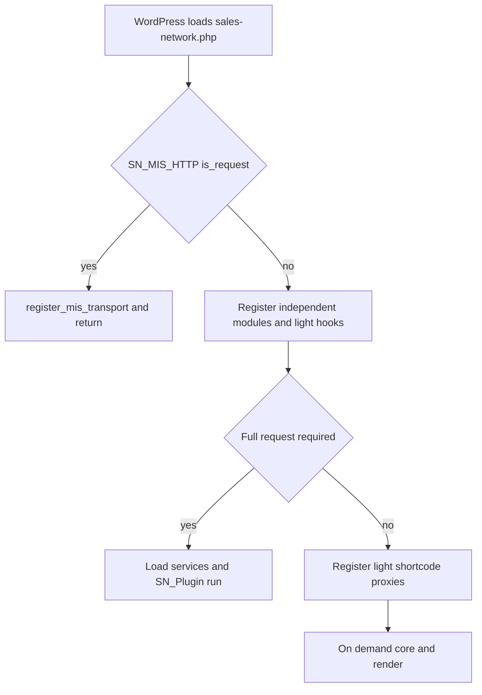
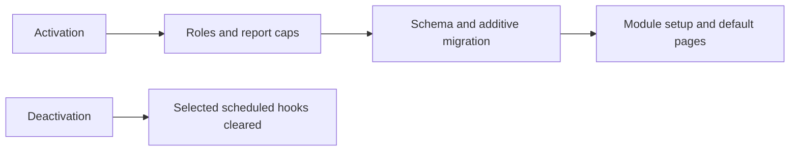
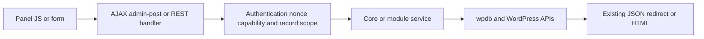
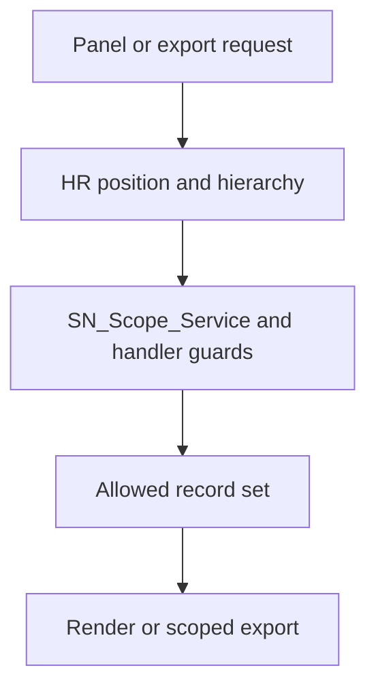
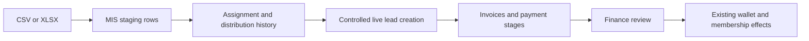
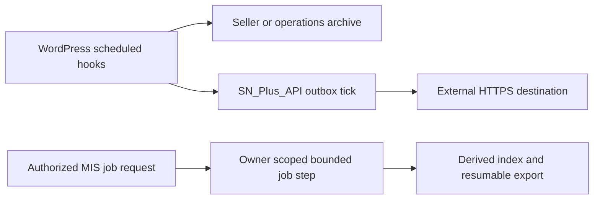
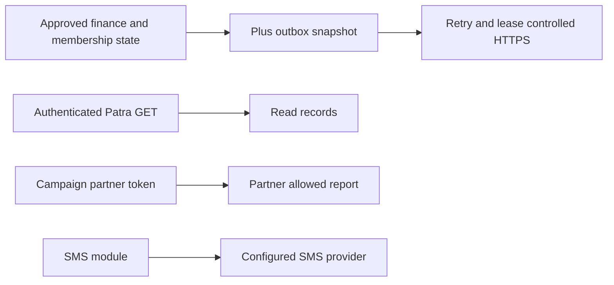
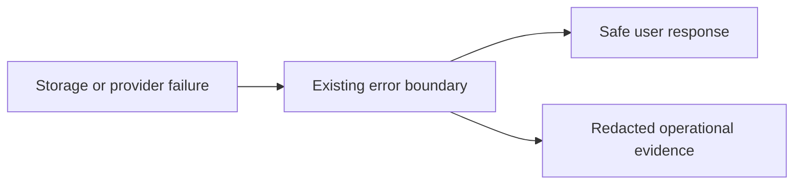

# Current architecture — R1 / 2.0.235

OBSERVED از ZIP تأییدشده مالک؛ بررسی فقط سورس و بدون اجرای WordPress. متن قدیمی
پایین برای حفظ تصمیم‌های معتبر نگهداری شده است؛ عبارت‌های حدسی قدیمی درباره وجود
فایل‌ها با [inventory فعلی](audit/PLUGIN_INVENTORY.md) جایگزین می‌شوند.

## Bootstrap and lifecycle

[sales-network.php](../sales-network.php) نسخه، build و حداقل WP/PHP را تعریف می‌کند.
ابتدا SN_MIS_HTTP بررسی می‌کند آیا action عضو مسیر جداشده MIS است؛ در آن حالت
register_mis_transport اجرا و bootstrap اصلی زود return می‌کند. در مسیر عادی تعدادی
ماژول مستقل hookهایشان را ثبت می‌کنند. full core بر اساس admin/AJAX/REST/callback/
cron/CLI و shortcode لازم بار می‌شود. با shortcode proxy، SN_Plugin می‌تواند با
run=false برای render ساخته شود؛ همه درخواست‌ها یک مسیر اجرا ندارند.

Activation در [SN_Activator::activate](../includes/class-sn-activator.php) Role/cap،
schema، migration، صفحات و defaults را اجرا می‌کند. deactivate چند cron را پاک می‌کند؛
SN_Plus_API نیز deactivation hook جدا دارد. برخی initها در bootstrap و ماژول‌ها
installer/repair اجرا می‌کنند؛ تنها نصب/activation نقطه تغییر DB نیست.

## Interfaces, panels and authorization

هسته [SN_Plugin](../includes/class-sn-plugin.php) حدود 2.5MB است و مسئولیت‌های
مشترک auth، admin، shortcodes، فروش، finance، report، history و migration bridges
دارد. تقسیم فایل یا تغییر run order خارج از این مأموریت است.

Hookها، filterها، AJAXهای مهمان و admin-postها در
[HOOK_API_INDEX.md](audit/HOOK_API_INDEX.md) با line مرجع آمده‌اند. REST گزارش کمپین
`sn-crm/v1` + `/campaign/report` در SN_Campaign_Tracking ثبت می‌شود و با وجود
permission_callback باز، توکن را داخل callback احراز می‌کند. Patra route و namespace
از constantهای SN_Patra_Plus_API می‌آیند؛ authorize مجوز HTTPS/key/rate را اجرا می‌کند.

UI فارسی server-rendered و JS بدون bundler است. assets مشترک و فایل‌های نقش‌محور
وجود دارند. shortcode detection محتوای post و Elementor را بررسی می‌کند. Role، HR
Position، سطح حقوق/پورسانت و scope مفاهیم جدا هستند. مجوز گزارش جدید نیز در همین
مبنای فعلی وجود دارد؛ در این کار هیچ مجوزی به کاربر عملیاتی اعطا نشده است.

## Data, jobs and integrations

این نمودار مرز ساختاری است؛ مجوز تبدیل live، transitionهای واقعی و همه مسیرهای
قدیمی را تنها handler مشخص می‌کند. DDL در Activator، Migration Service، core و
ماژول‌ها توزیع شده و در [schema audit](audit/DATABASE_SCHEMA_AUDIT.md) با 119 declaration
ثبت شده است. Production schema، Foreign Keyهای اجراشده و indexهای واقعی UNVERIFIED‌اند.

MIS Jobs لزوماً daemon یا cron نیست؛ stepهای bounded و owner-scoped در HTTP دارد.
MIS از lock و transaction/InnoDB، claim تلفن، history append و projection مشتق استفاده
می‌کند. WordPress options/transients، cacheهای درون کلاس و read model نیز وجود دارند.

WooCommerce product/order، Zibal/ZarinPal و دیگر adapterهای SN_Invoice، SMS و Biavin
از وابستگی‌ها هستند؛ credential و نسخه/تنظیم واقعی آنها در بسته نیست. خطاها ترکیبی
از WP_Error، JSON، redirect و error_log‌اند؛ کد handler باید پیش از تغییر بررسی شود.

## Scope and remaining verification

۲۰ حوزه واقعی در [قراردادها](modules/README.md) مستند شده‌اند. deficiency/refund را
به‌عنوان service مستقل جدید نساخته‌ایم؛ اگر در متد مالی وضعیت برگشت وجود دارد همان
رفتار باید در هسته trace شود. همه endpoint payloadها، policy دسترسی تک‌تک handlerها،
ترتیب runtime hookها، schema سرور، UI و رفتار providerها در این ممیزی ایستا به‌طور
کامل اثبات نشده‌اند. [Security audit](audit/SECURITY_AUDIT.md) حدود نتیجه را مشخص می‌کند.

---

## Historical architecture reference (preserved verbatim)

# ARCHITECTURE

## Top-level plugin structure
Known from available package and phase reports:

- `sales-network.php`
  - Plugin bootstrap.
  - Defines constants.
  - Always loads bounded lightweight modules (Campaign, Projects and HR Transfer).
  - Uses a selective bootstrap for CRM AJAX/admin/callback requests and a light shortcode proxy for normal frontend requests.
  - Registers activation/deactivation.
  - Loads and instantiates the legacy `SN_Plugin` core only when the request or rendered shortcode requires it.
- `includes/class-sn-plugin.php`
  - Main hook registration, shortcodes, admin pages, AJAX/admin-post handlers.
  - Large legacy file; should be split gradually.
- `includes/class-sn-activator.php`
  - Roles, activation schema, default pages/settings in older package.
- `includes/class-sn-helpers.php`
  - Shared helpers, upload helpers, escaping/sanitization helpers.
- `includes/class-sn-sms.php`
  - SMS provider integration.
- `includes/class-sn-invoice.php`
  - Invoice-related helper/model code.
- Newer v4 services from reports:
  - `class-sn-migration-service.php` — versioned/safe migrations and repairs.
  - `class-sn-hr-service.php` — HR profiles, positions, levels, panel resolver.
  - `class-sn-hierarchy-service.php` — manager/assignment hierarchy and history.
  - `class-sn-scope-service.php` — scope simulation/enforcement decisions.
  - `class-sn-seller-flow.php` — shared seller stage-one state/history, bounded archive cron, manager archive rendering and invoice product-type classification.
- `assets/js/*`
  - Frontend/admin panel behavior.
- `assets/css/*`
  - Public/admin panel styling.
- `docs/*`
  - Project documentation for future Codex tasks.

## Request flow
- WordPress loads `sales-network.php`.
- Lightweight modules register their own hooks without loading the legacy core.
- CRM admin, AJAX, callback, cron and CLI requests load the full core and call `SN_Plugin::run()`.
- Normal frontend requests register proxy shortcodes; rendering a CRM shortcode loads the core on demand.
- Shortcode detection inspects both `post_content` and Elementor `_elementor_data` so required assets are selected consistently.
- When loaded, `SN_Plugin::run()` registers:
  - admin menus.
  - AJAX actions (`wp_ajax_*`, some `wp_ajax_nopriv_*`).
  - `admin_post_*` form handlers.
  - shortcodes.
  - assets.
- Public/role panels render via shortcodes.
- AJAX returns JSON, generally via `wp_send_json_success()` / `wp_send_json_error()`.
- Form handlers redirect back with status/report options.

## Panel routing
- `[sn_my_panel]` resolves the logged-in user with `SN_HR_Service::resolve_panel_for_user($user_id)`.
- HR Position wins over WordPress role when HR profile exists.
- Fallback uses legacy role/WP role for compatibility.
- Guest users should see the plugin login form, not `wp-login.php`.

## Scope architecture
- `SN_Scope_Service` provides read-only audit and enforcement.
- Modes:
  - `off`
  - `audit_only`
  - `enforce_seller`
  - `enforce_seller_supervisor`
  - `enforce_sales_management`
- Enforcement is intended only for read/list/search paths unless explicitly expanded.

## Database architecture
- Legacy operational tables store leads, invoices, payments, wallet, logs.
- HR tables store dynamic positions, levels, profiles, assignments, and logs.
- MIS tables stage imported rows before any live lead creation.
- Migrations must be idempotent and repair missing columns/tables without destructive operations.

## Frontend/backend relationship
- Server renders many panels and tables.
- JavaScript handles form/AJAX UX in existing panels.
- User-controlled output must be escaped before HTML insertion.
- Public invoice page requires token-aware frontend requests.

## Needs confirmation
- Current v4 repository may have additional directories/classes not present in the uploaded older package.
- Exact hook names added after Phase 3E-4 must be verified in the active codebase.
