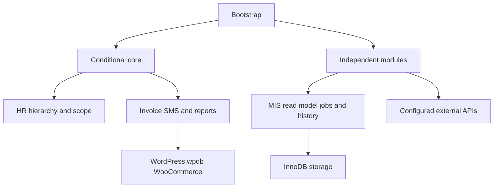

# Dependency map

OBSERVED static imports/calls. Version ranges outside the bootstrap header are
UNVERIFIED; no dependency lock manifests were shipped.

| Consumer | Dependency | Evidence / operational implication |
|---|---|---|
| Bootstrap and all modules | WordPress >=6.0, PHP >=8.0 | [sales-network.php](../../sales-network.php); hooks/options/auth/wpdb |
| Core | Migration, HR, hierarchy, scope, report, SMS, invoice | `sn_bootstrap_load_core` in bootstrap; request-dependent loading |
| MIS transport | helpers, migration, HR, hierarchy, scope, SN_Plugin | [class-sn-mis-http.php](../../includes/class-sn-mis-http.php) register() |
| MIS service | read model, jobs, import log, feedback | [class-sn-mis-service.php](../../includes/class-sn-mis-service.php) imports |
| MIS storage | InnoDB + named locks + transactions | assert_storage / atomic; source and history tables must support rollback |
| MIS XLSX | PHP ZipArchive / XML operations | [class-sn-mis-xlsx.php](../../includes/class-sn-mis-xlsx.php), test README |
| Invoice/product/core | WooCommerce APIs | SN_Invoice, SN_Product_Flow, SN_Sales_Catalog and core call sites; exact version UNVERIFIED |
| Invoice | configured gateways including Zibal and ZarinPal | [class-sn-invoice.php](../../includes/class-sn-invoice.php); unit and callback contracts sensitive |
| SMS | configured remote provider | [class-sn-sms.php](../../includes/class-sn-sms.php); no real provider calls in this task |
| Plus outbound | HTTPS endpoint, secret, source UUID, jobs table | [class-sn-plus-api.php](../../includes/class-sn-plus-api.php); 64-bit PHP gate, retry/lease |
| Patra inbound | HTTPS, hash-authenticated key, record reader | [class-sn-patra-plus-api.php](../../includes/class-sn-patra-plus-api.php) |
| Campaign reports | Partner token allowlist | [class-sn-campaign-tracking.php](../../includes/class-sn-campaign-tracking.php) |
| UI | WordPress-enqueued JS, jQuery where declared, CSS, Vazirmatn font | assets, templates and enqueue code; no bundler |
| Element detection | Elementor metadata when present | bootstrap reads `_elementor_data`; does not prove Elementor installed |
| Verification | Python 3.10+, PHP CLI, Node, Gitleaks | scripts/check.py and ci.yml; development tools, not plugin runtime dependencies |

No vendor/node_modules/submodule payload exists. The generated symbol/hook index
is lexical: dynamically named imports and hooks still require code inspection.
