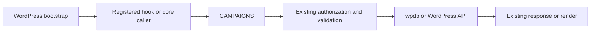

# CAMPAIGNS — کمپین و انتساب

Status: OBSERVED static source, baseline 2.0.235 / 2026-11-12. Human specialist: UNASSIGNED; repository owner: @mehrdadhafezi.

## 1. Purpose & Scope

ثبت UTM، رویداد، attribution و گزارش محدود شریک. گزارش هر شریک فقط از allowlist همان شریک ساخته شود. first touch بازنویسی نشود. permission_callback باز REST با احراز توکن داخل callback همراه است و حذف آن کنترل ممنوع است. این قرارداد برای توسعه ماژول موجود است؛ بازطراحی فرآیند تجاری خارج از محدوده است.

## 2. File Structure

- [includes/class-sn-campaign-tracking.php:1](../../includes/class-sn-campaign-tracking.php#L1): `SN_Campaign_Tracking`

متدهای راهنما (نام و محل واقعی؛ قرارداد کامل را در declaration بخوانید):

- [includes/class-sn-campaign-tracking.php:24](../../includes/class-sn-campaign-tracking.php#L24) — `instance`
- [includes/class-sn-campaign-tracking.php:29](../../includes/class-sn-campaign-tracking.php#L29) — `__construct`
- [includes/class-sn-campaign-tracking.php:31](../../includes/class-sn-campaign-tracking.php#L31) — `register_hooks`
- [includes/class-sn-campaign-tracking.php:60](../../includes/class-sn-campaign-tracking.php#L60) — `activate`
- [includes/class-sn-campaign-tracking.php:66](../../includes/class-sn-campaign-tracking.php#L66) — `maybe_upgrade`
- [includes/class-sn-campaign-tracking.php:73](../../includes/class-sn-campaign-tracking.php#L73) — `tables`
- [includes/class-sn-campaign-tracking.php:86](../../includes/class-sn-campaign-tracking.php#L86) — `table_exists`
- [includes/class-sn-campaign-tracking.php:93](../../includes/class-sn-campaign-tracking.php#L93) — `install_schema`
- [includes/class-sn-campaign-tracking.php:263](../../includes/class-sn-campaign-tracking.php#L263) — `register_role`
- [includes/class-sn-campaign-tracking.php:277](../../includes/class-sn-campaign-tracking.php#L277) — `register_shortcode`
- [includes/class-sn-campaign-tracking.php:281](../../includes/class-sn-campaign-tracking.php#L281) — `tracking_enabled`
- [includes/class-sn-campaign-tracking.php:285](../../includes/class-sn-campaign-tracking.php#L285) — `should_track_front_request`

## 3. Execution Flow

مسیر مشاهده‌شده در سطح ماژول: bootstrap وردپرس، ثبت hook یا caller هسته، سپس متد ماژول. شکل زیر نمای ساختاری است؛ ترتیب همه callbackها را تضمین نمی‌کند.

## 4. Coding Standards

[استاندارد توسعه](../DEVELOPMENT_STANDARDS.md) لازم است. فقط مسیرهای این ماژول که در تسک مجاز شده‌اند تغییر کنند. متدهای عمومی و hookهای موجود rename نشوند. اشتراک در SN_Plugin به معنی مجوز تغییر تمام هسته نیست. گزارش هر شریک فقط از allowlist همان شریک ساخته شود. first touch بازنویسی نشود. permission_callback باز REST با احراز توکن داخل callback همراه است و حذف آن کنترل ممنوع است.

## 5. Component & Interface Contracts

کلاس‌ها و متدهای بخش ۲ interface فعلی‌اند؛ امضا، مقدار پیش‌فرض و return type از سورس مرجع حفظ شوند. برای ورودی و خروجی کامل هر درخواست [API_CONTRACTS.md](../API_CONTRACTS.md) و handler متناظر را با هم بخوانید. شِمای exhaustively verified برای همه payloadها: UNVERIFIED؛ lexical index جایگزین بررسی handler نیست. خطاهای کاربر فارسی و امن باشند و رفتار فعلی status/redirect حفظ شود.

## 6. Adding or Modifying Features

1. رفتار فعلی و معیار پذیرش را از تسک و caller اثبات کنید.
2. مجوز مسیر و بازبینی مالک برای نقاط حساس را بررسی کنید.
3. تغییر محدود انجام دهید؛ migration، Role، API یا side effect جدید بدون شرح و تأیید وارد نشود.
4. سناریوهای بخش ۸ و Syntax را اجرا کنید؛ تست اجرا‌نشده را NOT_RUN بنویسید.
5. این قرارداد، API/schema مرتبط و گزارش PR را به‌روز کنید.

## 7. Data Ownership & Integrity

گزارش هر شریک فقط از allowlist همان شریک ساخته شود. first touch بازنویسی نشود. permission_callback باز REST با احراز توکن داخل callback همراه است و حذف آن کنترل ممنوع است.

نام‌های جدول literal مشاهده‌شده و traceشده در DDL/اتصال prefix (فهرست runtime کامل نیست): `sn_campaign_attributions`, `sn_campaign_conversions`, `sn_campaign_events`, `sn_campaign_partner_campaigns`, `sn_campaign_partner_tokens`, `sn_campaign_sessions`, `sn_campaigns`, `sn_dot_marketing_events`, `sn_dot_marketing_leads`, `sn_invoices`

DDL و PK/indexها: [DATABASE_SCHEMA_AUDIT.md](../audit/DATABASE_SCHEMA_AUDIT.md). اطلاعات مشتری، مالی، token و snapshot داده حساس‌اند. رابطه‌ای که فقط در کد وجود دارد Foreign Key فرض نشود. حذف history، double-credit و استفاده از رکورد خارج از scope ممنوع است.

## 8. Testing & Preview

سناریوهای ضروری این ماژول: رویداد تکراری؛ first/last touch؛ توکن غایب/باطل؛ درخواست شریک دیگر؛ محدودیت نرخ؛ عدم پذیرش توکن query string.

Syntax و Secret Scan در CI فعال‌اند. [ماتریس تست](../TESTING_STANDARDS.md) وضعیت زیرساخت را مشخص می‌کند. تست MIS فقط در محیط disposable با guard مجاز است؛ سایر سناریوها که fixture ندارند NOT_IMPLEMENTED هستند. پیش‌نمایش UI و تست authorization واقعی نیازمند سایت آزمایشی ایزوله است.

## 9. API & Integration Contracts

ثبت‌های literal مرتبط (اگر action با حلقه یا نام پویا ساخته شود باید caller را نیز بررسی کنید):

- `add_action`: `init` — [includes/class-sn-campaign-tracking.php:35](../../includes/class-sn-campaign-tracking.php#L35)
- `add_action`: `init` — [includes/class-sn-campaign-tracking.php:36](../../includes/class-sn-campaign-tracking.php#L36)
- `add_action`: `template_redirect` — [includes/class-sn-campaign-tracking.php:37](../../includes/class-sn-campaign-tracking.php#L37)
- `add_action`: `template_redirect` — [includes/class-sn-campaign-tracking.php:38](../../includes/class-sn-campaign-tracking.php#L38)
- `add_action`: `wp_enqueue_scripts` — [includes/class-sn-campaign-tracking.php:39](../../includes/class-sn-campaign-tracking.php#L39)
- `add_action`: `wp_ajax_sn_campaign_track` — [includes/class-sn-campaign-tracking.php:40](../../includes/class-sn-campaign-tracking.php#L40)
- `add_action`: `wp_ajax_nopriv_sn_campaign_track` — [includes/class-sn-campaign-tracking.php:41](../../includes/class-sn-campaign-tracking.php#L41)
- `add_action`: `rest_api_init` — [includes/class-sn-campaign-tracking.php:42](../../includes/class-sn-campaign-tracking.php#L42)
- `add_filter`: `jwt_auth_do_jwt_check` — [includes/class-sn-campaign-tracking.php:43](../../includes/class-sn-campaign-tracking.php#L43)
- `add_action`: `admin_menu` — [includes/class-sn-campaign-tracking.php:45](../../includes/class-sn-campaign-tracking.php#L45)
- `add_action`: `admin_enqueue_scripts` — [includes/class-sn-campaign-tracking.php:46](../../includes/class-sn-campaign-tracking.php#L46)
- `add_action`: `admin_post_sn_campaign_save` — [includes/class-sn-campaign-tracking.php:47](../../includes/class-sn-campaign-tracking.php#L47)
- `add_action`: `admin_post_sn_campaign_assign_partner` — [includes/class-sn-campaign-tracking.php:48](../../includes/class-sn-campaign-tracking.php#L48)
- `add_action`: `admin_post_sn_campaign_generate_token` — [includes/class-sn-campaign-tracking.php:49](../../includes/class-sn-campaign-tracking.php#L49)
- `add_action`: `admin_post_sn_campaign_revoke_token` — [includes/class-sn-campaign-tracking.php:50](../../includes/class-sn-campaign-tracking.php#L50)
- `add_action`: `admin_post_sn_campaign_save_settings` — [includes/class-sn-campaign-tracking.php:51](../../includes/class-sn-campaign-tracking.php#L51)
- `add_action`: `user_register` — [includes/class-sn-campaign-tracking.php:53](../../includes/class-sn-campaign-tracking.php#L53)
- `add_action`: `sn_invoice_paid` — [includes/class-sn-campaign-tracking.php:54](../../includes/class-sn-campaign-tracking.php#L54)
- `add_action`: `admin_init` — [includes/class-sn-campaign-tracking.php:55](../../includes/class-sn-campaign-tracking.php#L55)
- `add_action`: `after_setup_theme` — [includes/class-sn-campaign-tracking.php:56](../../includes/class-sn-campaign-tracking.php#L56)
- `add_filter`: `login_redirect` — [includes/class-sn-campaign-tracking.php:57](../../includes/class-sn-campaign-tracking.php#L57)
- `add_shortcode`: `sn_campaign_partner_portal` — [includes/class-sn-campaign-tracking.php:278](../../includes/class-sn-campaign-tracking.php#L278)
- `register_rest_route`: `sn-crm/v1` — [includes/class-sn-campaign-tracking.php:1412](../../includes/class-sn-campaign-tracking.php#L1412)

فهرست ثبت کامل در [HOOK_API_INDEX.md](../audit/HOOK_API_INDEX.md) و امضاها در [SOURCE_SYMBOLS.json](../audit/SOURCE_SYMBOLS.json). auth، nonce، scope، ورودی/خروجی و کد خطا باید برای handler تغییرکرده مستقیماً مستند شوند؛ endpoint جدید در این سند ساخته نشده است.

## 10. Administrative & Role Behavior

مجوز جاری از handler، SN_HR_Service/SN_Scope_Service و capabilityهای ثبت‌شده خوانده می‌شود. مخفی‌کردن دکمه مجوز backend نیست. تغییر cap، role، نگاشت HR یا scope نیازمند تسک مستقل و تأیید مالک است. ماتریس تست‌شده نقش‌ها در Production: UNVERIFIED. درخواست فاقد احراز هویت، nonce لازم یا scope باید با الگوی موجود رد شود.

## 11. Compatibility & Change History

R1 در 2026-11-12 فقط کد موجود نسخه 2.0.235 را مستند کرده است؛ کد PHP/JS/CSS تغییر نکرده است. Header: WordPress >=6.0 و PHP >=8.0؛ سازگاری runtime تمام نسخه‌ها در این جلسه UNVERIFIED. تاریخچه Releaseهای قدیمی شواهد تاریخی است و به معنی PASS این نسخه نیست. Merge و Deployment این مأموریت انجام نمی‌شود.
