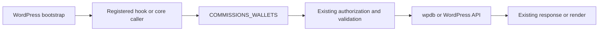

# COMMISSIONS_WALLETS — پورسانت و کیف پول

Status: OBSERVED static source, baseline 2.0.235 / 2026-11-12. Human specialist: UNASSIGNED; repository owner: @mehrdadhafezi.

## 1. Purpose & Scope

پورسانت مبتنی بر هدف و تعامل با ledger هسته. dry-run با ثبت ledger یکسان نیست. flag و approval ثبت مالی باید حفظ شوند. توابع legacy در SN_Plugin نیز مالک حساس‌اند و تغییر خارج از تسک ممنوع است. این قرارداد برای توسعه ماژول موجود است؛ بازطراحی فرآیند تجاری خارج از محدوده است.

## 2. File Structure

- [includes/class-sn-purpose-commission.php:1](../../includes/class-sn-purpose-commission.php#L1): `SN_Purpose_Commission`

متدهای راهنما (نام و محل واقعی؛ قرارداد کامل را در declaration بخوانید):

- [includes/class-sn-purpose-commission.php:19](../../includes/class-sn-purpose-commission.php#L19) — `instance`
- [includes/class-sn-purpose-commission.php:24](../../includes/class-sn-purpose-commission.php#L24) — `__construct`
- [includes/class-sn-purpose-commission.php:26](../../includes/class-sn-purpose-commission.php#L26) — `is_matrix_engine_enabled`
- [includes/class-sn-purpose-commission.php:30](../../includes/class-sn-purpose-commission.php#L30) — `register_hooks`
- [includes/class-sn-purpose-commission.php:44](../../includes/class-sn-purpose-commission.php#L44) — `maybe_upgrade`
- [includes/class-sn-purpose-commission.php:49](../../includes/class-sn-purpose-commission.php#L49) — `table`
- [includes/class-sn-purpose-commission.php:54](../../includes/class-sn-purpose-commission.php#L54) — `table_exists`
- [includes/class-sn-purpose-commission.php:62](../../includes/class-sn-purpose-commission.php#L62) — `columns`
- [includes/class-sn-purpose-commission.php:70](../../includes/class-sn-purpose-commission.php#L70) — `install_schema`
- [includes/class-sn-purpose-commission.php:107](../../includes/class-sn-purpose-commission.php#L107) — `ensure_wallet_tables`
- [includes/class-sn-purpose-commission.php:153](../../includes/class-sn-purpose-commission.php#L153) — `purposes`
- [includes/class-sn-purpose-commission.php:166](../../includes/class-sn-purpose-commission.php#L166) — `roles`

## 3. Execution Flow

مسیر مشاهده‌شده در سطح ماژول: bootstrap وردپرس، ثبت hook یا caller هسته، سپس متد ماژول. شکل زیر نمای ساختاری است؛ ترتیب همه callbackها را تضمین نمی‌کند.

## 4. Coding Standards

[استاندارد توسعه](../DEVELOPMENT_STANDARDS.md) لازم است. فقط مسیرهای این ماژول که در تسک مجاز شده‌اند تغییر کنند. متدهای عمومی و hookهای موجود rename نشوند. اشتراک در SN_Plugin به معنی مجوز تغییر تمام هسته نیست. dry-run با ثبت ledger یکسان نیست. flag و approval ثبت مالی باید حفظ شوند. توابع legacy در SN_Plugin نیز مالک حساس‌اند و تغییر خارج از تسک ممنوع است.

## 5. Component & Interface Contracts

کلاس‌ها و متدهای بخش ۲ interface فعلی‌اند؛ امضا، مقدار پیش‌فرض و return type از سورس مرجع حفظ شوند. برای ورودی و خروجی کامل هر درخواست [API_CONTRACTS.md](../API_CONTRACTS.md) و handler متناظر را با هم بخوانید. شِمای exhaustively verified برای همه payloadها: UNVERIFIED؛ lexical index جایگزین بررسی handler نیست. خطاهای کاربر فارسی و امن باشند و رفتار فعلی status/redirect حفظ شود.

## 6. Adding or Modifying Features

1. رفتار فعلی و معیار پذیرش را از تسک و caller اثبات کنید.
2. مجوز مسیر و بازبینی مالک برای نقاط حساس را بررسی کنید.
3. تغییر محدود انجام دهید؛ migration، Role، API یا side effect جدید بدون شرح و تأیید وارد نشود.
4. سناریوهای بخش ۸ و Syntax را اجرا کنید؛ تست اجرا‌نشده را NOT_RUN بنویسید.
5. این قرارداد، API/schema مرتبط و گزارش PR را به‌روز کنید.

## 7. Data Ownership & Integrity

dry-run با ثبت ledger یکسان نیست. flag و approval ثبت مالی باید حفظ شوند. توابع legacy در SN_Plugin نیز مالک حساس‌اند و تغییر خارج از تسک ممنوع است.

نام‌های جدول literal مشاهده‌شده و traceشده در DDL/اتصال prefix (فهرست runtime کامل نیست): `sn_dot_cases`, `sn_dot_invoice_links`, `sn_hr_assignments`, `sn_hr_positions`, `sn_hr_profiles`, `sn_invoice_items`, `sn_invoice_payment_stages`, `sn_invoices`, `sn_leads`, `sn_operations_execution_cases`, `sn_payment_commission_matrix`, `sn_payment_review_events`, `sn_project_membership_items`, `sn_project_memberships`, `sn_project_operations`, `sn_wallet_transactions`, `sn_wallets`

DDL و PK/indexها: [DATABASE_SCHEMA_AUDIT.md](../audit/DATABASE_SCHEMA_AUDIT.md). اطلاعات مشتری، مالی، token و snapshot داده حساس‌اند. رابطه‌ای که فقط در کد وجود دارد Foreign Key فرض نشود. حذف history، double-credit و استفاده از رکورد خارج از scope ممنوع است.

## 8. Testing & Preview

سناریوهای ضروری این ماژول: تاریخ مؤثر؛ ارث‌بری Rule؛ نتیجه dry-run بدون ledger؛ ثبت مجدد؛ پرداخت برگشتی؛ رگرسیون مبالغ و history.

Syntax و Secret Scan در CI فعال‌اند. [ماتریس تست](../TESTING_STANDARDS.md) وضعیت زیرساخت را مشخص می‌کند. تست MIS فقط در محیط disposable با guard مجاز است؛ سایر سناریوها که fixture ندارند NOT_IMPLEMENTED هستند. پیش‌نمایش UI و تست authorization واقعی نیازمند سایت آزمایشی ایزوله است.

## 9. API & Integration Contracts

ثبت‌های literal مرتبط (اگر action با حلقه یا نام پویا ساخته شود باید caller را نیز بررسی کنید):

- `add_action`: `init` — [includes/class-sn-purpose-commission.php:33](../../includes/class-sn-purpose-commission.php#L33)
- `add_action`: `admin_init` — [includes/class-sn-purpose-commission.php:34](../../includes/class-sn-purpose-commission.php#L34)
- `add_action`: `admin_menu` — [includes/class-sn-purpose-commission.php:35](../../includes/class-sn-purpose-commission.php#L35)
- `add_action`: `admin_post_sn_save_purpose_commission_matrix` — [includes/class-sn-purpose-commission.php:36](../../includes/class-sn-purpose-commission.php#L36)
- `add_action`: `admin_post_sn_backfill_purpose_commissions` — [includes/class-sn-purpose-commission.php:37](../../includes/class-sn-purpose-commission.php#L37)
- `add_action`: `sn_backfill_purpose_commissions` — [includes/class-sn-purpose-commission.php:38](../../includes/class-sn-purpose-commission.php#L38)
- `add_action`: `sn_invoice_payment_stage_approved` — [includes/class-sn-purpose-commission.php:39](../../includes/class-sn-purpose-commission.php#L39)
- `add_action`: `sn_invoice_financial_rejected` — [includes/class-sn-purpose-commission.php:40](../../includes/class-sn-purpose-commission.php#L40)
- `add_action`: `sn_invoice_financial_reopened` — [includes/class-sn-purpose-commission.php:41](../../includes/class-sn-purpose-commission.php#L41)

فهرست ثبت کامل در [HOOK_API_INDEX.md](../audit/HOOK_API_INDEX.md) و امضاها در [SOURCE_SYMBOLS.json](../audit/SOURCE_SYMBOLS.json). auth، nonce، scope، ورودی/خروجی و کد خطا باید برای handler تغییرکرده مستقیماً مستند شوند؛ endpoint جدید در این سند ساخته نشده است.

## 10. Administrative & Role Behavior

مجوز جاری از handler، SN_HR_Service/SN_Scope_Service و capabilityهای ثبت‌شده خوانده می‌شود. مخفی‌کردن دکمه مجوز backend نیست. تغییر cap، role، نگاشت HR یا scope نیازمند تسک مستقل و تأیید مالک است. ماتریس تست‌شده نقش‌ها در Production: UNVERIFIED. درخواست فاقد احراز هویت، nonce لازم یا scope باید با الگوی موجود رد شود.

## 11. Compatibility & Change History

R1 در 2026-11-12 فقط کد موجود نسخه 2.0.235 را مستند کرده است؛ کد PHP/JS/CSS تغییر نکرده است. Header: WordPress >=6.0 و PHP >=8.0؛ سازگاری runtime تمام نسخه‌ها در این جلسه UNVERIFIED. تاریخچه Releaseهای قدیمی شواهد تاریخی است و به معنی PASS این نسخه نیست. Merge و Deployment این مأموریت انجام نمی‌شود.
