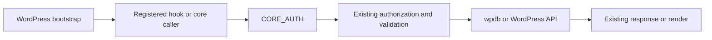

# CORE_AUTH — هسته، ورود و کنترل دسترسی

Status: OBSERVED static source, baseline 2.0.235 / 2026-11-12. Human specialist: UNASSIGNED; repository owner: @mehrdadhafezi.

## 1. Purpose & Scope

راه‌اندازی انتخابی، ثبت پنل‌ها، ورود و Role/Capabilityهای موجود. فعال‌سازی و init می‌توانند Schema و Role را تغییر دهند؛ import سورس به معنای مجوز فعال‌سازی نیست. Nonce جایگزین احراز هویت و scope نیست. این قرارداد برای توسعه ماژول موجود است؛ بازطراحی فرآیند تجاری خارج از محدوده است.

## 2. File Structure

- [sales-network.php:1](../../sales-network.php#L1):
- [includes/class-sn-plugin.php:1](../../includes/class-sn-plugin.php#L1): `SN_Plugin`
- [includes/class-sn-activator.php:1](../../includes/class-sn-activator.php#L1): `SN_Activator`

متدهای راهنما (نام و محل واقعی؛ قرارداد کامل را در declaration بخوانید):

- [includes/class-sn-activator.php:7](../../includes/class-sn-activator.php#L7) — `activate`
- [includes/class-sn-activator.php:54](../../includes/class-sn-activator.php#L54) — `deactivate`
- [includes/class-sn-activator.php:67](../../includes/class-sn-activator.php#L67) — `register_report_caps`
- [includes/class-sn-activator.php:88](../../includes/class-sn-activator.php#L88) — `register_report_state_schema`
- [includes/class-sn-activator.php:120](../../includes/class-sn-activator.php#L120) — `repair_stale_seller_status_ownership`
- [includes/class-sn-activator.php:153](../../includes/class-sn-activator.php#L153) — `register_roles`
- [includes/class-sn-activator.php:213](../../includes/class-sn-activator.php#L213) — `migrate_finance_user_caps`
- [includes/class-sn-activator.php:232](../../includes/class-sn-activator.php#L232) — `create_tables`
- [includes/class-sn-activator.php:707](../../includes/class-sn-activator.php#L707) — `backfill_invoice_access_tokens`
- [includes/class-sn-activator.php:720](../../includes/class-sn-activator.php#L720) — `insert_defaults`
- [includes/class-sn-activator.php:783](../../includes/class-sn-activator.php#L783) — `shortcode_bracketed`
- [includes/class-sn-activator.php:789](../../includes/class-sn-activator.php#L789) — `elementor_shortcode_data`

## 3. Execution Flow

مسیر مشاهده‌شده در سطح ماژول: bootstrap وردپرس، ثبت hook یا caller هسته، سپس متد ماژول. شکل زیر نمای ساختاری است؛ ترتیب همه callbackها را تضمین نمی‌کند.

## 4. Coding Standards

[استاندارد توسعه](../DEVELOPMENT_STANDARDS.md) لازم است. فقط مسیرهای این ماژول که در تسک مجاز شده‌اند تغییر کنند. متدهای عمومی و hookهای موجود rename نشوند. اشتراک در SN_Plugin به معنی مجوز تغییر تمام هسته نیست. فعال‌سازی و init می‌توانند Schema و Role را تغییر دهند؛ import سورس به معنای مجوز فعال‌سازی نیست. Nonce جایگزین احراز هویت و scope نیست.

## 5. Component & Interface Contracts

کلاس‌ها و متدهای بخش ۲ interface فعلی‌اند؛ امضا، مقدار پیش‌فرض و return type از سورس مرجع حفظ شوند. برای ورودی و خروجی کامل هر درخواست [API_CONTRACTS.md](../API_CONTRACTS.md) و handler متناظر را با هم بخوانید. شِمای exhaustively verified برای همه payloadها: UNVERIFIED؛ lexical index جایگزین بررسی handler نیست. خطاهای کاربر فارسی و امن باشند و رفتار فعلی status/redirect حفظ شود.

## 6. Adding or Modifying Features

1. رفتار فعلی و معیار پذیرش را از تسک و caller اثبات کنید.
2. مجوز مسیر و بازبینی مالک برای نقاط حساس را بررسی کنید.
3. تغییر محدود انجام دهید؛ migration، Role، API یا side effect جدید بدون شرح و تأیید وارد نشود.
4. سناریوهای بخش ۸ و Syntax را اجرا کنید؛ تست اجرا‌نشده را NOT_RUN بنویسید.
5. این قرارداد، API/schema مرتبط و گزارش PR را به‌روز کنید.

## 7. Data Ownership & Integrity

فعال‌سازی و init می‌توانند Schema و Role را تغییر دهند؛ import سورس به معنای مجوز فعال‌سازی نیست. Nonce جایگزین احراز هویت و scope نیست.

نام‌های جدول literal مشاهده‌شده و traceشده در DDL/اتصال prefix (فهرست runtime کامل نیست): `sn_activity_logs`, `sn_after_sales_case_logs`, `sn_after_sales_cases`, `sn_aggregate_customer_ids`, `sn_commission_dry_run_items`, `sn_commission_dry_runs`, `sn_commission_rules`, `sn_commission_wallet_posting_logs`, `sn_customer_id_map_v`, `sn_distribution_chain_steps`, `sn_distribution_chains`, `sn_distribution_item_logs`, `sn_distribution_items`, `sn_dot_cases`, `sn_dot_invoice_links`, `sn_extra_number_requests`, `sn_hr_assignments`, `sn_hr_change_requests`, `sn_hr_compensation_history`, `sn_hr_compensation_profiles`, `sn_hr_departments`, `sn_hr_levels`, `sn_hr_position_role_mappings`, `sn_hr_positions`, `sn_hr_profile_logs`, `sn_hr_profiles`, `sn_hr_teams`, `sn_hr_units`, `sn_invoice_items`, `sn_invoice_payment_stages`, `sn_invoice_wheel`, `sn_invoices`, `sn_lead_status_history`, `sn_lead_statuses`, `sn_leads`, `sn_mis_data_rows`, `sn_mis_distribution_logs`, `sn_mis_distribution_plan_items`, `sn_mis_distribution_plans`, `sn_mis_distribution_rules`, `sn_mis_import_batches`, `sn_mis_lead_pool`, `sn_payment_reward_claims`, `sn_payments`, `sn_project_memberships`, `sn_report_invoice_state_events`, `sn_wallet_transactions`, `sn_wallets`

DDL و PK/indexها: [DATABASE_SCHEMA_AUDIT.md](../audit/DATABASE_SCHEMA_AUDIT.md). اطلاعات مشتری، مالی، token و snapshot داده حساس‌اند. رابطه‌ای که فقط در کد وجود دارد Foreign Key فرض نشود. حذف history، double-credit و استفاده از رکورد خارج از scope ممنوع است.

## 8. Testing & Preview

سناریوهای ضروری این ماژول: ورود مهمان/کارمند؛ خروج و مقصد ورود؛ nonce نامعتبر؛ Role لغوشده؛ دسترسی افقی به رکورد دیگران؛ bootstrap سبک و کامل.

Syntax و Secret Scan در CI فعال‌اند. [ماتریس تست](../TESTING_STANDARDS.md) وضعیت زیرساخت را مشخص می‌کند. تست MIS فقط در محیط disposable با guard مجاز است؛ سایر سناریوها که fixture ندارند NOT_IMPLEMENTED هستند. پیش‌نمایش UI و تست authorization واقعی نیازمند سایت آزمایشی ایزوله است.

## 9. API & Integration Contracts

ثبت‌های literal مرتبط (اگر action با حلقه یا نام پویا ساخته شود باید caller را نیز بررسی کنید):

- `add_action`: `init` — [includes/class-sn-plugin.php:57](../../includes/class-sn-plugin.php#L57)
- `add_filter`: `wp_redirect` — [includes/class-sn-plugin.php:58](../../includes/class-sn-plugin.php#L58)
- `add_filter`: `map_meta_cap` — [includes/class-sn-plugin.php:59](../../includes/class-sn-plugin.php#L59)
- `add_action`: `init` — [includes/class-sn-plugin.php:61](../../includes/class-sn-plugin.php#L61)
- `add_action`: `admin_init` — [includes/class-sn-plugin.php:62](../../includes/class-sn-plugin.php#L62)
- `add_action`: `admin_menu` — [includes/class-sn-plugin.php:63](../../includes/class-sn-plugin.php#L63)
- `add_action`: `wp_enqueue_scripts` — [includes/class-sn-plugin.php:64](../../includes/class-sn-plugin.php#L64)
- `add_action`: `admin_enqueue_scripts` — [includes/class-sn-plugin.php:65](../../includes/class-sn-plugin.php#L65)
- `add_action`: `admin_init` — [includes/class-sn-plugin.php:66](../../includes/class-sn-plugin.php#L66)
- `add_action`: `admin_init` — [includes/class-sn-plugin.php:67](../../includes/class-sn-plugin.php#L67)
- `add_action`: `admin_init` — [includes/class-sn-plugin.php:68](../../includes/class-sn-plugin.php#L68)
- `add_action`: `admin_init` — [includes/class-sn-plugin.php:69](../../includes/class-sn-plugin.php#L69)
- `add_action`: `admin_init` — [includes/class-sn-plugin.php:70](../../includes/class-sn-plugin.php#L70)
- `add_action`: `admin_init` — [includes/class-sn-plugin.php:71](../../includes/class-sn-plugin.php#L71)
- `add_action`: `admin_init` — [includes/class-sn-plugin.php:72](../../includes/class-sn-plugin.php#L72)
- `add_action`: `admin_post_sn_sales_branches` — [includes/class-sn-plugin.php:73](../../includes/class-sn-plugin.php#L73)
- `add_action`: `admin_post_sn_save_finance_user` — [includes/class-sn-plugin.php:74](../../includes/class-sn-plugin.php#L74)
- `add_action`: `admin_post_sn_save_hr_role_mappings` — [includes/class-sn-plugin.php:75](../../includes/class-sn-plugin.php#L75)
- `add_action`: `admin_post_sn_repair_hr_defaults` — [includes/class-sn-plugin.php:76](../../includes/class-sn-plugin.php#L76)
- `add_action`: `admin_post_sn_backfill_invoice_tokens` — [includes/class-sn-plugin.php:77](../../includes/class-sn-plugin.php#L77)
- `add_action`: `admin_post_sn_sync_hr_profiles` — [includes/class-sn-plugin.php:78](../../includes/class-sn-plugin.php#L78)
- `add_action`: `admin_post_sn_assign_hr_parent` — [includes/class-sn-plugin.php:79](../../includes/class-sn-plugin.php#L79)
- `add_action`: `admin_post_sn_end_hr_assignment` — [includes/class-sn-plugin.php:80](../../includes/class-sn-plugin.php#L80)
- `add_action`: `admin_post_sn_sync_hr_hierarchy` — [includes/class-sn-plugin.php:81](../../includes/class-sn-plugin.php#L81)
- `add_action`: `admin_post_sn_bulk_hr_hierarchy_repair` — [includes/class-sn-plugin.php:82](../../includes/class-sn-plugin.php#L82)
- `add_action`: `admin_post_sn_restore_seller_hierarchy_from_leads` — [includes/class-sn-plugin.php:83](../../includes/class-sn-plugin.php#L83)
- `add_action`: `admin_post_sn_hr_bulk_assign_hierarchy` — [includes/class-sn-plugin.php:84](../../includes/class-sn-plugin.php#L84)
- `add_action`: `admin_post_sn_hierarchy_consistency_check` — [includes/class-sn-plugin.php:85](../../includes/class-sn-plugin.php#L85)
- `add_action`: `admin_post_sn_distribution_current_structure_preset` — [includes/class-sn-plugin.php:86](../../includes/class-sn-plugin.php#L86)
- `add_action`: `admin_post_sn_transition_legacy_supervisors` — [includes/class-sn-plugin.php:87](../../includes/class-sn-plugin.php#L87)

فهرست ثبت کامل در [HOOK_API_INDEX.md](../audit/HOOK_API_INDEX.md) و امضاها در [SOURCE_SYMBOLS.json](../audit/SOURCE_SYMBOLS.json). auth، nonce، scope، ورودی/خروجی و کد خطا باید برای handler تغییرکرده مستقیماً مستند شوند؛ endpoint جدید در این سند ساخته نشده است.

## 10. Administrative & Role Behavior

مجوز جاری از handler، SN_HR_Service/SN_Scope_Service و capabilityهای ثبت‌شده خوانده می‌شود. مخفی‌کردن دکمه مجوز backend نیست. تغییر cap، role، نگاشت HR یا scope نیازمند تسک مستقل و تأیید مالک است. ماتریس تست‌شده نقش‌ها در Production: UNVERIFIED. درخواست فاقد احراز هویت، nonce لازم یا scope باید با الگوی موجود رد شود.

## 11. Compatibility & Change History

R1 در 2026-11-12 فقط کد موجود نسخه 2.0.235 را مستند کرده است؛ کد PHP/JS/CSS تغییر نکرده است. Header: WordPress >=6.0 و PHP >=8.0؛ سازگاری runtime تمام نسخه‌ها در این جلسه UNVERIFIED. تاریخچه Releaseهای قدیمی شواهد تاریخی است و به معنی PASS این نسخه نیست. Merge و Deployment این مأموریت انجام نمی‌شود.
