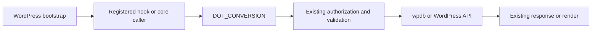

# DOT_CONVERSION — ارزیابی و تبدیل Dot

Status: OBSERVED static source, baseline 2.0.235 / 2026-11-12. Human specialist: UNASSIGNED; repository owner: @mehrdadhafezi.

## 1. Purpose & Scope

گردش ارزیابی، انتخاب، تبدیل و بایگانی عملیاتی. پرداخت واقعی، هدیه ارزیابی و پیش‌فاکتور از هم جدا بمانند. وضعیت‌های فعلی فقط با بررسی transitionهای همان کلاس تغییر کنند. این قرارداد برای توسعه ماژول موجود است؛ بازطراحی فرآیند تجاری خارج از محدوده است.

## 2. File Structure

- [includes/class-sn-dot-flow.php:1](../../includes/class-sn-dot-flow.php#L1): `SN_Dot_Flow`

متدهای راهنما (نام و محل واقعی؛ قرارداد کامل را در declaration بخوانید):

- [includes/class-sn-dot-flow.php:39](../../includes/class-sn-dot-flow.php#L39) — `instance`
- [includes/class-sn-dot-flow.php:44](../../includes/class-sn-dot-flow.php#L44) — `__construct`
- [includes/class-sn-dot-flow.php:46](../../includes/class-sn-dot-flow.php#L46) — `activate`
- [includes/class-sn-dot-flow.php:54](../../includes/class-sn-dot-flow.php#L54) — `deactivate`
- [includes/class-sn-dot-flow.php:59](../../includes/class-sn-dot-flow.php#L59) — `register_hooks`
- [includes/class-sn-dot-flow.php:117](../../includes/class-sn-dot-flow.php#L117) — `maybe_upgrade`
- [includes/class-sn-dot-flow.php:132](../../includes/class-sn-dot-flow.php#L132) — `maybe_backfill_abandoned_marketing_preinvoices`
- [includes/class-sn-dot-flow.php:175](../../includes/class-sn-dot-flow.php#L175) — `ensure_flow_pages`
- [includes/class-sn-dot-flow.php:219](../../includes/class-sn-dot-flow.php#L219) — `tables`
- [includes/class-sn-dot-flow.php:232](../../includes/class-sn-dot-flow.php#L232) — `install_schema`
- [includes/class-sn-dot-flow.php:506](../../includes/class-sn-dot-flow.php#L506) — `migrate_legacy_marketing_leads`
- [includes/class-sn-dot-flow.php:558](../../includes/class-sn-dot-flow.php#L558) — `marketing_form_identity_for_product`

## 3. Execution Flow

مسیر مشاهده‌شده در سطح ماژول: bootstrap وردپرس، ثبت hook یا caller هسته، سپس متد ماژول. شکل زیر نمای ساختاری است؛ ترتیب همه callbackها را تضمین نمی‌کند.

## 4. Coding Standards

[استاندارد توسعه](../DEVELOPMENT_STANDARDS.md) لازم است. فقط مسیرهای این ماژول که در تسک مجاز شده‌اند تغییر کنند. متدهای عمومی و hookهای موجود rename نشوند. اشتراک در SN_Plugin به معنی مجوز تغییر تمام هسته نیست. پرداخت واقعی، هدیه ارزیابی و پیش‌فاکتور از هم جدا بمانند. وضعیت‌های فعلی فقط با بررسی transitionهای همان کلاس تغییر کنند.

## 5. Component & Interface Contracts

Unreleased local work gives new classic Dot purchases one canonical full-price
invoice with ordinary payment stages and a current-stage adapter. Existing child
invoices are retained. The stored marker and rollback are described in the
[traceability contract](../tasks/INVOICE_PAYMENT_TRACEABILITY.md); this is not
authorization to rewrite old cases or deploy the local work.

کلاس‌ها و متدهای بخش ۲ interface فعلی‌اند؛ امضا، مقدار پیش‌فرض و return type از سورس مرجع حفظ شوند. برای ورودی و خروجی کامل هر درخواست [API_CONTRACTS.md](../API_CONTRACTS.md) و handler متناظر را با هم بخوانید. شِمای exhaustively verified برای همه payloadها: UNVERIFIED؛ lexical index جایگزین بررسی handler نیست. خطاهای کاربر فارسی و امن باشند و رفتار فعلی status/redirect حفظ شود.

## 6. Adding or Modifying Features

1. رفتار فعلی و معیار پذیرش را از تسک و caller اثبات کنید.
2. مجوز مسیر و بازبینی مالک برای نقاط حساس را بررسی کنید.
3. تغییر محدود انجام دهید؛ migration، Role، API یا side effect جدید بدون شرح و تأیید وارد نشود.
4. سناریوهای بخش ۸ و Syntax را اجرا کنید؛ تست اجرا‌نشده را NOT_RUN بنویسید.
5. این قرارداد، API/schema مرتبط و گزارش PR را به‌روز کنید.

## 7. Data Ownership & Integrity

پرداخت واقعی، هدیه ارزیابی و پیش‌فاکتور از هم جدا بمانند. وضعیت‌های فعلی فقط با بررسی transitionهای همان کلاس تغییر کنند.

نام‌های جدول literal مشاهده‌شده و traceشده در DDL/اتصال prefix (فهرست runtime کامل نیست): `sn_campaign_attributions`, `sn_distribution_items`, `sn_dot_case_logs`, `sn_dot_cases`, `sn_dot_invoice_links`, `sn_dot_marketing_events`, `sn_dot_marketing_leads`, `sn_dot_operational_archives`, `sn_dot_payments`, `sn_hr_assignments`, `sn_hr_position_role_mappings`, `sn_hr_positions`, `sn_hr_profiles`, `sn_invoice_items`, `sn_invoice_payment_stages`, `sn_invoices`, `sn_leads`, `sn_payments`

DDL و PK/indexها: [DATABASE_SCHEMA_AUDIT.md](../audit/DATABASE_SCHEMA_AUDIT.md). اطلاعات مشتری، مالی، token و snapshot داده حساس‌اند. رابطه‌ای که فقط در کد وجود دارد Foreign Key فرض نشود. حذف history، double-credit و استفاده از رکورد خارج از scope ممنوع است.

## 8. Testing & Preview

سناریوهای ضروری این ماژول: هدیه بدون پول واقعی؛ پرداخت ناقص؛ انصراف با دلیل؛ بازگشایی معتبر؛ invoice token؛ عدم اجرای مجدد اثر مالی.

Syntax و Secret Scan در CI فعال‌اند. [ماتریس تست](../TESTING_STANDARDS.md) وضعیت زیرساخت را مشخص می‌کند. تست MIS فقط در محیط disposable با guard مجاز است؛ سایر سناریوها که fixture ندارند NOT_IMPLEMENTED هستند. پیش‌نمایش UI و تست authorization واقعی نیازمند سایت آزمایشی ایزوله است.

## 9. API & Integration Contracts

ثبت‌های literal مرتبط (اگر action با حلقه یا نام پویا ساخته شود باید caller را نیز بررسی کنید):

- `add_action`: `init` — [includes/class-sn-dot-flow.php:63](../../includes/class-sn-dot-flow.php#L63)
- `add_action`: `admin_init` — [includes/class-sn-dot-flow.php:64](../../includes/class-sn-dot-flow.php#L64)
- `add_action`: `init` — [includes/class-sn-dot-flow.php:65](../../includes/class-sn-dot-flow.php#L65)
- `add_action`: `init` — [includes/class-sn-dot-flow.php:68](../../includes/class-sn-dot-flow.php#L68)
- `add_action`: `init` — [includes/class-sn-dot-flow.php:71](../../includes/class-sn-dot-flow.php#L71)
- `add_action`: `wp_footer` — [includes/class-sn-dot-flow.php:72](../../includes/class-sn-dot-flow.php#L72)
- `add_action`: `admin_footer` — [includes/class-sn-dot-flow.php:73](../../includes/class-sn-dot-flow.php#L73)
- `add_action`: `shutdown` — [includes/class-sn-dot-flow.php:74](../../includes/class-sn-dot-flow.php#L74)
- `add_action`: `sn_invoice_paid` — [includes/class-sn-dot-flow.php:78](../../includes/class-sn-dot-flow.php#L78)
- `add_action`: `sn_invoice_payment_stage_approved` — [includes/class-sn-dot-flow.php:79](../../includes/class-sn-dot-flow.php#L79)
- `add_action`: `sn_invoice_financial_rejected` — [includes/class-sn-dot-flow.php:80](../../includes/class-sn-dot-flow.php#L80)
- `add_action`: `admin_post_` — [includes/class-sn-dot-flow.php:92](../../includes/class-sn-dot-flow.php#L92)
- `add_action`: `wp_ajax_` — [includes/class-sn-dot-flow.php:93](../../includes/class-sn-dot-flow.php#L93)
- `add_action`: `admin_post_nopriv_sn_dot_verify_code` — [includes/class-sn-dot-flow.php:95](../../includes/class-sn-dot-flow.php#L95)
- `add_action`: `admin_post_nopriv_sn_dot_select_option` — [includes/class-sn-dot-flow.php:96](../../includes/class-sn-dot-flow.php#L96)
- `add_action`: `admin_post_sn_dot_marketing_start_payment` — [includes/class-sn-dot-flow.php:97](../../includes/class-sn-dot-flow.php#L97)
- `add_action`: `admin_post_nopriv_sn_dot_marketing_start_payment` — [includes/class-sn-dot-flow.php:98](../../includes/class-sn-dot-flow.php#L98)
- `add_action`: `wp_ajax_sn_dot_marketing_send_otp` — [includes/class-sn-dot-flow.php:99](../../includes/class-sn-dot-flow.php#L99)
- `add_action`: `wp_ajax_nopriv_sn_dot_marketing_send_otp` — [includes/class-sn-dot-flow.php:100](../../includes/class-sn-dot-flow.php#L100)
- `add_action`: `wp_ajax_sn_dot_marketing_verify_otp` — [includes/class-sn-dot-flow.php:101](../../includes/class-sn-dot-flow.php#L101)
- `add_action`: `wp_ajax_nopriv_sn_dot_marketing_verify_otp` — [includes/class-sn-dot-flow.php:102](../../includes/class-sn-dot-flow.php#L102)
- `add_action`: `wp_ajax_sn_dot_marketing_save_lead` — [includes/class-sn-dot-flow.php:103](../../includes/class-sn-dot-flow.php#L103)
- `add_action`: `wp_ajax_nopriv_sn_dot_marketing_save_lead` — [includes/class-sn-dot-flow.php:104](../../includes/class-sn-dot-flow.php#L104)
- `add_action`: `wp_ajax_sn_dot_marketing_record_exit` — [includes/class-sn-dot-flow.php:105](../../includes/class-sn-dot-flow.php#L105)
- `add_action`: `wp_ajax_nopriv_sn_dot_marketing_record_exit` — [includes/class-sn-dot-flow.php:106](../../includes/class-sn-dot-flow.php#L106)
- `add_action`: `wp_ajax_sn_dot_marketing_record_event` — [includes/class-sn-dot-flow.php:107](../../includes/class-sn-dot-flow.php#L107)
- `add_action`: `wp_ajax_nopriv_sn_dot_marketing_record_event` — [includes/class-sn-dot-flow.php:108](../../includes/class-sn-dot-flow.php#L108)
- `add_action`: `wp_ajax_sn_dot_poll_test_sms` — [includes/class-sn-dot-flow.php:109](../../includes/class-sn-dot-flow.php#L109)
- `add_action`: `wp_ajax_sn_dot_converter_invoices` — [includes/class-sn-dot-flow.php:110](../../includes/class-sn-dot-flow.php#L110)
- `add_action`: `wp_ajax_sn_dot_bulk_assign_converter` — [includes/class-sn-dot-flow.php:111](../../includes/class-sn-dot-flow.php#L111)

فهرست ثبت کامل در [HOOK_API_INDEX.md](../audit/HOOK_API_INDEX.md) و امضاها در [SOURCE_SYMBOLS.json](../audit/SOURCE_SYMBOLS.json). auth، nonce، scope، ورودی/خروجی و کد خطا باید برای handler تغییرکرده مستقیماً مستند شوند؛ endpoint جدید در این سند ساخته نشده است.

## 10. Administrative & Role Behavior

مجوز جاری از handler، SN_HR_Service/SN_Scope_Service و capabilityهای ثبت‌شده خوانده می‌شود. مخفی‌کردن دکمه مجوز backend نیست. تغییر cap، role، نگاشت HR یا scope نیازمند تسک مستقل و تأیید مالک است. ماتریس تست‌شده نقش‌ها در Production: UNVERIFIED. درخواست فاقد احراز هویت، nonce لازم یا scope باید با الگوی موجود رد شود.

## 11. Compatibility & Change History

R1 در 2026-11-12 فقط کد موجود نسخه 2.0.235 را مستند کرده است؛ کد PHP/JS/CSS تغییر نکرده است. Header: WordPress >=6.0 و PHP >=8.0؛ سازگاری runtime تمام نسخه‌ها در این جلسه UNVERIFIED. تاریخچه Releaseهای قدیمی شواهد تاریخی است و به معنی PASS این نسخه نیست. Merge و Deployment این مأموریت انجام نمی‌شود.
