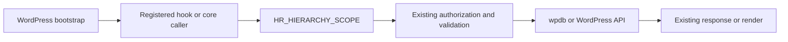

# HR_HIERARCHY_SCOPE — منابع انسانی، سلسله‌مراتب و دامنه دسترسی

Status: OBSERVED static source, baseline 2.0.235 / 2026-11-12. Human specialist: UNASSIGNED; repository owner: @mehrdadhafezi.

## 1. Purpose & Scope

پروفایل پرسنلی، انتقال مدیر، حل مسیر پنل و دامنه خواندن. HR Position و WordPress Role یک مفهوم نیستند. سابقه انتساب و بازه اثرگذاری حفظ شود. سطح دسترسی جدید و تغییر خودکار Role نیازمند تسک و تأیید مالک است. این قرارداد برای توسعه ماژول موجود است؛ بازطراحی فرآیند تجاری خارج از محدوده است.

## 2. File Structure

- [includes/class-sn-hr-service.php:1](../../includes/class-sn-hr-service.php#L1): `SN_HR_Service`
- [includes/class-sn-hierarchy-service.php:1](../../includes/class-sn-hierarchy-service.php#L1): `SN_Hierarchy_Service`
- [includes/class-sn-scope-service.php:1](../../includes/class-sn-scope-service.php#L1): `SN_Scope_Service`
- [includes/class-sn-hr-transfer.php:1](../../includes/class-sn-hr-transfer.php#L1): `SN_HR_Transfer`
- [includes/class-sn-hr-front-panel.php:1](../../includes/class-sn-hr-front-panel.php#L1): `SN_HR_Front_Panel`
- [includes/class-sn-hr-workforce-filters.php:1](../../includes/class-sn-hr-workforce-filters.php#L1): `SN_HR_Workforce_Filters`
- [includes/class-sn-hr-invoice-reissue.php](../../includes/class-sn-hr-invoice-reissue.php): `SN_HR_Invoice_Reissue`, owner-approved 2.0.239 policy.

متدهای راهنما (نام و محل واقعی؛ قرارداد کامل را در declaration بخوانید):

- [includes/class-sn-hierarchy-service.php:8](../../includes/class-sn-hierarchy-service.php#L8) — `__construct`
- [includes/class-sn-hierarchy-service.php:14](../../includes/class-sn-hierarchy-service.php#L14) — `get_current_parent_profile_id`
- [includes/class-sn-hierarchy-service.php:21](../../includes/class-sn-hierarchy-service.php#L21) — `get_current_parent_user_id`
- [includes/class-sn-hierarchy-service.php:29](../../includes/class-sn-hierarchy-service.php#L29) — `assign_parent`
- [includes/class-sn-hierarchy-service.php:66](../../includes/class-sn-hierarchy-service.php#L66) — `end_current_assignment`
- [includes/class-sn-hierarchy-service.php:80](../../includes/class-sn-hierarchy-service.php#L80) — `get_direct_children_profile_ids`
- [includes/class-sn-hierarchy-service.php:87](../../includes/class-sn-hierarchy-service.php#L87) — `get_descendant_profile_ids`
- [includes/class-sn-hierarchy-service.php:106](../../includes/class-sn-hierarchy-service.php#L106) — `get_ancestor_profile_ids`
- [includes/class-sn-hierarchy-service.php:118](../../includes/class-sn-hierarchy-service.php#L118) — `would_create_cycle`
- [includes/class-sn-hierarchy-service.php:123](../../includes/class-sn-hierarchy-service.php#L123) — `sync_legacy_supervisor_assignments`
- [includes/class-sn-hierarchy-service.php:158](../../includes/class-sn-hierarchy-service.php#L158) — `bulk_assign_position_to_parent`
- [includes/class-sn-hierarchy-service.php:241](../../includes/class-sn-hierarchy-service.php#L241) — `hierarchy_repair_audit_counts`

## 3. Execution Flow

مسیر مشاهده‌شده در سطح ماژول: bootstrap وردپرس، ثبت hook یا caller هسته، سپس متد ماژول. شکل زیر نمای ساختاری است؛ ترتیب همه callbackها را تضمین نمی‌کند.

## 4. Coding Standards

[استاندارد توسعه](../DEVELOPMENT_STANDARDS.md) لازم است. فقط مسیرهای این ماژول که در تسک مجاز شده‌اند تغییر کنند. متدهای عمومی و hookهای موجود rename نشوند. اشتراک در SN_Plugin به معنی مجوز تغییر تمام هسته نیست. HR Position و WordPress Role یک مفهوم نیستند. سابقه انتساب و بازه اثرگذاری حفظ شود. سطح دسترسی جدید و تغییر خودکار Role نیازمند تسک و تأیید مالک است.

## 5. Component & Interface Contracts

2.0.239 adds the HR tab **صدور مجدد فاکتور**. HR/admin selects a sales manager,
then seniors, supervisors and sellers within that branch. Each selected row has
inherit/allow/deny; nearest explicit policy wins and the default denies reissue.
Current HR assignments are read live, never changed by this feature. A personal
exception survives transfer. Missing/inactive/ambiguous/cyclic chains fail closed.
The policy is user meta, with existing HR audit records; no schema or WP role
change. [Detailed AJAX contract](../API_CONTRACTS.md#hr-invoice-reissue-policy-20239).

The plugin constructor registers the policy's existing HR permission predicate
for both lightweight frontend shortcodes and full AJAX bootstrap. Rendering this
tab must not depend on forcing the full CRM lifecycle on frontend requests.

کلاس‌ها و متدهای بخش ۲ interface فعلی‌اند؛ امضا، مقدار پیش‌فرض و return type از سورس مرجع حفظ شوند. برای ورودی و خروجی کامل هر درخواست [API_CONTRACTS.md](../API_CONTRACTS.md) و handler متناظر را با هم بخوانید. شِمای exhaustively verified برای همه payloadها: UNVERIFIED؛ lexical index جایگزین بررسی handler نیست. خطاهای کاربر فارسی و امن باشند و رفتار فعلی status/redirect حفظ شود.

## 6. Adding or Modifying Features

1. رفتار فعلی و معیار پذیرش را از تسک و caller اثبات کنید.
2. مجوز مسیر و بازبینی مالک برای نقاط حساس را بررسی کنید.
3. تغییر محدود انجام دهید؛ migration، Role، API یا side effect جدید بدون شرح و تأیید وارد نشود.
4. سناریوهای بخش ۸ و Syntax را اجرا کنید؛ تست اجرا‌نشده را NOT_RUN بنویسید.
5. این قرارداد، API/schema مرتبط و گزارش PR را به‌روز کنید.

## 7. Data Ownership & Integrity

HR Position و WordPress Role یک مفهوم نیستند. سابقه انتساب و بازه اثرگذاری حفظ شود. سطح دسترسی جدید و تغییر خودکار Role نیازمند تسک و تأیید مالک است.

نام‌های جدول literal مشاهده‌شده و traceشده در DDL/اتصال prefix (فهرست runtime کامل نیست): `sn_commission_rules`, `sn_hr_assignment_history`, `sn_hr_assignments`, `sn_hr_compensation_profiles`, `sn_hr_departments`, `sn_hr_levels`, `sn_hr_positions`, `sn_hr_profile_logs`, `sn_hr_profiles`, `sn_hr_teams`, `sn_hr_units`

DDL و PK/indexها: [DATABASE_SCHEMA_AUDIT.md](../audit/DATABASE_SCHEMA_AUDIT.md). اطلاعات مشتری، مالی، token و snapshot داده حساس‌اند. رابطه‌ای که فقط در کد وجود دارد Foreign Key فرض نشود. حذف history، double-credit و استفاده از رکورد خارج از scope ممنوع است.

## 8. Testing & Preview

2.0.239 regressions: `php tests/hr/invoice-reissue.php` (memory only) and the
[guarded native HR suite](../../tests/hr/README.md). They cover inheritance,
exceptions, current branch scope, transfer, impersonation, nonce, malformed input,
optimistic conflicts, atomic audit failure and unchanged financial rows/roles.

سناریوهای ضروری این ماژول: والد نامعتبر و چرخه؛ انتقال همزمان؛ حفظ history؛ scope خود/تیم/مدیر؛ کارمند غیرفعال؛ تفاوت audit_only با enforce.

Syntax و Secret Scan در CI فعال‌اند. [ماتریس تست](../TESTING_STANDARDS.md) وضعیت زیرساخت را مشخص می‌کند. تست MIS فقط در محیط disposable با guard مجاز است؛ سایر سناریوها که fixture ندارند NOT_IMPLEMENTED هستند. پیش‌نمایش UI و تست authorization واقعی نیازمند سایت آزمایشی ایزوله است.

## 9. API & Integration Contracts

2.0.239 adds `wp_ajax_sn_hr_invoice_reissue` and explicit 401-denial
`wp_ajax_nopriv_sn_hr_invoice_reissue`; see the new module and API contract above.

ثبت‌های literal مرتبط (اگر action با حلقه یا نام پویا ساخته شود باید caller را نیز بررسی کنید):

- `add_action`: `admin_init` — [includes/class-sn-hr-front-panel.php:9](../../includes/class-sn-hr-front-panel.php#L9)
- `add_action`: `admin_menu` — [includes/class-sn-hr-front-panel.php:10](../../includes/class-sn-hr-front-panel.php#L10)
- `add_action`: `wp_enqueue_scripts` — [includes/class-sn-hr-front-panel.php:11](../../includes/class-sn-hr-front-panel.php#L11)
- `add_action`: `template_redirect` — [includes/class-sn-hr-front-panel.php:12](../../includes/class-sn-hr-front-panel.php#L12)
- `add_filter`: `wp_robots` — [includes/class-sn-hr-front-panel.php:107](../../includes/class-sn-hr-front-panel.php#L107)
- `add_action`: `admin_menu` — [includes/class-sn-hr-transfer.php:31](../../includes/class-sn-hr-transfer.php#L31)
- `add_action`: `admin_enqueue_scripts` — [includes/class-sn-hr-transfer.php:32](../../includes/class-sn-hr-transfer.php#L32)
- `add_action`: `wp_enqueue_scripts` — [includes/class-sn-hr-transfer.php:33](../../includes/class-sn-hr-transfer.php#L33)
- `add_action`: `admin_post_sn_hr_export_users` — [includes/class-sn-hr-transfer.php:34](../../includes/class-sn-hr-transfer.php#L34)
- `add_action`: `wp_ajax_sn_hr_transfer_search_users` — [includes/class-sn-hr-transfer.php:35](../../includes/class-sn-hr-transfer.php#L35)

فهرست ثبت کامل در [HOOK_API_INDEX.md](../audit/HOOK_API_INDEX.md) و امضاها در [SOURCE_SYMBOLS.json](../audit/SOURCE_SYMBOLS.json). auth، nonce، scope، ورودی/خروجی و کد خطا باید برای handler تغییرکرده مستقیماً مستند شوند؛ endpoint جدید در این سند ساخته نشده است.

## 10. Administrative & Role Behavior

مجوز جاری از handler، SN_HR_Service/SN_Scope_Service و capabilityهای ثبت‌شده خوانده می‌شود. مخفی‌کردن دکمه مجوز backend نیست. تغییر cap، role، نگاشت HR یا scope نیازمند تسک مستقل و تأیید مالک است. ماتریس تست‌شده نقش‌ها در Production: UNVERIFIED. درخواست فاقد احراز هویت، nonce لازم یا scope باید با الگوی موجود رد شود.

## 11. Compatibility & Change History

R1 در 2026-11-12 فقط کد موجود نسخه 2.0.235 را مستند کرده است؛ کد PHP/JS/CSS تغییر نکرده است. Header: WordPress >=6.0 و PHP >=8.0؛ سازگاری runtime تمام نسخه‌ها در این جلسه UNVERIFIED. تاریخچه Releaseهای قدیمی شواهد تاریخی است و به معنی PASS این نسخه نیست. Merge و Deployment این مأموریت انجام نمی‌شود.
