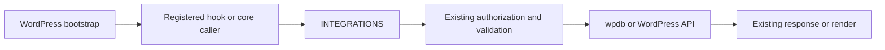

# INTEGRATIONS — APIها و سرویس‌های بیرونی

Status: OBSERVED static source, baseline 2.0.235 / 2026-11-12. Human specialist: UNASSIGNED; repository owner: @mehrdadhafezi.

## 1. Purpose & Scope

Biavin، outbox خروجی Plus و API خواندنی Patra. secret و داده مشتری وارد Git نشوند. SN_Plus_API outbox اثر شبکه را از ثبت مالی جدا می‌کند. REST خواندنی Patra الزام HTTPS، hash کلید و نرخ محدود دارد. این قرارداد برای توسعه ماژول موجود است؛ بازطراحی فرآیند تجاری خارج از محدوده است.

## 2. File Structure

- [includes/class-sn-biavin-api.php:1](../../includes/class-sn-biavin-api.php#L1): `SN_Biavin_API`
- [includes/class-sn-plus-api.php:1](../../includes/class-sn-plus-api.php#L1): `SN_Plus_API`
- [includes/class-sn-plus-api-contract.php:1](../../includes/class-sn-plus-api-contract.php#L1): `SN_Plus_API_Contract`
- [includes/class-sn-patra-plus-api.php:1](../../includes/class-sn-patra-plus-api.php#L1): `SN_Patra_Plus_API`
- [includes/class-sn-patra-plus-records.php:1](../../includes/class-sn-patra-plus-records.php#L1): `SN_Patra_Plus_Records`

متدهای راهنما (نام و محل واقعی؛ قرارداد کامل را در declaration بخوانید):

- [includes/class-sn-biavin-api.php:11](../../includes/class-sn-biavin-api.php#L11) — `instance`
- [includes/class-sn-biavin-api.php:16](../../includes/class-sn-biavin-api.php#L16) — `__construct`
- [includes/class-sn-biavin-api.php:18](../../includes/class-sn-biavin-api.php#L18) — `config_for_item`
- [includes/class-sn-biavin-api.php:27](../../includes/class-sn-biavin-api.php#L27) — `products`
- [includes/class-sn-biavin-api.php:43](../../includes/class-sn-biavin-api.php#L43) — `create_order`
- [includes/class-sn-biavin-api.php:55](../../includes/class-sn-biavin-api.php#L55) — `charge_wallet`
- [includes/class-sn-biavin-api.php:68](../../includes/class-sn-biavin-api.php#L68) — `request`
- [includes/class-sn-biavin-api.php:83](../../includes/class-sn-biavin-api.php#L83) — `table_exists`
- [includes/class-sn-patra-plus-api.php:20](../../includes/class-sn-patra-plus-api.php#L20) — `register_hooks`
- [includes/class-sn-patra-plus-api.php:28](../../includes/class-sn-patra-plus-api.php#L28) — `menu`
- [includes/class-sn-patra-plus-api.php:42](../../includes/class-sn-patra-plus-api.php#L42) — `settings`
- [includes/class-sn-patra-plus-api.php:51](../../includes/class-sn-patra-plus-api.php#L51) — `routes`

## 3. Execution Flow

مسیر مشاهده‌شده در سطح ماژول: bootstrap وردپرس، ثبت hook یا caller هسته، سپس متد ماژول. شکل زیر نمای ساختاری است؛ ترتیب همه callbackها را تضمین نمی‌کند.

## 4. Coding Standards

[استاندارد توسعه](../DEVELOPMENT_STANDARDS.md) لازم است. فقط مسیرهای این ماژول که در تسک مجاز شده‌اند تغییر کنند. متدهای عمومی و hookهای موجود rename نشوند. اشتراک در SN_Plugin به معنی مجوز تغییر تمام هسته نیست. secret و داده مشتری وارد Git نشوند. SN_Plus_API outbox اثر شبکه را از ثبت مالی جدا می‌کند. REST خواندنی Patra الزام HTTPS، hash کلید و نرخ محدود دارد.

## 5. Component & Interface Contracts

کلاس‌ها و متدهای بخش ۲ interface فعلی‌اند؛ امضا، مقدار پیش‌فرض و return type از سورس مرجع حفظ شوند. برای ورودی و خروجی کامل هر درخواست [API_CONTRACTS.md](../API_CONTRACTS.md) و handler متناظر را با هم بخوانید. شِمای exhaustively verified برای همه payloadها: UNVERIFIED؛ lexical index جایگزین بررسی handler نیست. خطاهای کاربر فارسی و امن باشند و رفتار فعلی status/redirect حفظ شود.

## 6. Adding or Modifying Features

1. رفتار فعلی و معیار پذیرش را از تسک و caller اثبات کنید.
2. مجوز مسیر و بازبینی مالک برای نقاط حساس را بررسی کنید.
3. تغییر محدود انجام دهید؛ migration، Role، API یا side effect جدید بدون شرح و تأیید وارد نشود.
4. سناریوهای بخش ۸ و Syntax را اجرا کنید؛ تست اجرا‌نشده را NOT_RUN بنویسید.
5. این قرارداد، API/schema مرتبط و گزارش PR را به‌روز کنید.

## 7. Data Ownership & Integrity

secret و داده مشتری وارد Git نشوند. SN_Plus_API outbox اثر شبکه را از ثبت مالی جدا می‌کند. REST خواندنی Patra الزام HTTPS، hash کلید و نرخ محدود دارد.

نام‌های جدول literal مشاهده‌شده و traceشده در DDL/اتصال prefix (فهرست runtime کامل نیست): `sn_dot_cases`, `sn_dot_invoice_links`, `sn_dot_payments`, `sn_invoices`, `sn_operations_execution_cases`, `sn_payment_review_events`, `sn_plus_api_jobs`, `sn_project_api_configs`, `sn_project_membership_items`, `sn_project_memberships`, `sn_subscription_plus_sales`

DDL و PK/indexها: [DATABASE_SCHEMA_AUDIT.md](../audit/DATABASE_SCHEMA_AUDIT.md). اطلاعات مشتری، مالی، token و snapshot داده حساس‌اند. رابطه‌ای که فقط در کد وجود دارد Foreign Key فرض نشود. حذف history، double-credit و استفاده از رکورد خارج از scope ممنوع است.

## 8. Testing & Preview

سناریوهای ضروری این ماژول: کلید باطل؛ HTTP ردشده؛ limit و cursor؛ timeout؛ retry/outbox lease؛ مقصد تغییرکرده؛ اعتبارسنجی ACK؛ عدم تغییر invoice از API خواندنی.

Syntax و Secret Scan در CI فعال‌اند. [ماتریس تست](../TESTING_STANDARDS.md) وضعیت زیرساخت را مشخص می‌کند. تست MIS فقط در محیط disposable با guard مجاز است؛ سایر سناریوها که fixture ندارند NOT_IMPLEMENTED هستند. پیش‌نمایش UI و تست authorization واقعی نیازمند سایت آزمایشی ایزوله است.

## 9. API & Integration Contracts

ثبت‌های literal مرتبط (اگر action با حلقه یا نام پویا ساخته شود باید caller را نیز بررسی کنید):

- `add_action`: `admin_menu` — [includes/class-sn-patra-plus-api.php:22](../../includes/class-sn-patra-plus-api.php#L22)
- `add_action`: `rest_api_init` — [includes/class-sn-patra-plus-api.php:23](../../includes/class-sn-patra-plus-api.php#L23)
- `add_filter`: `rest_post_dispatch` — [includes/class-sn-patra-plus-api.php:24](../../includes/class-sn-patra-plus-api.php#L24)
- `add_filter`: `jwt_auth_do_jwt_check` — [includes/class-sn-patra-plus-api.php:25](../../includes/class-sn-patra-plus-api.php#L25)
- `add_action`: `load-` — [includes/class-sn-patra-plus-api.php:32](../../includes/class-sn-patra-plus-api.php#L32)
- `add_action`: `admin_enqueue_scripts` — [includes/class-sn-patra-plus-api.php:33](../../includes/class-sn-patra-plus-api.php#L33)
- `add_filter`: `cron_schedules` — [includes/class-sn-plus-api.php:15](../../includes/class-sn-plus-api.php#L15)
- `add_action`: `init` — [includes/class-sn-plus-api.php:16](../../includes/class-sn-plus-api.php#L16)
- `add_action`: `sn_plus_api_tick` — [includes/class-sn-plus-api.php:17](../../includes/class-sn-plus-api.php#L17)
- `add_action`: `admin_menu` — [includes/class-sn-plus-api.php:18](../../includes/class-sn-plus-api.php#L18)
- `add_action`: `admin_post_sn_plus_api_save` — [includes/class-sn-plus-api.php:19](../../includes/class-sn-plus-api.php#L19)
- `add_action`: `admin_post_sn_plus_api_run` — [includes/class-sn-plus-api.php:20](../../includes/class-sn-plus-api.php#L20)
- `add_action`: `admin_post_sn_plus_api_retry` — [includes/class-sn-plus-api.php:21](../../includes/class-sn-plus-api.php#L21)

فهرست ثبت کامل در [HOOK_API_INDEX.md](../audit/HOOK_API_INDEX.md) و امضاها در [SOURCE_SYMBOLS.json](../audit/SOURCE_SYMBOLS.json). auth، nonce، scope، ورودی/خروجی و کد خطا باید برای handler تغییرکرده مستقیماً مستند شوند؛ endpoint جدید در این سند ساخته نشده است.

## 10. Administrative & Role Behavior

مجوز جاری از handler، SN_HR_Service/SN_Scope_Service و capabilityهای ثبت‌شده خوانده می‌شود. مخفی‌کردن دکمه مجوز backend نیست. تغییر cap، role، نگاشت HR یا scope نیازمند تسک مستقل و تأیید مالک است. ماتریس تست‌شده نقش‌ها در Production: UNVERIFIED. درخواست فاقد احراز هویت، nonce لازم یا scope باید با الگوی موجود رد شود.

## 11. Compatibility & Change History

R1 در 2026-11-12 فقط کد موجود نسخه 2.0.235 را مستند کرده است؛ کد PHP/JS/CSS تغییر نکرده است. Header: WordPress >=6.0 و PHP >=8.0؛ سازگاری runtime تمام نسخه‌ها در این جلسه UNVERIFIED. تاریخچه Releaseهای قدیمی شواهد تاریخی است و به معنی PASS این نسخه نیست. Merge و Deployment این مأموریت انجام نمی‌شود.
