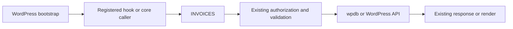

# INVOICES — فاکتور و بازبینی

Status: OBSERVED static source, baseline 2.0.235 / 2026-11-12. Human specialist: UNASSIGNED; repository owner: @mehrdadhafezi.

## 1. Purpose & Scope

مدل فاکتور، درگاه‌ها و ویرایش کنترل‌شده. invoice_code و access_token قرارداد عمومی‌اند. کد کوتاه جدید نباید کد قدیمی را از جستجو خارج کند. مبلغ، مراحل، اقلام و اثر سفارش WooCommerce اتمیک و سازگار بمانند. این قرارداد برای توسعه ماژول موجود است؛ بازطراحی فرآیند تجاری خارج از محدوده است.

## 2. File Structure

- [includes/class-sn-invoice.php:1](../../includes/class-sn-invoice.php#L1): `SN_Invoice`
- [includes/class-sn-invoice-review.php:1](../../includes/class-sn-invoice-review.php#L1): `SN_Invoice_Review`
- [includes/class-sn-plus-invoice-editor.php:1](../../includes/class-sn-plus-invoice-editor.php#L1): `SN_Plus_Invoice_Editor`

متدهای راهنما (نام و محل واقعی؛ قرارداد کامل را در declaration بخوانید):

- [includes/class-sn-invoice-review.php:15](../../includes/class-sn-invoice-review.php#L15) — `status_condition`
- [includes/class-sn-invoice-review.php:38](../../includes/class-sn-invoice-review.php#L38) — `register_hooks`
- [includes/class-sn-invoice-review.php:49](../../includes/class-sn-invoice-review.php#L49) — `login_redirect`
- [includes/class-sn-invoice-review.php:58](../../includes/class-sn-invoice-review.php#L58) — `logout_redirect`
- [includes/class-sn-invoice-review.php:64](../../includes/class-sn-invoice-review.php#L64) — `ensure_role`
- [includes/class-sn-invoice-review.php:72](../../includes/class-sn-invoice-review.php#L72) — `ensure_page`
- [includes/class-sn-invoice-review.php:92](../../includes/class-sn-invoice-review.php#L92) — `enqueue_assets`
- [includes/class-sn-invoice-review.php:103](../../includes/class-sn-invoice-review.php#L103) — `allowed`
- [includes/class-sn-invoice-review.php:108](../../includes/class-sn-invoice-review.php#L108) — `protect_cache`
- [includes/class-sn-invoice-review.php:118](../../includes/class-sn-invoice-review.php#L118) — `input`
- [includes/class-sn-invoice-review.php:124](../../includes/class-sn-invoice-review.php#L124) — `statuses`
- [includes/class-sn-invoice-review.php:135](../../includes/class-sn-invoice-review.php#L135) — `filters`

## 3. Execution Flow

مسیر مشاهده‌شده در سطح ماژول: bootstrap وردپرس، ثبت hook یا caller هسته، سپس متد ماژول. شکل زیر نمای ساختاری است؛ ترتیب همه callbackها را تضمین نمی‌کند.

## 4. Coding Standards

[استاندارد توسعه](../DEVELOPMENT_STANDARDS.md) لازم است. فقط مسیرهای این ماژول که در تسک مجاز شده‌اند تغییر کنند. متدهای عمومی و hookهای موجود rename نشوند. اشتراک در SN_Plugin به معنی مجوز تغییر تمام هسته نیست. invoice_code و access_token قرارداد عمومی‌اند. کد کوتاه جدید نباید کد قدیمی را از جستجو خارج کند. مبلغ، مراحل، اقلام و اثر سفارش WooCommerce اتمیک و سازگار بمانند.

## 5. Component & Interface Contracts

Unreleased local work separates invoice identity from receipt/stage references.
New classic Dot purchases retain one invoice across installments; existing old
child invoices are preserved. See the [traceability contract and release limits](../tasks/INVOICE_PAYMENT_TRACEABILITY.md).

2.0.240 preserves public token validation and provider amount conversion. The
30-minute window only controls pending-request reuse; age cannot cancel a bank
request or create a competing request. An unresolved older request needs matched
inquiry or explicit internal manual-method selection. New bank requests are
blocked while that stage has a manual hold or the invoice needs reconciliation.
See [payment contract](PAYMENTS_FINANCE.md).

Owner-approved 2.0.239 adds HR-controlled reissue permission for the existing
ordinary-seller duplicate check: same seller + normalized customer phone,
independent of existing invoice status/product. Default prevention is preserved;
nearest explicit HR inherit/allow/deny policy can allow reissue. Existing admin
and controlled-workflow exceptions, ownership, manual-issuance permission,
product eligibility, tokens, prices and payment state are unchanged. See
[HR policy](HR_HIERARCHY_SCOPE.md) and [tests](../../tests/hr/README.md).

کلاس‌ها و متدهای بخش ۲ interface فعلی‌اند؛ امضا، مقدار پیش‌فرض و return type از سورس مرجع حفظ شوند. برای ورودی و خروجی کامل هر درخواست [API_CONTRACTS.md](../API_CONTRACTS.md) و handler متناظر را با هم بخوانید. شِمای exhaustively verified برای همه payloadها: UNVERIFIED؛ lexical index جایگزین بررسی handler نیست. خطاهای کاربر فارسی و امن باشند و رفتار فعلی status/redirect حفظ شود.

## 6. Adding or Modifying Features

1. رفتار فعلی و معیار پذیرش را از تسک و caller اثبات کنید.
2. مجوز مسیر و بازبینی مالک برای نقاط حساس را بررسی کنید.
3. تغییر محدود انجام دهید؛ migration، Role، API یا side effect جدید بدون شرح و تأیید وارد نشود.
4. سناریوهای بخش ۸ و Syntax را اجرا کنید؛ تست اجرا‌نشده را NOT_RUN بنویسید.
5. این قرارداد، API/schema مرتبط و گزارش PR را به‌روز کنید.

## 7. Data Ownership & Integrity

invoice_code و access_token قرارداد عمومی‌اند. کد کوتاه جدید نباید کد قدیمی را از جستجو خارج کند. مبلغ، مراحل، اقلام و اثر سفارش WooCommerce اتمیک و سازگار بمانند.

نام‌های جدول literal مشاهده‌شده و traceشده در DDL/اتصال prefix (فهرست runtime کامل نیست): `sn_invoice_items`, `sn_invoice_payment_stages`, `sn_invoices`, `sn_payments`

DDL و PK/indexها: [DATABASE_SCHEMA_AUDIT.md](../audit/DATABASE_SCHEMA_AUDIT.md). اطلاعات مشتری، مالی، token و snapshot داده حساس‌اند. رابطه‌ای که فقط در کد وجود دارد Foreign Key فرض نشود. حذف history، double-credit و استفاده از رکورد خارج از scope ممنوع است.

## 8. Testing & Preview

Approval visibility regression: `php tests/payments/approval-visibility.php`
(standalone CLI, SQLite3, synthetic memory only). A stale pending compatibility
column must not hide the final decision; receipt approval with an unpaid balance
must remain distinct from invoice settlement. No stored status is repaired by a
read request. See also `node tests/payments/approval-visibility-ui.cjs`.

[Native integration](../../tests/payments/integration/README.md) adds actual
WordPress AJAX and rendered seller/supervisor/senior panels, with MySQL, legacy
upgrade/rollback, desktop/mobile RTL screenshots and browser refresh checks.

سناریوهای ضروری این ماژول: فاکتور بدون/با توکن؛ کد قدیمی؛ پیش‌فاکتور؛ جمع اقلام؛ تغییر همزمان؛ سابقه بازبینی؛ واحد ریال/تومان.

Syntax و Secret Scan در CI فعال‌اند. [ماتریس تست](../TESTING_STANDARDS.md) وضعیت زیرساخت را مشخص می‌کند. تست MIS فقط در محیط disposable با guard مجاز است؛ سایر سناریوها که fixture ندارند NOT_IMPLEMENTED هستند. پیش‌نمایش UI و تست authorization واقعی نیازمند سایت آزمایشی ایزوله است.

## 9. API & Integration Contracts

ثبت‌های literal مرتبط (اگر action با حلقه یا نام پویا ساخته شود باید caller را نیز بررسی کنید):

- `add_action`: `init` — [includes/class-sn-invoice-review.php:40](../../includes/class-sn-invoice-review.php#L40)
- `add_filter`: `login_redirect` — [includes/class-sn-invoice-review.php:41](../../includes/class-sn-invoice-review.php#L41)
- `add_filter`: `logout_redirect` — [includes/class-sn-invoice-review.php:42](../../includes/class-sn-invoice-review.php#L42)
- `add_action`: `admin_init` — [includes/class-sn-invoice-review.php:43](../../includes/class-sn-invoice-review.php#L43)
- `add_action`: `wp_enqueue_scripts` — [includes/class-sn-invoice-review.php:44](../../includes/class-sn-invoice-review.php#L44)
- `add_action`: `admin_post_sn_invoice_review_export` — [includes/class-sn-invoice-review.php:45](../../includes/class-sn-invoice-review.php#L45)
- `add_action`: `template_redirect` — [includes/class-sn-invoice-review.php:46](../../includes/class-sn-invoice-review.php#L46)

فهرست ثبت کامل در [HOOK_API_INDEX.md](../audit/HOOK_API_INDEX.md) و امضاها در [SOURCE_SYMBOLS.json](../audit/SOURCE_SYMBOLS.json). auth، nonce، scope، ورودی/خروجی و کد خطا باید برای handler تغییرکرده مستقیماً مستند شوند؛ endpoint جدید در این سند ساخته نشده است.

## 10. Administrative & Role Behavior

مجوز جاری از handler، SN_HR_Service/SN_Scope_Service و capabilityهای ثبت‌شده خوانده می‌شود. مخفی‌کردن دکمه مجوز backend نیست. تغییر cap، role، نگاشت HR یا scope نیازمند تسک مستقل و تأیید مالک است. ماتریس تست‌شده نقش‌ها در Production: UNVERIFIED. درخواست فاقد احراز هویت، nonce لازم یا scope باید با الگوی موجود رد شود.

## 11. Compatibility & Change History

R1 در 2026-11-12 فقط کد موجود نسخه 2.0.235 را مستند کرده است؛ کد PHP/JS/CSS تغییر نکرده است. Header: WordPress >=6.0 و PHP >=8.0؛ سازگاری runtime تمام نسخه‌ها در این جلسه UNVERIFIED. تاریخچه Releaseهای قدیمی شواهد تاریخی است و به معنی PASS این نسخه نیست. Merge و Deployment این مأموریت انجام نمی‌شود.
