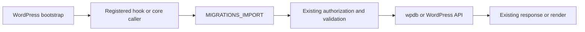

# MIGRATIONS_IMPORT — مهاجرت و ابزار ورود ارتقا

Status: OBSERVED static source, baseline 2.0.235 / 2026-11-12. Human specialist: UNASSIGNED; repository owner: @mehrdadhafezi.

## 1. Purpose & Scope

schema افزایشی و ورود کنترل‌شده سوابق ارتقا. اجرای migrate یا repair یک عملیات داده است، صرفاً بازکردن صفحه نیست. idempotence، dry-run، تعداد ردیف و برنامه بازیابی باید قبل از اجرا تأیید شوند. این قرارداد برای توسعه ماژول موجود است؛ بازطراحی فرآیند تجاری خارج از محدوده است.

## 2. File Structure

- [includes/class-sn-migration-service.php:1](../../includes/class-sn-migration-service.php#L1): `SN_Migration_Service`
- [includes/class-sn-upgrade-importer.php:1](../../includes/class-sn-upgrade-importer.php#L1): `SN_Upgrade_Importer`

متدهای راهنما (نام و محل واقعی؛ قرارداد کامل را در declaration بخوانید):

- [includes/class-sn-migration-service.php:11](../../includes/class-sn-migration-service.php#L11) — `__construct`
- [includes/class-sn-migration-service.php:16](../../includes/class-sn-migration-service.php#L16) — `get_db_version`
- [includes/class-sn-migration-service.php:21](../../includes/class-sn-migration-service.php#L21) — `migrate_if_needed`
- [includes/class-sn-migration-service.php:31](../../includes/class-sn-migration-service.php#L31) — `migrate`
- [includes/class-sn-migration-service.php:71](../../includes/class-sn-migration-service.php#L71) — `repair_default_seed_data`
- [includes/class-sn-migration-service.php:94](../../includes/class-sn-migration-service.php#L94) — `mis_tables_complete`
- [includes/class-sn-migration-service.php:103](../../includes/class-sn-migration-service.php#L103) — `distribution_tables_complete`
- [includes/class-sn-migration-service.php:112](../../includes/class-sn-migration-service.php#L112) — `after_sales_tables_complete`
- [includes/class-sn-migration-service.php:121](../../includes/class-sn-migration-service.php#L121) — `commission_tables_complete`
- [includes/class-sn-migration-service.php:130](../../includes/class-sn-migration-service.php#L130) — `hr_compensation_tables_complete`
- [includes/class-sn-migration-service.php:134](../../includes/class-sn-migration-service.php#L134) — `repair_mis_schema`
- [includes/class-sn-migration-service.php:155](../../includes/class-sn-migration-service.php#L155) — `mis_schema_status`

## 3. Execution Flow

مسیر مشاهده‌شده در سطح ماژول: bootstrap وردپرس، ثبت hook یا caller هسته، سپس متد ماژول. شکل زیر نمای ساختاری است؛ ترتیب همه callbackها را تضمین نمی‌کند.

## 4. Coding Standards

[استاندارد توسعه](../DEVELOPMENT_STANDARDS.md) لازم است. فقط مسیرهای این ماژول که در تسک مجاز شده‌اند تغییر کنند. متدهای عمومی و hookهای موجود rename نشوند. اشتراک در SN_Plugin به معنی مجوز تغییر تمام هسته نیست. اجرای migrate یا repair یک عملیات داده است، صرفاً بازکردن صفحه نیست. idempotence، dry-run، تعداد ردیف و برنامه بازیابی باید قبل از اجرا تأیید شوند.

## 5. Component & Interface Contracts

کلاس‌ها و متدهای بخش ۲ interface فعلی‌اند؛ امضا، مقدار پیش‌فرض و return type از سورس مرجع حفظ شوند. برای ورودی و خروجی کامل هر درخواست [API_CONTRACTS.md](../API_CONTRACTS.md) و handler متناظر را با هم بخوانید. شِمای exhaustively verified برای همه payloadها: UNVERIFIED؛ lexical index جایگزین بررسی handler نیست. خطاهای کاربر فارسی و امن باشند و رفتار فعلی status/redirect حفظ شود.

## 6. Adding or Modifying Features

1. رفتار فعلی و معیار پذیرش را از تسک و caller اثبات کنید.
2. مجوز مسیر و بازبینی مالک برای نقاط حساس را بررسی کنید.
3. تغییر محدود انجام دهید؛ migration، Role، API یا side effect جدید بدون شرح و تأیید وارد نشود.
4. سناریوهای بخش ۸ و Syntax را اجرا کنید؛ تست اجرا‌نشده را NOT_RUN بنویسید.
5. این قرارداد، API/schema مرتبط و گزارش PR را به‌روز کنید.

## 7. Data Ownership & Integrity

اجرای migrate یا repair یک عملیات داده است، صرفاً بازکردن صفحه نیست. idempotence، dry-run، تعداد ردیف و برنامه بازیابی باید قبل از اجرا تأیید شوند.

نام‌های جدول literal مشاهده‌شده و traceشده در DDL/اتصال prefix (فهرست runtime کامل نیست): `sn_after_sales_case_logs`, `sn_after_sales_cases`, `sn_commission_dry_run_items`, `sn_commission_dry_runs`, `sn_commission_rules`, `sn_commission_wallet_posting_logs`, `sn_distribution_chain_steps`, `sn_distribution_chains`, `sn_distribution_item_logs`, `sn_distribution_items`, `sn_hr_assignment_history`, `sn_hr_assignments`, `sn_hr_compensation_history`, `sn_hr_compensation_profiles`, `sn_hr_departments`, `sn_hr_levels`, `sn_hr_position_role_mappings`, `sn_hr_positions`, `sn_hr_profile_logs`, `sn_hr_profiles`, `sn_hr_teams`, `sn_hr_units`, `sn_mis_data_rows`, `sn_mis_distribution_logs`, `sn_mis_distribution_plan_items`, `sn_mis_distribution_plans`, `sn_mis_distribution_rules`, `sn_mis_import_batches`, `sn_mis_lead_pool`, `sn_project_card_upgrade_rules`, `sn_wallet_settlement_batches`, `sn_wallet_settlement_items`

DDL و PK/indexها: [DATABASE_SCHEMA_AUDIT.md](../audit/DATABASE_SCHEMA_AUDIT.md). اطلاعات مشتری، مالی، token و snapshot داده حساس‌اند. رابطه‌ای که فقط در کد وجود دارد Foreign Key فرض نشود. حذف history، double-credit و استفاده از رکورد خارج از scope ممنوع است.

## 8. Testing & Preview

سناریوهای ضروری این ماژول: نصب تازه؛ upgrade از نسخه قبلی؛ اجرای دوباره؛ نیمه‌کاره؛ schema گمشده؛ حفظ فاکتور و Role قدیمی؛ backup restore.

Syntax و Secret Scan در CI فعال‌اند. [ماتریس تست](../TESTING_STANDARDS.md) وضعیت زیرساخت را مشخص می‌کند. تست MIS فقط در محیط disposable با guard مجاز است؛ سایر سناریوها که fixture ندارند NOT_IMPLEMENTED هستند. پیش‌نمایش UI و تست authorization واقعی نیازمند سایت آزمایشی ایزوله است.

## 9. API & Integration Contracts

ثبت‌های literal مرتبط (اگر action با حلقه یا نام پویا ساخته شود باید caller را نیز بررسی کنید):

- `add_action`: `admin_menu` — [includes/class-sn-upgrade-importer.php:6](../../includes/class-sn-upgrade-importer.php#L6)
- `add_action`: `admin_post_sn_upgrade_csv_import` — [includes/class-sn-upgrade-importer.php:7](../../includes/class-sn-upgrade-importer.php#L7)
- `add_action`: `admin_post_sn_upgrade_rollback` — [includes/class-sn-upgrade-importer.php:8](../../includes/class-sn-upgrade-importer.php#L8)

فهرست ثبت کامل در [HOOK_API_INDEX.md](../audit/HOOK_API_INDEX.md) و امضاها در [SOURCE_SYMBOLS.json](../audit/SOURCE_SYMBOLS.json). auth، nonce، scope، ورودی/خروجی و کد خطا باید برای handler تغییرکرده مستقیماً مستند شوند؛ endpoint جدید در این سند ساخته نشده است.

## 10. Administrative & Role Behavior

مجوز جاری از handler، SN_HR_Service/SN_Scope_Service و capabilityهای ثبت‌شده خوانده می‌شود. مخفی‌کردن دکمه مجوز backend نیست. تغییر cap، role، نگاشت HR یا scope نیازمند تسک مستقل و تأیید مالک است. ماتریس تست‌شده نقش‌ها در Production: UNVERIFIED. درخواست فاقد احراز هویت، nonce لازم یا scope باید با الگوی موجود رد شود.

## 11. Compatibility & Change History

R1 در 2026-11-12 فقط کد موجود نسخه 2.0.235 را مستند کرده است؛ کد PHP/JS/CSS تغییر نکرده است. Header: WordPress >=6.0 و PHP >=8.0؛ سازگاری runtime تمام نسخه‌ها در این جلسه UNVERIFIED. تاریخچه Releaseهای قدیمی شواهد تاریخی است و به معنی PASS این نسخه نیست. Merge و Deployment این مأموریت انجام نمی‌شود.
