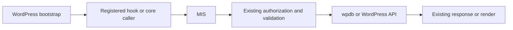

# MIS — ورود، توزیع و تاریخچه MIS

Status: OBSERVED static source, baseline 2.0.235 / 2026-11-12. Human specialist: UNASSIGNED; repository owner: @mehrdadhafezi.

## 1. Purpose & Scope

ورود فایل، staging، تخصیص، بازگشت، تاریخچه و خروجی مرحله‌ای. مرز staging و live lead حفظ شود. SN_MIS_Service::atomic با InnoDB، transaction و قفل پایگاه داده کار می‌کند. setup وب از install آزمایشی جداست. history و claim تلفن حذف خودکار نشوند. این قرارداد برای توسعه ماژول موجود است؛ بازطراحی فرآیند تجاری خارج از محدوده است.

## 2. File Structure

- [includes/class-sn-mis-http.php:1](../../includes/class-sn-mis-http.php#L1): `SN_MIS_HTTP`
- [includes/class-sn-mis-service.php:1](../../includes/class-sn-mis-service.php#L1): `SN_MIS_Service`, `SN_MIS_Request_Lock`
- [includes/class-sn-mis-setup.php:1](../../includes/class-sn-mis-setup.php#L1): `SN_MIS_Setup`
- [includes/class-sn-mis-read-model.php:1](../../includes/class-sn-mis-read-model.php#L1): `SN_MIS_Read_Model`
- [includes/class-sn-mis-jobs.php:1](../../includes/class-sn-mis-jobs.php#L1): `SN_MIS_Jobs`
- [includes/class-sn-mis-import-log.php:1](../../includes/class-sn-mis-import-log.php#L1): `SN_MIS_Import_Log`
- [includes/class-sn-mis-feedback.php:1](../../includes/class-sn-mis-feedback.php#L1): `SN_MIS_Feedback`
- [includes/class-sn-mis-xlsx.php:1](../../includes/class-sn-mis-xlsx.php#L1): `SN_MIS_XLSX`
- [includes/trait-sn-mis-classic.php:1](../../includes/trait-sn-mis-classic.php#L1): `SN_MIS_Classic`
- [includes/trait-sn-mis-experience.php:1](../../includes/trait-sn-mis-experience.php#L1): `SN_MIS_Experience`
- [includes/trait-sn-mis-extras.php:1](../../includes/trait-sn-mis-extras.php#L1): `SN_MIS_Extras`
- [includes/trait-sn-mis-management.php:1](../../includes/trait-sn-mis-management.php#L1): `SN_MIS_Management`
- [includes/trait-sn-mis-portal.php:1](../../includes/trait-sn-mis-portal.php#L1): `SN_MIS_Portal`
- [includes/trait-sn-mis-transport.php:1](../../includes/trait-sn-mis-transport.php#L1): `SN_MIS_Transport`
- [includes/trait-sn-mis-user-tools.php:1](../../includes/trait-sn-mis-user-tools.php#L1): `SN_MIS_User_Tools`

متدهای راهنما (نام و محل واقعی؛ قرارداد کامل را در declaration بخوانید):

- [includes/class-sn-mis-feedback.php:6](../../includes/class-sn-mis-feedback.php#L6) — `error`
- [includes/class-sn-mis-feedback.php:41](../../includes/class-sn-mis-feedback.php#L41) — `session`
- [includes/class-sn-mis-feedback.php:42](../../includes/class-sn-mis-feedback.php#L42) — `is_ajax`
- [includes/class-sn-mis-feedback.php:43](../../includes/class-sn-mis-feedback.php#L43) — `jalali_datetime`
- [includes/class-sn-mis-http.php:6](../../includes/class-sn-mis-http.php#L6) — `is_request`
- [includes/class-sn-mis-http.php:10](../../includes/class-sn-mis-http.php#L10) — `portal_template`
- [includes/class-sn-mis-http.php:17](../../includes/class-sn-mis-http.php#L17) — `register`
- [includes/class-sn-mis-import-log.php:8](../../includes/class-sn-mis-import-log.php#L8) — `__construct`
- [includes/class-sn-mis-import-log.php:9](../../includes/class-sn-mis-import-log.php#L9) — `table`
- [includes/class-sn-mis-import-log.php:10](../../includes/class-sn-mis-import-log.php#L10) — `check`
- [includes/class-sn-mis-import-log.php:11](../../includes/class-sn-mis-import-log.php#L11) — `schema`
- [includes/class-sn-mis-import-log.php:23](../../includes/class-sn-mis-import-log.php#L23) — `ready`

## 3. Execution Flow

مسیر مشاهده‌شده در سطح ماژول: bootstrap وردپرس، ثبت hook یا caller هسته، سپس متد ماژول. شکل زیر نمای ساختاری است؛ ترتیب همه callbackها را تضمین نمی‌کند.

## 4. Coding Standards

[استاندارد توسعه](../DEVELOPMENT_STANDARDS.md) لازم است. فقط مسیرهای این ماژول که در تسک مجاز شده‌اند تغییر کنند. متدهای عمومی و hookهای موجود rename نشوند. اشتراک در SN_Plugin به معنی مجوز تغییر تمام هسته نیست. مرز staging و live lead حفظ شود. SN_MIS_Service::atomic با InnoDB، transaction و قفل پایگاه داده کار می‌کند. setup وب از install آزمایشی جداست. history و claim تلفن حذف خودکار نشوند.

## 5. Component & Interface Contracts

کلاس‌ها و متدهای بخش ۲ interface فعلی‌اند؛ امضا، مقدار پیش‌فرض و return type از سورس مرجع حفظ شوند. برای ورودی و خروجی کامل هر درخواست [API_CONTRACTS.md](../API_CONTRACTS.md) و handler متناظر را با هم بخوانید. شِمای exhaustively verified برای همه payloadها: UNVERIFIED؛ lexical index جایگزین بررسی handler نیست. خطاهای کاربر فارسی و امن باشند و رفتار فعلی status/redirect حفظ شود.

## 6. Adding or Modifying Features

1. رفتار فعلی و معیار پذیرش را از تسک و caller اثبات کنید.
2. مجوز مسیر و بازبینی مالک برای نقاط حساس را بررسی کنید.
3. تغییر محدود انجام دهید؛ migration، Role، API یا side effect جدید بدون شرح و تأیید وارد نشود.
4. سناریوهای بخش ۸ و Syntax را اجرا کنید؛ تست اجرا‌نشده را NOT_RUN بنویسید.
5. این قرارداد، API/schema مرتبط و گزارش PR را به‌روز کنید.

## 7. Data Ownership & Integrity

مرز staging و live lead حفظ شود. SN_MIS_Service::atomic با InnoDB، transaction و قفل پایگاه داده کار می‌کند. setup وب از install آزمایشی جداست. history و claim تلفن حذف خودکار نشوند.

نام‌های جدول literal مشاهده‌شده و traceشده در DDL/اتصال prefix (فهرست runtime کامل نیست): `sn_hr_profiles`, `sn_mis_claims`, `sn_mis_data_rows`, `sn_mis_distribution_logs`, `sn_mis_distribution_plan_items`, `sn_mis_distribution_plans`, `sn_mis_events`, `sn_mis_import_batches`, `sn_mis_import_runs`, `sn_mis_index_dirty`, `sn_mis_job_rows`, `sn_mis_jobs`, `sn_mis_lead_pool`, `sn_mis_record_meta`, `sn_mis_row_index`

DDL و PK/indexها: [DATABASE_SCHEMA_AUDIT.md](../audit/DATABASE_SCHEMA_AUDIT.md). اطلاعات مشتری، مالی، token و snapshot داده حساس‌اند. رابطه‌ای که فقط در کد وجود دارد Foreign Key فرض نشود. حذف history، double-credit و استفاده از رکورد خارج از scope ممنوع است.

## 8. Testing & Preview

سناریوهای ضروری این ماژول: CSV/XLSX خراب؛ صفر اول تلفن؛ ردیف تکراری؛ فرمول Excel؛ تخصیص و بازگشت؛ دو اتصال همزمان؛ SQL failure و rollback؛ job مالک دیگر؛ classic shortcode و workspace.

Syntax و Secret Scan در CI فعال‌اند. [ماتریس تست](../TESTING_STANDARDS.md) وضعیت زیرساخت را مشخص می‌کند. تست MIS فقط در محیط disposable با guard مجاز است؛ سایر سناریوها که fixture ندارند NOT_IMPLEMENTED هستند. پیش‌نمایش UI و تست authorization واقعی نیازمند سایت آزمایشی ایزوله است.

## 9. API & Integration Contracts

ثبت‌های literal مرتبط (اگر action با حلقه یا نام پویا ساخته شود باید caller را نیز بررسی کنید):

- `add_action`: `init` — [includes/trait-sn-mis-portal.php:23](../../includes/trait-sn-mis-portal.php#L23)
- `add_action`: `admin_post_sn_distribution_deliver_pool` — [includes/trait-sn-mis-portal.php:24](../../includes/trait-sn-mis-portal.php#L24)
- `add_action`: `admin_post_sn_mis_` — [includes/trait-sn-mis-portal.php:25](../../includes/trait-sn-mis-portal.php#L25)
- `add_action`: `init` — [includes/trait-sn-mis-portal.php:30](../../includes/trait-sn-mis-portal.php#L30)
- `add_action`: `admin_post_sn_mis_v2` — [includes/trait-sn-mis-portal.php:31](../../includes/trait-sn-mis-portal.php#L31)
- `add_action`: `wp_ajax_sn_mis_setup` — [includes/trait-sn-mis-portal.php:32](../../includes/trait-sn-mis-portal.php#L32)
- `add_action`: `wp_ajax_sn_mis_view` — [includes/trait-sn-mis-portal.php:33](../../includes/trait-sn-mis-portal.php#L33)
- `add_action`: `wp_ajax_sn_mis_job` — [includes/trait-sn-mis-portal.php:34](../../includes/trait-sn-mis-portal.php#L34)
- `add_action`: `admin_post_sn_mis_download` — [includes/trait-sn-mis-portal.php:35](../../includes/trait-sn-mis-portal.php#L35)
- `add_action`: `edit_user_profile` — [includes/trait-sn-mis-user-tools.php:12](../../includes/trait-sn-mis-user-tools.php#L12)
- `add_action`: `show_user_profile` — [includes/trait-sn-mis-user-tools.php:13](../../includes/trait-sn-mis-user-tools.php#L13)
- `add_action`: `admin_post_sn_mis_user_tools_access` — [includes/trait-sn-mis-user-tools.php:14](../../includes/trait-sn-mis-user-tools.php#L14)
- `add_action`: `admin_footer` — [includes/trait-sn-mis-user-tools.php:15](../../includes/trait-sn-mis-user-tools.php#L15)

فهرست ثبت کامل در [HOOK_API_INDEX.md](../audit/HOOK_API_INDEX.md) و امضاها در [SOURCE_SYMBOLS.json](../audit/SOURCE_SYMBOLS.json). auth، nonce، scope، ورودی/خروجی و کد خطا باید برای handler تغییرکرده مستقیماً مستند شوند؛ endpoint جدید در این سند ساخته نشده است.

## 10. Administrative & Role Behavior

مجوز جاری از handler، SN_HR_Service/SN_Scope_Service و capabilityهای ثبت‌شده خوانده می‌شود. مخفی‌کردن دکمه مجوز backend نیست. تغییر cap، role، نگاشت HR یا scope نیازمند تسک مستقل و تأیید مالک است. ماتریس تست‌شده نقش‌ها در Production: UNVERIFIED. درخواست فاقد احراز هویت، nonce لازم یا scope باید با الگوی موجود رد شود.

## 11. Compatibility & Change History

R1 در 2026-11-12 فقط کد موجود نسخه 2.0.235 را مستند کرده است؛ کد PHP/JS/CSS تغییر نکرده است. Header: WordPress >=6.0 و PHP >=8.0؛ سازگاری runtime تمام نسخه‌ها در این جلسه UNVERIFIED. تاریخچه Releaseهای قدیمی شواهد تاریخی است و به معنی PASS این نسخه نیست. Merge و Deployment این مأموریت انجام نمی‌شود.
