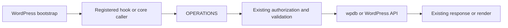

# OPERATIONS — فروش و اجرای عملیات

Status: OBSERVED static source, baseline 2.0.235 / 2026-11-12. Human specialist: UNASSIGNED; repository owner: @mehrdadhafezi.

## 1. Purpose & Scope

مسیر عملیات فروش، وضعیت اجرا و تحویل. مرز نقش‌های فروش عملیات و اجرای عملیات حفظ شود. reset یا انتقال نباید پرداخت، invoice یا سابقه مالکیت را پاک کند. این قرارداد برای توسعه ماژول موجود است؛ بازطراحی فرآیند تجاری خارج از محدوده است.

## 2. File Structure

- [includes/class-sn-operations-flow.php:1](../../includes/class-sn-operations-flow.php#L1): `SN_Operations_Flow`
- [includes/class-sn-operations-execution.php:1](../../includes/class-sn-operations-execution.php#L1): `SN_Operations_Execution`

متدهای راهنما (نام و محل واقعی؛ قرارداد کامل را در declaration بخوانید):

- [includes/class-sn-operations-execution.php:16](../../includes/class-sn-operations-execution.php#L16) — `instance`
- [includes/class-sn-operations-execution.php:21](../../includes/class-sn-operations-execution.php#L21) — `__construct`
- [includes/class-sn-operations-execution.php:23](../../includes/class-sn-operations-execution.php#L23) — `activate`
- [includes/class-sn-operations-execution.php:30](../../includes/class-sn-operations-execution.php#L30) — `register_hooks`
- [includes/class-sn-operations-execution.php:46](../../includes/class-sn-operations-execution.php#L46) — `tables`
- [includes/class-sn-operations-execution.php:57](../../includes/class-sn-operations-execution.php#L57) — `table_exists`
- [includes/class-sn-operations-execution.php:65](../../includes/class-sn-operations-execution.php#L65) — `maybe_upgrade`
- [includes/class-sn-operations-execution.php:73](../../includes/class-sn-operations-execution.php#L73) — `install_schema`
- [includes/class-sn-operations-execution.php:174](../../includes/class-sn-operations-execution.php#L174) — `ensure_role_and_hr`
- [includes/class-sn-operations-execution.php:197](../../includes/class-sn-operations-execution.php#L197) — `ensure_page`
- [includes/class-sn-operations-execution.php:207](../../includes/class-sn-operations-execution.php#L207) — `register_admin_page`
- [includes/class-sn-operations-execution.php:211](../../includes/class-sn-operations-execution.php#L211) — `fulfillment_types`

## 3. Execution Flow

مسیر مشاهده‌شده در سطح ماژول: bootstrap وردپرس، ثبت hook یا caller هسته، سپس متد ماژول. شکل زیر نمای ساختاری است؛ ترتیب همه callbackها را تضمین نمی‌کند.

## 4. Coding Standards

[استاندارد توسعه](../DEVELOPMENT_STANDARDS.md) لازم است. فقط مسیرهای این ماژول که در تسک مجاز شده‌اند تغییر کنند. متدهای عمومی و hookهای موجود rename نشوند. اشتراک در SN_Plugin به معنی مجوز تغییر تمام هسته نیست. مرز نقش‌های فروش عملیات و اجرای عملیات حفظ شود. reset یا انتقال نباید پرداخت، invoice یا سابقه مالکیت را پاک کند.

## 5. Component & Interface Contracts

کلاس‌ها و متدهای بخش ۲ interface فعلی‌اند؛ امضا، مقدار پیش‌فرض و return type از سورس مرجع حفظ شوند. برای ورودی و خروجی کامل هر درخواست [API_CONTRACTS.md](../API_CONTRACTS.md) و handler متناظر را با هم بخوانید. شِمای exhaustively verified برای همه payloadها: UNVERIFIED؛ lexical index جایگزین بررسی handler نیست. خطاهای کاربر فارسی و امن باشند و رفتار فعلی status/redirect حفظ شود.

## 6. Adding or Modifying Features

1. رفتار فعلی و معیار پذیرش را از تسک و caller اثبات کنید.
2. مجوز مسیر و بازبینی مالک برای نقاط حساس را بررسی کنید.
3. تغییر محدود انجام دهید؛ migration، Role، API یا side effect جدید بدون شرح و تأیید وارد نشود.
4. سناریوهای بخش ۸ و Syntax را اجرا کنید؛ تست اجرا‌نشده را NOT_RUN بنویسید.
5. این قرارداد، API/schema مرتبط و گزارش PR را به‌روز کنید.

## 7. Data Ownership & Integrity

مرز نقش‌های فروش عملیات و اجرای عملیات حفظ شود. reset یا انتقال نباید پرداخت، invoice یا سابقه مالکیت را پاک کند.

نام‌های جدول literal مشاهده‌شده و traceشده در DDL/اتصال prefix (فهرست runtime کامل نیست): `sn_dot_cases`, `sn_hr_assignments`, `sn_hr_position_role_mappings`, `sn_hr_positions`, `sn_hr_profiles`, `sn_invoice_items`, `sn_invoice_payment_stages`, `sn_invoices`, `sn_operations_execution_cases`, `sn_operations_execution_events`, `sn_operations_form_definitions`, `sn_operations_form_submissions`, `sn_operations_wallet_codes`, `sn_project_actions`, `sn_project_events`, `sn_project_membership_items`, `sn_project_memberships`, `sn_project_operations`, `sn_project_operations_manager_products`, `sn_project_operations_sales_routes`, `sn_project_operations_supervisor_sales_routes`

DDL و PK/indexها: [DATABASE_SCHEMA_AUDIT.md](../audit/DATABASE_SCHEMA_AUDIT.md). اطلاعات مشتری، مالی، token و snapshot داده حساس‌اند. رابطه‌ای که فقط در کد وجود دارد Foreign Key فرض نشود. حذف history، double-credit و استفاده از رکورد خارج از scope ممنوع است.

## 8. Testing & Preview

سناریوهای ضروری این ماژول: مدیر/سرپرست/کارشناس؛ routing شاخه؛ callback و inactivity؛ تحویل اجرا؛ عدم انتقال به مدیر نامرتبط.

Syntax و Secret Scan در CI فعال‌اند. [ماتریس تست](../TESTING_STANDARDS.md) وضعیت زیرساخت را مشخص می‌کند. تست MIS فقط در محیط disposable با guard مجاز است؛ سایر سناریوها که fixture ندارند NOT_IMPLEMENTED هستند. پیش‌نمایش UI و تست authorization واقعی نیازمند سایت آزمایشی ایزوله است.

## 9. API & Integration Contracts

ثبت‌های literal مرتبط (اگر action با حلقه یا نام پویا ساخته شود باید caller را نیز بررسی کنید):

- `add_action`: `init` — [includes/class-sn-operations-execution.php:33](../../includes/class-sn-operations-execution.php#L33)
- `add_action`: `admin_init` — [includes/class-sn-operations-execution.php:34](../../includes/class-sn-operations-execution.php#L34)
- `add_action`: `admin_menu` — [includes/class-sn-operations-execution.php:35](../../includes/class-sn-operations-execution.php#L35)
- `add_action`: `add_meta_boxes_product` — [includes/class-sn-operations-execution.php:36](../../includes/class-sn-operations-execution.php#L36)
- `add_action`: `save_post_product` — [includes/class-sn-operations-execution.php:37](../../includes/class-sn-operations-execution.php#L37)
- `add_action`: `admin_post_sn_execution_save_form` — [includes/class-sn-operations-execution.php:38](../../includes/class-sn-operations-execution.php#L38)
- `add_action`: `admin_post_sn_execution_save_integration` — [includes/class-sn-operations-execution.php:39](../../includes/class-sn-operations-execution.php#L39)
- `add_action`: `admin_post_sn_operations_execution_action` — [includes/class-sn-operations-execution.php:40](../../includes/class-sn-operations-execution.php#L40)
- `add_action`: `admin_post_sn_operations_execution_export` — [includes/class-sn-operations-execution.php:41](../../includes/class-sn-operations-execution.php#L41)
- `add_action`: `admin_post_sn_operations_execution_shipping_update` — [includes/class-sn-operations-execution.php:42](../../includes/class-sn-operations-execution.php#L42)
- `add_shortcode`: `sn_operations_execution_expert_panel` — [includes/class-sn-operations-execution.php:43](../../includes/class-sn-operations-execution.php#L43)
- `add_action`: `init` — [includes/class-sn-operations-flow.php:44](../../includes/class-sn-operations-flow.php#L44)
- `add_action`: `admin_init` — [includes/class-sn-operations-flow.php:45](../../includes/class-sn-operations-flow.php#L45)
- `add_action`: `init` — [includes/class-sn-operations-flow.php:46](../../includes/class-sn-operations-flow.php#L46)
- `add_action`: `wp_enqueue_scripts` — [includes/class-sn-operations-flow.php:47](../../includes/class-sn-operations-flow.php#L47)
- `add_action`: `sn_project_membership_activated` — [includes/class-sn-operations-flow.php:48](../../includes/class-sn-operations-flow.php#L48)
- `add_action`: `sn_invoice_paid` — [includes/class-sn-operations-flow.php:49](../../includes/class-sn-operations-flow.php#L49)
- `add_action`: `sn_invoice_payment_stage_approved` — [includes/class-sn-operations-flow.php:50](../../includes/class-sn-operations-flow.php#L50)
- `add_action`: `sn_invoice_financial_rejected` — [includes/class-sn-operations-flow.php:51](../../includes/class-sn-operations-flow.php#L51)
- `add_action`: `sn_invoice_financial_reopened` — [includes/class-sn-operations-flow.php:52](../../includes/class-sn-operations-flow.php#L52)
- `add_action`: `admin_post_sn_operations_customer_action` — [includes/class-sn-operations-flow.php:54](../../includes/class-sn-operations-flow.php#L54)
- `add_action`: `admin_post_sn_operations_staff_action` — [includes/class-sn-operations-flow.php:55](../../includes/class-sn-operations-flow.php#L55)
- `add_shortcode`: `sn_operations_sales_manager_panel` — [includes/class-sn-operations-flow.php:59](../../includes/class-sn-operations-flow.php#L59)
- `add_shortcode`: `sn_operations_sales_supervisor_panel` — [includes/class-sn-operations-flow.php:60](../../includes/class-sn-operations-flow.php#L60)
- `add_shortcode`: `sn_operations_sales_expert_panel` — [includes/class-sn-operations-flow.php:61](../../includes/class-sn-operations-flow.php#L61)
- `add_shortcode`: `sn_operations_executive_manager_panel` — [includes/class-sn-operations-flow.php:62](../../includes/class-sn-operations-flow.php#L62)

فهرست ثبت کامل در [HOOK_API_INDEX.md](../audit/HOOK_API_INDEX.md) و امضاها در [SOURCE_SYMBOLS.json](../audit/SOURCE_SYMBOLS.json). auth، nonce، scope، ورودی/خروجی و کد خطا باید برای handler تغییرکرده مستقیماً مستند شوند؛ endpoint جدید در این سند ساخته نشده است.

## 10. Administrative & Role Behavior

مجوز جاری از handler، SN_HR_Service/SN_Scope_Service و capabilityهای ثبت‌شده خوانده می‌شود. مخفی‌کردن دکمه مجوز backend نیست. تغییر cap، role، نگاشت HR یا scope نیازمند تسک مستقل و تأیید مالک است. ماتریس تست‌شده نقش‌ها در Production: UNVERIFIED. درخواست فاقد احراز هویت، nonce لازم یا scope باید با الگوی موجود رد شود.

## 11. Compatibility & Change History

R1 در 2026-11-12 فقط کد موجود نسخه 2.0.235 را مستند کرده است؛ کد PHP/JS/CSS تغییر نکرده است. Header: WordPress >=6.0 و PHP >=8.0؛ سازگاری runtime تمام نسخه‌ها در این جلسه UNVERIFIED. تاریخچه Releaseهای قدیمی شواهد تاریخی است و به معنی PASS این نسخه نیست. Merge و Deployment این مأموریت انجام نمی‌شود.
