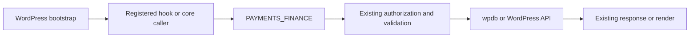

# PAYMENTS_FINANCE — پرداخت، فیش و مالی

Status: OBSERVED static source, baseline 2.0.235 / 2026-11-12. Human specialist: UNASSIGNED; repository owner: @mehrdadhafezi.

## 1. Purpose & Scope

پرداخت گروهی، بازبینی رسید، محافظ جلسه درگاه و نمای مالی. کد pending به معنی paid نیست. فقط inquiry قطعی مجاز است درخواست pending را بازنشسته کند. lock مرحله، پرداخت تکراری، مبالغ و عدم double-credit حفظ شوند. approval در هسته نیز قرار دارد. این قرارداد برای توسعه ماژول موجود است؛ بازطراحی فرآیند تجاری خارج از محدوده است.

## 2. File Structure

- [includes/class-sn-payment-transactions.php:1](../../includes/class-sn-payment-transactions.php#L1): `SN_Payment_Transactions`
- [includes/class-sn-payment-batch.php:1](../../includes/class-sn-payment-batch.php#L1): `SN_Payment_Batch`
- [includes/class-sn-payment-management-state.php:1](../../includes/class-sn-payment-management-state.php#L1): `SN_Payment_Management_State`
- [includes/class-sn-payment-gateway-guard.php:1](../../includes/class-sn-payment-gateway-guard.php#L1): `SN_Payment_Gateway_Guard`
- [includes/class-sn-receipt-review.php:1](../../includes/class-sn-receipt-review.php#L1): `SN_Receipt_Review`

متدهای راهنما (نام و محل واقعی؛ قرارداد کامل را در declaration بخوانید):

- [includes/class-sn-payment-batch.php:9](../../includes/class-sn-payment-batch.php#L9) — `decode`
- [includes/class-sn-payment-batch.php:22](../../includes/class-sn-payment-batch.php#L22) — `check_files`
- [includes/class-sn-payment-batch.php:43](../../includes/class-sn-payment-batch.php#L43) — `fields`
- [includes/class-sn-payment-batch.php:90](../../includes/class-sn-payment-batch.php#L90) — `save`
- [includes/class-sn-payment-gateway-guard.php:6](../../includes/class-sn-payment-gateway-guard.php#L6) — `snapshot`
- [includes/class-sn-payment-gateway-guard.php:16](../../includes/class-sn-payment-gateway-guard.php#L16) — `check`
- [includes/class-sn-payment-management-state.php:6](../../includes/class-sn-payment-management-state.php#L6) — `describe`
- [includes/class-sn-payment-transactions.php:8](../../includes/class-sn-payment-transactions.php#L8) — `rows`
- [includes/class-sn-payment-transactions.php:34](../../includes/class-sn-payment-transactions.php#L34) — `proof_fields`
- [includes/class-sn-payment-transactions.php:39](../../includes/class-sn-payment-transactions.php#L39) — `pending_rows`
- [includes/class-sn-payment-transactions.php:45](../../includes/class-sn-payment-transactions.php#L45) — `summary`
- [includes/class-sn-payment-transactions.php:62](../../includes/class-sn-payment-transactions.php#L62) — `parse_amount`

## 3. Execution Flow

مسیر مشاهده‌شده در سطح ماژول: bootstrap وردپرس، ثبت hook یا caller هسته، سپس متد ماژول. شکل زیر نمای ساختاری است؛ ترتیب همه callbackها را تضمین نمی‌کند.

## 4. Coding Standards

[استاندارد توسعه](../DEVELOPMENT_STANDARDS.md) لازم است. فقط مسیرهای این ماژول که در تسک مجاز شده‌اند تغییر کنند. متدهای عمومی و hookهای موجود rename نشوند. اشتراک در SN_Plugin به معنی مجوز تغییر تمام هسته نیست. کد pending به معنی paid نیست. فقط inquiry قطعی مجاز است درخواست pending را بازنشسته کند. lock مرحله، پرداخت تکراری، مبالغ و عدم double-credit حفظ شوند. approval در هسته نیز قرار دارد.

## 5. Component & Interface Contracts

کلاس‌ها و متدهای بخش ۲ interface فعلی‌اند؛ امضا، مقدار پیش‌فرض و return type از سورس مرجع حفظ شوند. برای ورودی و خروجی کامل هر درخواست [API_CONTRACTS.md](../API_CONTRACTS.md) و handler متناظر را با هم بخوانید. شِمای exhaustively verified برای همه payloadها: UNVERIFIED؛ lexical index جایگزین بررسی handler نیست. خطاهای کاربر فارسی و امن باشند و رفتار فعلی status/redirect حفظ شود.

## 6. Adding or Modifying Features

1. رفتار فعلی و معیار پذیرش را از تسک و caller اثبات کنید.
2. مجوز مسیر و بازبینی مالک برای نقاط حساس را بررسی کنید.
3. تغییر محدود انجام دهید؛ migration، Role، API یا side effect جدید بدون شرح و تأیید وارد نشود.
4. سناریوهای بخش ۸ و Syntax را اجرا کنید؛ تست اجرا‌نشده را NOT_RUN بنویسید.
5. این قرارداد، API/schema مرتبط و گزارش PR را به‌روز کنید.

## 7. Data Ownership & Integrity

کد pending به معنی paid نیست. فقط inquiry قطعی مجاز است درخواست pending را بازنشسته کند. lock مرحله، پرداخت تکراری، مبالغ و عدم double-credit حفظ شوند. approval در هسته نیز قرار دارد.

نام‌های جدول literal مشاهده‌شده و traceشده در DDL/اتصال prefix (فهرست runtime کامل نیست): `sn_invoice_payment_stages`, `sn_invoices`, `sn_payment_review_events`, `sn_payments`, `sn_wallet_transactions`

DDL و PK/indexها: [DATABASE_SCHEMA_AUDIT.md](../audit/DATABASE_SCHEMA_AUDIT.md). اطلاعات مشتری، مالی، token و snapshot داده حساس‌اند. رابطه‌ای که فقط در کد وجود دارد Foreign Key فرض نشود. حذف history، double-credit و استفاده از رکورد خارج از scope ممنوع است.

## 8. Testing & Preview

سناریوهای ضروری این ماژول: استعلام ساختگی؛ مبلغ/order mismatch؛ ثبت دستی همزمان با callback؛ فیش چندگانه؛ MIME جعلی؛ last4 اختیاری با صفر اول؛ تأیید/رد بدون cap.

Syntax و Secret Scan در CI فعال‌اند. [ماتریس تست](../TESTING_STANDARDS.md) وضعیت زیرساخت را مشخص می‌کند. تست MIS فقط در محیط disposable با guard مجاز است؛ سایر سناریوها که fixture ندارند NOT_IMPLEMENTED هستند. پیش‌نمایش UI و تست authorization واقعی نیازمند سایت آزمایشی ایزوله است.

## 9. API & Integration Contracts

ثبت‌های literal مرتبط (اگر action با حلقه یا نام پویا ساخته شود باید caller را نیز بررسی کنید):

NOT_APPLICABLE برای endpoint literal مستقل در این فایل‌ها؛ callerهای هسته و فهرست hookها را بررسی کنید.

فهرست ثبت کامل در [HOOK_API_INDEX.md](../audit/HOOK_API_INDEX.md) و امضاها در [SOURCE_SYMBOLS.json](../audit/SOURCE_SYMBOLS.json). auth، nonce، scope، ورودی/خروجی و کد خطا باید برای handler تغییرکرده مستقیماً مستند شوند؛ endpoint جدید در این سند ساخته نشده است.

## 10. Administrative & Role Behavior

مجوز جاری از handler، SN_HR_Service/SN_Scope_Service و capabilityهای ثبت‌شده خوانده می‌شود. مخفی‌کردن دکمه مجوز backend نیست. تغییر cap، role، نگاشت HR یا scope نیازمند تسک مستقل و تأیید مالک است. ماتریس تست‌شده نقش‌ها در Production: UNVERIFIED. درخواست فاقد احراز هویت، nonce لازم یا scope باید با الگوی موجود رد شود.

## 11. Compatibility & Change History

R1 در 2026-11-12 فقط کد موجود نسخه 2.0.235 را مستند کرده است؛ کد PHP/JS/CSS تغییر نکرده است. Header: WordPress >=6.0 و PHP >=8.0؛ سازگاری runtime تمام نسخه‌ها در این جلسه UNVERIFIED. تاریخچه Releaseهای قدیمی شواهد تاریخی است و به معنی PASS این نسخه نیست. Merge و Deployment این مأموریت انجام نمی‌شود.
