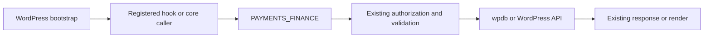

# PAYMENTS_FINANCE — پرداخت، فیش و مالی

Status: OBSERVED static source, baseline 2.0.235 / 2026-11-12. Human specialist: UNASSIGNED; repository owner: @mehrdadhafezi.

## 1. Purpose & Scope

2.0.245 follow-up: Finance approval of an already verified online stage uses its
existing bank receipt, not the manual receipt guard. Under the invoice/stage
transaction, require exactly one active verified gateway request with matching
amount, reference and source; conflicting requests or live manual receipts block
approval. Mark that same receipt paid atomically with the stage and invoice.
Optional `payment_stage_no` on the existing approval request rejects a stale
displayed stage. `review_gateway_stage` is a list UI hint only; it grants no access.

Local 2.0.244 Finance hotfix preserves gross first-stage capacity after a partial
receipt approval. A full first stage reduced exactly to its remaining balance can
be reconciled only within an authorized, locked receipt approve/reject operation,
with matching paid/due/total evidence, one canonical stage, no overpayment and an
audit event. Ambiguous partial stages remain blocked; there is no background
financial repair. Catalog normalization skips stages with any receipt history or
stored paid money. Finance list/KPI queries use grouped receipt projections while
retaining existing bucket priority, permissions, filters, sums and sorting.
No schema, capability, public token or commission-rate changes are included.

2.0.243 fixes the natural pending-to-verified online receipt boundary for new
staged Dot purchases, and exposes paid stage aliases separately from purchase
settlement. New Zibal order references are stored in existing proof metadata;
legacy orders retain unsuffixed inquiry matching. No authorization/token/DDL
changes or automatic reconciliation of historical failures are included. See
[the release contract](../RELEASE_2.0.243_STAGED_GATEWAY.md).

پرداخت گروهی، بازبینی رسید، محافظ جلسه درگاه و نمای مالی. کد pending به معنی paid نیست. فقط inquiry قطعی مجاز است درخواست pending را بازنشسته کند. lock مرحله، پرداخت تکراری، مبالغ و عدم double-credit حفظ شوند. approval در هسته نیز قرار دارد. این قرارداد برای توسعه ماژول موجود است؛ بازطراحی فرآیند تجاری خارج از محدوده است.

## 2. File Structure

- [includes/class-sn-payment-transactions.php:1](../../includes/class-sn-payment-transactions.php#L1): `SN_Payment_Transactions`
- [includes/class-sn-payment-batch.php:1](../../includes/class-sn-payment-batch.php#L1): `SN_Payment_Batch`
- [includes/class-sn-payment-management-state.php:1](../../includes/class-sn-payment-management-state.php#L1): `SN_Payment_Management_State`
- [includes/class-sn-payment-gateway-guard.php:1](../../includes/class-sn-payment-gateway-guard.php#L1): `SN_Payment_Gateway_Guard`
- [includes/class-sn-receipt-review.php:1](../../includes/class-sn-receipt-review.php#L1): `SN_Receipt_Review`

متدهای راهنما (نام و محل واقعی؛ قرارداد کامل را در declaration بخوانید):

- [includes/class-sn-payment-batch.php:9](../../includes/class-sn-payment-batch.php#L9) — `decode`
- [includes/class-sn-payment-batch.php:22](../../includes/class-sn-payment-batch.php#L22) — `check_files`
- [includes/class-sn-payment-batch.php:43](../../includes/class-sn-payment-batch.php#L43) — `fields`
- [includes/class-sn-payment-batch.php:90](../../includes/class-sn-payment-batch.php#L90) — `save`
- [includes/class-sn-payment-gateway-guard.php:6](../../includes/class-sn-payment-gateway-guard.php#L6) — `snapshot`
- [includes/class-sn-payment-gateway-guard.php:16](../../includes/class-sn-payment-gateway-guard.php#L16) — `check`
- [includes/class-sn-payment-management-state.php:6](../../includes/class-sn-payment-management-state.php#L6) — `describe`
- [includes/class-sn-payment-transactions.php:8](../../includes/class-sn-payment-transactions.php#L8) — `rows`
- [includes/class-sn-payment-transactions.php:34](../../includes/class-sn-payment-transactions.php#L34) — `proof_fields`
- [includes/class-sn-payment-transactions.php:39](../../includes/class-sn-payment-transactions.php#L39) — `pending_rows`
- [includes/class-sn-payment-transactions.php:45](../../includes/class-sn-payment-transactions.php#L45) — `summary`
- [includes/class-sn-payment-transactions.php:62](../../includes/class-sn-payment-transactions.php#L62) — `parse_amount`

## 3. Execution Flow

مسیر مشاهده‌شده در سطح ماژول: bootstrap وردپرس، ثبت hook یا caller هسته، سپس متد ماژول. شکل زیر نمای ساختاری است؛ ترتیب همه callbackها را تضمین نمی‌کند.

## 4. Coding Standards

[استاندارد توسعه](../DEVELOPMENT_STANDARDS.md) لازم است. فقط مسیرهای این ماژول که در تسک مجاز شده‌اند تغییر کنند. متدهای عمومی و hookهای موجود rename نشوند. اشتراک در SN_Plugin به معنی مجوز تغییر تمام هسته نیست. کد pending به معنی paid نیست. فقط inquiry قطعی مجاز است درخواست pending را بازنشسته کند. lock مرحله، پرداخت تکراری، مبالغ و عدم double-credit حفظ شوند. approval در هسته نیز قرار دارد.

## 5. Component & Interface Contracts

Unreleased local traceability adds stable PAY/STG references to authorized read
projections and CSV exports. New classic Dot purchases use canonical invoice
stages and an explicit adapter marker, without changing legacy receipts. See the
[scope, compatibility and rollback limits](../tasks/INVOICE_PAYMENT_TRACEABILITY.md).

2.0.240 adds an explicit internal manual-method choice after matched fresh Zibal
inquiries. `manual_hold` is local intent, not provider cancellation or approved
money. Existing `proof_data` preserves actor/time/provider observation atomically;
authority and amount remain intact. Finance freshly re-inquires held requests.
Verified late callbacks preserve their reference as `reconcile_error` under the
same stage lock, without duplicate stage/wallet credit. Unreconciled bank payment
blocks further manual action, including when a later stage is open. Only the
existing confirmed-terminal statuses retire a request as failed. See
[2.0.240 task and rollback limits](../tasks/GATEWAY_MANUAL_PAYMENT_240.md).

کلاس‌ها و متدهای بخش ۲ interface فعلی‌اند؛ امضا، مقدار پیش‌فرض و return type از سورس مرجع حفظ شوند. برای ورودی و خروجی کامل هر درخواست [API_CONTRACTS.md](../API_CONTRACTS.md) و handler متناظر را با هم بخوانید. شِمای exhaustively verified برای همه payloadها: UNVERIFIED؛ lexical index جایگزین بررسی handler نیست. خطاهای کاربر فارسی و امن باشند و رفتار فعلی status/redirect حفظ شود.

## 6. Adding or Modifying Features

1. رفتار فعلی و معیار پذیرش را از تسک و caller اثبات کنید.
2. مجوز مسیر و بازبینی مالک برای نقاط حساس را بررسی کنید.
3. تغییر محدود انجام دهید؛ migration، Role، API یا side effect جدید بدون شرح و تأیید وارد نشود.
4. سناریوهای بخش ۸ و Syntax را اجرا کنید؛ تست اجرا‌نشده را NOT_RUN بنویسید.
5. این قرارداد، API/schema مرتبط و گزارش PR را به‌روز کنید.

## 7. Data Ownership & Integrity

کد pending به معنی paid نیست. فقط inquiry قطعی مجاز است درخواست pending را بازنشسته کند. lock مرحله، پرداخت تکراری، مبالغ و عدم double-credit حفظ شوند. approval در هسته نیز قرار دارد.

نام‌های جدول literal مشاهده‌شده و traceشده در DDL/اتصال prefix (فهرست runtime کامل نیست): `sn_invoice_payment_stages`, `sn_invoices`, `sn_payment_review_events`, `sn_payments`, `sn_wallet_transactions`

DDL و PK/indexها: [DATABASE_SCHEMA_AUDIT.md](../audit/DATABASE_SCHEMA_AUDIT.md). اطلاعات مشتری، مالی، token و snapshot داده حساس‌اند. رابطه‌ای که فقط در کد وجود دارد Foreign Key فرض نشود. حذف history، double-credit و استفاده از رکورد خارج از scope ممنوع است.

Optional full bank references are per-payment proof metadata, distinct from
gateway verification and the legacy six-digit hint. Both receipt/info registration
and correction support the optional key; authorized history shows it. No schema,
role, amount or provider change. See the
[tracking-number contract](../tasks/PAYMENT_TRACKING_NUMBER.md).

## 8. Testing & Preview

`php tests/payments/gateway-manual-selection.php` requires SQLite3 and uses only
memory. `gateway-manual-native.php`, `gateway-manual-race.php` and
`gateway-manual-browser.cjs` require a guarded disposable synthetic WordPress/DB
site. They are never authorized against Production, an existing customer clone
or the canonical Staging owner's records. The native suite covers the actual
handlers, provider mismatches, late callbacks, receipt decisions and report totals;
race workers use real MySQL locks and independent PHP processes. Browser evidence
must include actual multipart parsing/MIME validation, not an upload mock.

Read-only approval visibility regression: `php tests/payments/approval-visibility.php`
requires PHP CLI with SQLite3 and uses an in-memory synthetic schema, without a
WordPress bootstrap, real provider, migration or financial writes. It checks stale
compatibility statuses, partial approvals, seller scope/nonce rejection and the
existing successful-payment report's ledger/fallback deduplication. Browser-state
regression: `node tests/payments/approval-visibility-ui.cjs`. These checks do not
replace WordPress/MySQL integration or validation of a production invoice.

Native integration is defined by [the isolated payment suite](../../tests/payments/integration/README.md)
and the `Finance approval integration` Actions workflow. It tests actual MySQL,
WordPress sessions/nonces, financial decision concurrency/rollback and the panels
on upgrade from both accepted source baselines. Use the exact-head workflow
result and its synthetic artifacts as evidence, not the presence of the runner.

سناریوهای ضروری این ماژول: استعلام ساختگی؛ مبلغ/order mismatch؛ ثبت دستی همزمان با callback؛ فیش چندگانه؛ MIME جعلی؛ last4 اختیاری با صفر اول؛ تأیید/رد بدون cap.

Syntax و Secret Scan در CI فعال‌اند. [ماتریس تست](../TESTING_STANDARDS.md) وضعیت زیرساخت را مشخص می‌کند. تست MIS فقط در محیط disposable با guard مجاز است؛ سایر سناریوها که fixture ندارند NOT_IMPLEMENTED هستند. پیش‌نمایش UI و تست authorization واقعی نیازمند سایت آزمایشی ایزوله است.

New tracking regressions: [local native/browser guide](../../tests/payments/TRACKING_NUMBER.md)
with standalone validation/SQL, real AJAX/upload/correction and wallet invariants.

## 9. API & Integration Contracts

ثبت‌های literal مرتبط (اگر action با حلقه یا نام پویا ساخته شود باید caller را نیز بررسی کنید):

NOT_APPLICABLE برای endpoint literal مستقل در این فایل‌ها؛ callerهای هسته و فهرست hookها را بررسی کنید.

فهرست ثبت کامل در [HOOK_API_INDEX.md](../audit/HOOK_API_INDEX.md) و امضاها در [SOURCE_SYMBOLS.json](../audit/SOURCE_SYMBOLS.json). auth، nonce، scope، ورودی/خروجی و کد خطا باید برای handler تغییرکرده مستقیماً مستند شوند؛ endpoint جدید در این سند ساخته نشده است.

## 10. Administrative & Role Behavior

مجوز جاری از handler، SN_HR_Service/SN_Scope_Service و capabilityهای ثبت‌شده خوانده می‌شود. مخفی‌کردن دکمه مجوز backend نیست. تغییر cap، role، نگاشت HR یا scope نیازمند تسک مستقل و تأیید مالک است. ماتریس تست‌شده نقش‌ها در Production: UNVERIFIED. درخواست فاقد احراز هویت، nonce لازم یا scope باید با الگوی موجود رد شود.

## 11. Compatibility & Change History

R1 در 2026-11-12 فقط کد موجود نسخه 2.0.235 را مستند کرده است؛ کد PHP/JS/CSS تغییر نکرده است. Header: WordPress >=6.0 و PHP >=8.0؛ سازگاری runtime تمام نسخه‌ها در این جلسه UNVERIFIED. تاریخچه Releaseهای قدیمی شواهد تاریخی است و به معنی PASS این نسخه نیست. Merge و Deployment این مأموریت انجام نمی‌شود.
