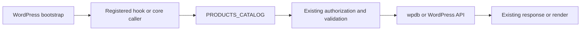

# PRODUCTS_CATALOG — محصولات و کاتالوگ فروش

Status: OBSERVED static source, baseline 2.0.235 / 2026-11-12. Human specialist: UNASSIGNED; repository owner: @mehrdadhafezi.

## 1. Purpose & Scope

محصول، همگام‌سازی کارت و تخفیف مجاز سمت سرور. قیمت و تخفیف دریافتی مرورگر قابل اعتماد نیست. snapshot تخفیف فاکتور حفظ شود. ensure_schema کاتالوگ می‌تواند اصلاح داده قبلی انجام دهد و اجرای آن مجوز جدا می‌خواهد. این قرارداد برای توسعه ماژول موجود است؛ بازطراحی فرآیند تجاری خارج از محدوده است.

## 2. File Structure

- [includes/class-sn-product-flow.php:1](../../includes/class-sn-product-flow.php#L1): `SN_Product_Flow`
- [includes/class-sn-product-card-sync.php:1](../../includes/class-sn-product-card-sync.php#L1): `SN_Product_Card_Sync`
- [includes/class-sn-sales-catalog.php:1](../../includes/class-sn-sales-catalog.php#L1): `SN_Sales_Catalog`

متدهای راهنما (نام و محل واقعی؛ قرارداد کامل را در declaration بخوانید):

- [includes/class-sn-product-card-sync.php:9](../../includes/class-sn-product-card-sync.php#L9) — `instance`
- [includes/class-sn-product-card-sync.php:10](../../includes/class-sn-product-card-sync.php#L10) — `register_hooks`
- [includes/class-sn-product-card-sync.php:15](../../includes/class-sn-product-card-sync.php#L15) — `enqueue`
- [includes/class-sn-product-card-sync.php:21](../../includes/class-sn-product-card-sync.php#L21) — `render_controls`
- [includes/class-sn-product-card-sync.php:38](../../includes/class-sn-product-card-sync.php#L38) — `table`
- [includes/class-sn-product-card-sync.php:43](../../includes/class-sn-product-card-sync.php#L43) — `authorize`
- [includes/class-sn-product-card-sync.php:51](../../includes/class-sn-product-card-sync.php#L51) — `schema`
- [includes/class-sn-product-card-sync.php:64](../../includes/class-sn-product-card-sync.php#L64) — `config`
- [includes/class-sn-product-card-sync.php:72](../../includes/class-sn-product-card-sync.php#L72) — `fingerprint`
- [includes/class-sn-product-card-sync.php:73](../../includes/class-sn-product-card-sync.php#L73) — `key`
- [includes/class-sn-product-card-sync.php:74](../../includes/class-sn-product-card-sync.php#L74) — `persist`
- [includes/class-sn-product-card-sync.php:78](../../includes/class-sn-product-card-sync.php#L78) — `reason_sql`

## 3. Execution Flow

مسیر مشاهده‌شده در سطح ماژول: bootstrap وردپرس، ثبت hook یا caller هسته، سپس متد ماژول. شکل زیر نمای ساختاری است؛ ترتیب همه callbackها را تضمین نمی‌کند.

## 4. Coding Standards

[استاندارد توسعه](../DEVELOPMENT_STANDARDS.md) لازم است. فقط مسیرهای این ماژول که در تسک مجاز شده‌اند تغییر کنند. متدهای عمومی و hookهای موجود rename نشوند. اشتراک در SN_Plugin به معنی مجوز تغییر تمام هسته نیست. قیمت و تخفیف دریافتی مرورگر قابل اعتماد نیست. snapshot تخفیف فاکتور حفظ شود. ensure_schema کاتالوگ می‌تواند اصلاح داده قبلی انجام دهد و اجرای آن مجوز جدا می‌خواهد.

## 5. Component & Interface Contracts

کلاس‌ها و متدهای بخش ۲ interface فعلی‌اند؛ امضا، مقدار پیش‌فرض و return type از سورس مرجع حفظ شوند. برای ورودی و خروجی کامل هر درخواست [API_CONTRACTS.md](../API_CONTRACTS.md) و handler متناظر را با هم بخوانید. شِمای exhaustively verified برای همه payloadها: UNVERIFIED؛ lexical index جایگزین بررسی handler نیست. خطاهای کاربر فارسی و امن باشند و رفتار فعلی status/redirect حفظ شود.

## 6. Adding or Modifying Features

1. رفتار فعلی و معیار پذیرش را از تسک و caller اثبات کنید.
2. مجوز مسیر و بازبینی مالک برای نقاط حساس را بررسی کنید.
3. تغییر محدود انجام دهید؛ migration، Role، API یا side effect جدید بدون شرح و تأیید وارد نشود.
4. سناریوهای بخش ۸ و Syntax را اجرا کنید؛ تست اجرا‌نشده را NOT_RUN بنویسید.
5. این قرارداد، API/schema مرتبط و گزارش PR را به‌روز کنید.

## 7. Data Ownership & Integrity

قیمت و تخفیف دریافتی مرورگر قابل اعتماد نیست. snapshot تخفیف فاکتور حفظ شود. ensure_schema کاتالوگ می‌تواند اصلاح داده قبلی انجام دهد و اجرای آن مجوز جدا می‌خواهد.

نام‌های جدول literal مشاهده‌شده و traceشده در DDL/اتصال prefix (فهرست runtime کامل نیست): `sn_hr_assignments`, `sn_hr_position_role_mappings`, `sn_hr_positions`, `sn_hr_profiles`, `sn_invoice_items`, `sn_invoice_payment_stages`, `sn_invoices`, `sn_payments`, `sn_product_flow_events`, `sn_shipping_order_logs`, `sn_shipping_orders`

DDL و PK/indexها: [DATABASE_SCHEMA_AUDIT.md](../audit/DATABASE_SCHEMA_AUDIT.md). اطلاعات مشتری، مالی، token و snapshot داده حساس‌اند. رابطه‌ای که فقط در کد وجود دارد Foreign Key فرض نشود. حذف history، double-credit و استفاده از رکورد خارج از scope ممنوع است.

## 8. Testing & Preview

سناریوهای ضروری این ماژول: محصول ممنوع برای مدیر؛ تخفیف دستکاری‌شده؛ WooCommerce غایب؛ تصویر و RTL؛ مجموع و باقی‌مانده مرحله پرداخت.

Syntax و Secret Scan در CI فعال‌اند. [ماتریس تست](../TESTING_STANDARDS.md) وضعیت زیرساخت را مشخص می‌کند. تست MIS فقط در محیط disposable با guard مجاز است؛ سایر سناریوها که fixture ندارند NOT_IMPLEMENTED هستند. پیش‌نمایش UI و تست authorization واقعی نیازمند سایت آزمایشی ایزوله است.

## 9. API & Integration Contracts

ثبت‌های literal مرتبط (اگر action با حلقه یا نام پویا ساخته شود باید caller را نیز بررسی کنید):

- `add_action`: `admin_enqueue_scripts` — [includes/class-sn-product-card-sync.php:11](../../includes/class-sn-product-card-sync.php#L11)
- `add_action`: `wp_ajax_sn_product_card_sync_preview` — [includes/class-sn-product-card-sync.php:12](../../includes/class-sn-product-card-sync.php#L12)
- `add_action`: `wp_ajax_sn_product_card_sync_apply` — [includes/class-sn-product-card-sync.php:13](../../includes/class-sn-product-card-sync.php#L13)
- `add_action`: `init` — [includes/class-sn-product-flow.php:32](../../includes/class-sn-product-flow.php#L32)
- `add_action`: `admin_init` — [includes/class-sn-product-flow.php:33](../../includes/class-sn-product-flow.php#L33)
- `add_action`: `sn_invoice_paid` — [includes/class-sn-product-flow.php:34](../../includes/class-sn-product-flow.php#L34)
- `add_action`: `admin_post_sn_shipping_update_order` — [includes/class-sn-product-flow.php:35](../../includes/class-sn-product-flow.php#L35)
- `add_action`: `wp_ajax_sn_supervisor_change_subscription` — [includes/class-sn-product-flow.php:36](../../includes/class-sn-product-flow.php#L36)
- `add_action`: `admin_menu` — [includes/class-sn-sales-catalog.php:17](../../includes/class-sn-sales-catalog.php#L17)
- `add_action`: `admin_enqueue_scripts` — [includes/class-sn-sales-catalog.php:18](../../includes/class-sn-sales-catalog.php#L18)
- `add_action`: `wp_enqueue_scripts` — [includes/class-sn-sales-catalog.php:19](../../includes/class-sn-sales-catalog.php#L19)
- `add_action`: `init` — [includes/class-sn-sales-catalog.php:20](../../includes/class-sn-sales-catalog.php#L20)
- `add_action`: `wp_ajax_sn_sales_catalog_load` — [includes/class-sn-sales-catalog.php:21](../../includes/class-sn-sales-catalog.php#L21)
- `add_action`: `wp_ajax_sn_sales_catalog_save` — [includes/class-sn-sales-catalog.php:22](../../includes/class-sn-sales-catalog.php#L22)
- `add_action`: `wp_ajax_sn_sales_catalog_staff` — [includes/class-sn-sales-catalog.php:23](../../includes/class-sn-sales-catalog.php#L23)

فهرست ثبت کامل در [HOOK_API_INDEX.md](../audit/HOOK_API_INDEX.md) و امضاها در [SOURCE_SYMBOLS.json](../audit/SOURCE_SYMBOLS.json). auth، nonce، scope، ورودی/خروجی و کد خطا باید برای handler تغییرکرده مستقیماً مستند شوند؛ endpoint جدید در این سند ساخته نشده است.

## 10. Administrative & Role Behavior

مجوز جاری از handler، SN_HR_Service/SN_Scope_Service و capabilityهای ثبت‌شده خوانده می‌شود. مخفی‌کردن دکمه مجوز backend نیست. تغییر cap، role، نگاشت HR یا scope نیازمند تسک مستقل و تأیید مالک است. ماتریس تست‌شده نقش‌ها در Production: UNVERIFIED. درخواست فاقد احراز هویت، nonce لازم یا scope باید با الگوی موجود رد شود.

## 11. Compatibility & Change History

R1 در 2026-11-12 فقط کد موجود نسخه 2.0.235 را مستند کرده است؛ کد PHP/JS/CSS تغییر نکرده است. Header: WordPress >=6.0 و PHP >=8.0؛ سازگاری runtime تمام نسخه‌ها در این جلسه UNVERIFIED. تاریخچه Releaseهای قدیمی شواهد تاریخی است و به معنی PASS این نسخه نیست. Merge و Deployment این مأموریت انجام نمی‌شود.
