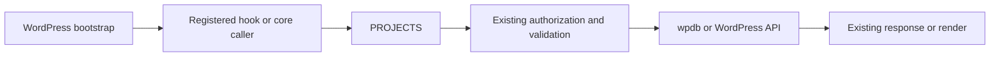

# PROJECTS — پروژه‌ها و عضویت

Status: OBSERVED static source, baseline 2.0.235 / 2026-11-12. Human specialist: UNASSIGNED; repository owner: @mehrdadhafezi.

## 1. Purpose & Scope

پروژه، عضویت، پیام، اعلان و ledger مرتبط. عضویت و کیف پول پروژه با تأیید مالی ارتباط دارند؛ دسترسی گفتگو و اعلان باید به عضو همان پروژه محدود بماند. این قرارداد برای توسعه ماژول موجود است؛ بازطراحی فرآیند تجاری خارج از محدوده است.

## 2. File Structure

- [includes/class-sn-projects.php:1](../../includes/class-sn-projects.php#L1): `SN_Projects`

متدهای راهنما (نام و محل واقعی؛ قرارداد کامل را در declaration بخوانید):

- [includes/class-sn-projects.php:19](../../includes/class-sn-projects.php#L19) — `instance`
- [includes/class-sn-projects.php:24](../../includes/class-sn-projects.php#L24) — `__construct`
- [includes/class-sn-projects.php:26](../../includes/class-sn-projects.php#L26) — `activate`
- [includes/class-sn-projects.php:32](../../includes/class-sn-projects.php#L32) — `register_hooks`
- [includes/class-sn-projects.php:72](../../includes/class-sn-projects.php#L72) — `register_shortcodes`
- [includes/class-sn-projects.php:77](../../includes/class-sn-projects.php#L77) — `maybe_upgrade`
- [includes/class-sn-projects.php:86](../../includes/class-sn-projects.php#L86) — `tables`
- [includes/class-sn-projects.php:111](../../includes/class-sn-projects.php#L111) — `table_exists`
- [includes/class-sn-projects.php:119](../../includes/class-sn-projects.php#L119) — `install_schema`
- [includes/class-sn-projects.php:473](../../includes/class-sn-projects.php#L473) — `ensure_membership_item_columns`
- [includes/class-sn-projects.php:489](../../includes/class-sn-projects.php#L489) — `ensure_action_api_columns`
- [includes/class-sn-projects.php:504](../../includes/class-sn-projects.php#L504) — `ensure_membership_chat_columns`

## 3. Execution Flow

مسیر مشاهده‌شده در سطح ماژول: bootstrap وردپرس، ثبت hook یا caller هسته، سپس متد ماژول. شکل زیر نمای ساختاری است؛ ترتیب همه callbackها را تضمین نمی‌کند.

## 4. Coding Standards

[استاندارد توسعه](../DEVELOPMENT_STANDARDS.md) لازم است. فقط مسیرهای این ماژول که در تسک مجاز شده‌اند تغییر کنند. متدهای عمومی و hookهای موجود rename نشوند. اشتراک در SN_Plugin به معنی مجوز تغییر تمام هسته نیست. عضویت و کیف پول پروژه با تأیید مالی ارتباط دارند؛ دسترسی گفتگو و اعلان باید به عضو همان پروژه محدود بماند.

## 5. Component & Interface Contracts

کلاس‌ها و متدهای بخش ۲ interface فعلی‌اند؛ امضا، مقدار پیش‌فرض و return type از سورس مرجع حفظ شوند. برای ورودی و خروجی کامل هر درخواست [API_CONTRACTS.md](../API_CONTRACTS.md) و handler متناظر را با هم بخوانید. شِمای exhaustively verified برای همه payloadها: UNVERIFIED؛ lexical index جایگزین بررسی handler نیست. خطاهای کاربر فارسی و امن باشند و رفتار فعلی status/redirect حفظ شود.

## 6. Adding or Modifying Features

1. رفتار فعلی و معیار پذیرش را از تسک و caller اثبات کنید.
2. مجوز مسیر و بازبینی مالک برای نقاط حساس را بررسی کنید.
3. تغییر محدود انجام دهید؛ migration، Role، API یا side effect جدید بدون شرح و تأیید وارد نشود.
4. سناریوهای بخش ۸ و Syntax را اجرا کنید؛ تست اجرا‌نشده را NOT_RUN بنویسید.
5. این قرارداد، API/schema مرتبط و گزارش PR را به‌روز کنید.

## 7. Data Ownership & Integrity

عضویت و کیف پول پروژه با تأیید مالی ارتباط دارند؛ دسترسی گفتگو و اعلان باید به عضو همان پروژه محدود بماند.

نام‌های جدول literal مشاهده‌شده و traceشده در DDL/اتصال prefix (فهرست runtime کامل نیست): `sn_dot_cases`, `sn_dot_invoice_links`, `sn_hr_assignments`, `sn_hr_position_role_mappings`, `sn_hr_positions`, `sn_hr_profiles`, `sn_invoice_items`, `sn_invoice_payment_stages`, `sn_invoices`, `sn_project_actions`, `sn_project_api_configs`, `sn_project_card_upgrade_rules`, `sn_project_commission_rules`, `sn_project_commissions`, `sn_project_events`, `sn_project_invoice_links`, `sn_project_manager_products`, `sn_project_manager_sales_routes`, `sn_project_membership_items`, `sn_project_memberships`, `sn_project_message_reads`, `sn_project_messages`, `sn_project_notes`, `sn_project_operations`, `sn_project_operations_manager_products`, `sn_project_operations_sales_routes`, `sn_project_operations_supervisor_sales_routes`, `sn_project_subscription_contents`, `sn_project_subscriptions`, `sn_wallet_transactions`, `sn_wallets`

DDL و PK/indexها: [DATABASE_SCHEMA_AUDIT.md](../audit/DATABASE_SCHEMA_AUDIT.md). اطلاعات مشتری، مالی، token و snapshot داده حساس‌اند. رابطه‌ای که فقط در کد وجود دارد Foreign Key فرض نشود. حذف history، double-credit و استفاده از رکورد خارج از scope ممنوع است.

## 8. Testing & Preview

سناریوهای ضروری این ماژول: عضو/غیرعضو؛ پیام و unread؛ polling سبک؛ درخواست تکراری؛ وضعیت عضویت و ledger.

Syntax و Secret Scan در CI فعال‌اند. [ماتریس تست](../TESTING_STANDARDS.md) وضعیت زیرساخت را مشخص می‌کند. تست MIS فقط در محیط disposable با guard مجاز است؛ سایر سناریوها که fixture ندارند NOT_IMPLEMENTED هستند. پیش‌نمایش UI و تست authorization واقعی نیازمند سایت آزمایشی ایزوله است.

## 9. API & Integration Contracts

ثبت‌های literal مرتبط (اگر action با حلقه یا نام پویا ساخته شود باید caller را نیز بررسی کنید):

- `add_action`: `init` — [includes/class-sn-projects.php:35](../../includes/class-sn-projects.php#L35)
- `add_action`: `admin_init` — [includes/class-sn-projects.php:36](../../includes/class-sn-projects.php#L36)
- `add_action`: `init` — [includes/class-sn-projects.php:37](../../includes/class-sn-projects.php#L37)
- `add_action`: `wp_enqueue_scripts` — [includes/class-sn-projects.php:38](../../includes/class-sn-projects.php#L38)
- `add_filter`: `woocommerce_is_purchasable` — [includes/class-sn-projects.php:39](../../includes/class-sn-projects.php#L39)
- `add_filter`: `woocommerce_variation_is_purchasable` — [includes/class-sn-projects.php:40](../../includes/class-sn-projects.php#L40)
- `add_filter`: `woocommerce_product_is_visible` — [includes/class-sn-projects.php:41](../../includes/class-sn-projects.php#L41)
- `add_filter`: `woocommerce_add_to_cart_validation` — [includes/class-sn-projects.php:42](../../includes/class-sn-projects.php#L42)
- `add_action`: `sn_invoice_payment_stage_approved` — [includes/class-sn-projects.php:43](../../includes/class-sn-projects.php#L43)
- `add_action`: `sn_invoice_paid` — [includes/class-sn-projects.php:44](../../includes/class-sn-projects.php#L44)
- `add_action`: `sn_invoice_financial_rejected` — [includes/class-sn-projects.php:45](../../includes/class-sn-projects.php#L45)
- `add_action`: `sn_invoice_financial_reopened` — [includes/class-sn-projects.php:46](../../includes/class-sn-projects.php#L46)
- `add_action`: `wp_ajax_` — [includes/class-sn-projects.php:67](../../includes/class-sn-projects.php#L67)
- `add_action`: `admin_post_sn_project_download` — [includes/class-sn-projects.php:69](../../includes/class-sn-projects.php#L69)
- `add_shortcode`: `sn_project_manager_panel` — [includes/class-sn-projects.php:73](../../includes/class-sn-projects.php#L73)
- `add_shortcode`: `sn_project_expert_panel` — [includes/class-sn-projects.php:74](../../includes/class-sn-projects.php#L74)

فهرست ثبت کامل در [HOOK_API_INDEX.md](../audit/HOOK_API_INDEX.md) و امضاها در [SOURCE_SYMBOLS.json](../audit/SOURCE_SYMBOLS.json). auth، nonce، scope، ورودی/خروجی و کد خطا باید برای handler تغییرکرده مستقیماً مستند شوند؛ endpoint جدید در این سند ساخته نشده است.

## 10. Administrative & Role Behavior

مجوز جاری از handler، SN_HR_Service/SN_Scope_Service و capabilityهای ثبت‌شده خوانده می‌شود. مخفی‌کردن دکمه مجوز backend نیست. تغییر cap، role، نگاشت HR یا scope نیازمند تسک مستقل و تأیید مالک است. ماتریس تست‌شده نقش‌ها در Production: UNVERIFIED. درخواست فاقد احراز هویت، nonce لازم یا scope باید با الگوی موجود رد شود.

## 11. Compatibility & Change History

R1 در 2026-11-12 فقط کد موجود نسخه 2.0.235 را مستند کرده است؛ کد PHP/JS/CSS تغییر نکرده است. Header: WordPress >=6.0 و PHP >=8.0؛ سازگاری runtime تمام نسخه‌ها در این جلسه UNVERIFIED. تاریخچه Releaseهای قدیمی شواهد تاریخی است و به معنی PASS این نسخه نیست. Merge و Deployment این مأموریت انجام نمی‌شود.
