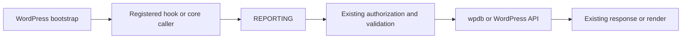

# REPORTING — گزارش‌ها و خروجی

Status: OBSERVED static source, baseline 2.0.235 / 2026-11-12. Human specialist: UNASSIGNED; repository owner: @mehrdadhafezi.

## 1. Purpose & Scope

گزارش عملیاتی و مدیریتی و export سفارش. scope گزارش و export یکسان بماند. خروجی هویتی/مالی داده حساس است. زمان محلی نمایش با timestamp ذخیره‌سازی یکسان فرض نشود. این قرارداد برای توسعه ماژول موجود است؛ بازطراحی فرآیند تجاری خارج از محدوده است.

## 2. File Structure

- [includes/reports/class-sn-report-service.php:1](../../includes/reports/class-sn-report-service.php#L1): `SN_Report_Service`
- [includes/reports/class-sn-report-executive.php:1](../../includes/reports/class-sn-report-executive.php#L1): `SN_Report_Executive`
- [includes/class-sn-bulk-order-export.php:1](../../includes/class-sn-bulk-order-export.php#L1): `SN_Bulk_Order_Export`

متدهای راهنما (نام و محل واقعی؛ قرارداد کامل را در declaration بخوانید):

- [includes/class-sn-bulk-order-export.php:14](../../includes/class-sn-bulk-order-export.php#L14) — `xml`
- [includes/class-sn-bulk-order-export.php:22](../../includes/class-sn-bulk-order-export.php#L22) — `row_xml`
- [includes/class-sn-bulk-order-export.php:34](../../includes/class-sn-bulk-order-export.php#L34) — `date_parts`
- [includes/class-sn-bulk-order-export.php:42](../../includes/class-sn-bulk-order-export.php#L42) — `values`
- [includes/class-sn-bulk-order-export.php:67](../../includes/class-sn-bulk-order-export.php#L67) — `query`
- [includes/class-sn-bulk-order-export.php:75](../../includes/class-sn-bulk-order-export.php#L75) — `write`
- [includes/class-sn-bulk-order-export.php:80](../../includes/class-sn-bulk-order-export.php#L80) — `download`
- [includes/reports/class-sn-report-executive.php:11](../../includes/reports/class-sn-report-executive.php#L11) — `__construct`
- [includes/reports/class-sn-report-executive.php:18](../../includes/reports/class-sn-report-executive.php#L18) — `under_person`
- [includes/reports/class-sn-report-executive.php:24](../../includes/reports/class-sn-report-executive.php#L24) — `definitions`
- [includes/reports/class-sn-report-executive.php:40](../../includes/reports/class-sn-report-executive.php#L40) — `filters`
- [includes/reports/class-sn-report-executive.php:52](../../includes/reports/class-sn-report-executive.php#L52) — `table_exists`

## 3. Execution Flow

مسیر مشاهده‌شده در سطح ماژول: bootstrap وردپرس، ثبت hook یا caller هسته، سپس متد ماژول. شکل زیر نمای ساختاری است؛ ترتیب همه callbackها را تضمین نمی‌کند.

## 4. Coding Standards

[استاندارد توسعه](../DEVELOPMENT_STANDARDS.md) لازم است. فقط مسیرهای این ماژول که در تسک مجاز شده‌اند تغییر کنند. متدهای عمومی و hookهای موجود rename نشوند. اشتراک در SN_Plugin به معنی مجوز تغییر تمام هسته نیست. scope گزارش و export یکسان بماند. خروجی هویتی/مالی داده حساس است. زمان محلی نمایش با timestamp ذخیره‌سازی یکسان فرض نشود.

## 5. Component & Interface Contracts

Local 2026-11-21 adds a read-only
[invoice financial reporting projection](../../includes/reports/class-sn-invoice-financial-report.php).
Admin `sn-invoices` uses approved/paid ledger rows for received money, separate
pending manual receipts, gateway reconciliation amounts, open/closed balances
and stored-vs-ledger discrepancies. Complete seller/customer aggregates have no
5000-invoice cutoff. Original invoice IDs/codes, typed XLS cells and formula-safe
CSV are specified in the [task contract](../tasks/INVOICE_FINANCIAL_REPORTING.md).
Existing report-panel successful-payment fallback semantics are unchanged.

Unreleased local traceability appends separate invoice/stage/transaction metadata
to existing authorized exports; amount units and totals stay unchanged. See the
[column semantics and compatibility limits](../tasks/INVOICE_PAYMENT_TRACEABILITY.md).

کلاس‌ها و متدهای بخش ۲ interface فعلی‌اند؛ امضا، مقدار پیش‌فرض و return type از سورس مرجع حفظ شوند. برای ورودی و خروجی کامل هر درخواست [API_CONTRACTS.md](../API_CONTRACTS.md) و handler متناظر را با هم بخوانید. شِمای exhaustively verified برای همه payloadها: UNVERIFIED؛ lexical index جایگزین بررسی handler نیست. خطاهای کاربر فارسی و امن باشند و رفتار فعلی status/redirect حفظ شود.

## 6. Adding or Modifying Features

1. رفتار فعلی و معیار پذیرش را از تسک و caller اثبات کنید.
2. مجوز مسیر و بازبینی مالک برای نقاط حساس را بررسی کنید.
3. تغییر محدود انجام دهید؛ migration، Role، API یا side effect جدید بدون شرح و تأیید وارد نشود.
4. سناریوهای بخش ۸ و Syntax را اجرا کنید؛ تست اجرا‌نشده را NOT_RUN بنویسید.
5. این قرارداد، API/schema مرتبط و گزارش PR را به‌روز کنید.

## 7. Data Ownership & Integrity

scope گزارش و export یکسان بماند. خروجی هویتی/مالی داده حساس است. زمان محلی نمایش با timestamp ذخیره‌سازی یکسان فرض نشود.

نام‌های جدول literal مشاهده‌شده و traceشده در DDL/اتصال prefix (فهرست runtime کامل نیست): `sn_invoice_items`, `sn_invoice_payment_stages`, `sn_invoices`, `sn_shipping_orders`

DDL و PK/indexها: [DATABASE_SCHEMA_AUDIT.md](../audit/DATABASE_SCHEMA_AUDIT.md). اطلاعات مشتری، مالی، token و snapshot داده حساس‌اند. رابطه‌ای که فقط در کد وجود دارد Foreign Key فرض نشود. حذف history، double-credit و استفاده از رکورد خارج از scope ممنوع است.

## 8. Testing & Preview

Invoice report regression: `tests/reporting/invoice-financial.php` uses synthetic
SQLite memory. Guarded native MySQL and real browser/CSV/XLS tests are documented
in [the reporting test guide](../../tests/reporting/README.md). These tests do not
authorize access to an existing site or establish production data parity.

`php tests/payments/approval-visibility.php` checks the successful-payment report
with a standalone synthetic SQLite adapter: approved receipts count once, pending
receipts are excluded, and an invoice fallback does not duplicate ledger stages.
Its existing successful-status contract is unchanged. Panel received totals are
separate from completed sales and retain the existing visibility scope. This is
query regression evidence, not a WordPress/MySQL or production audit.

The reconciled 2.0.238 candidate preserves the installed report-date validation,
Tehran day boundaries for manager leads, report-panel form anchor, invalid-range
errors and manager request cancellation. `php tests/reporting/date-filters.php`
executes 34 memory-only date, scope, money, pagination, invalid-input and read-only
regressions. `node tests/reporting/manager-refresh.cjs` executes 10 transport and
escaping regressions. The native integration suite also exercises the actual
reporting shortcode, hierarchy-scoped CSV export, nonces and formula safety.

The [native payment integration suite](../../tests/payments/integration/README.md)
also executes these queries on actual MySQL and checks live scoped panel totals
before/after synthetic receipt approval. Results are tied to its Actions head.

سناریوهای ضروری این ماژول: سطح self/team/manager/all؛ بازه تاریخ؛ مجوز export؛ totals با ردیف‌ها؛ UTF-8/RTL؛ XLSX formula safety.

Syntax و Secret Scan در CI فعال‌اند. [ماتریس تست](../TESTING_STANDARDS.md) وضعیت زیرساخت را مشخص می‌کند. تست MIS فقط در محیط disposable با guard مجاز است؛ سایر سناریوها که fixture ندارند NOT_IMPLEMENTED هستند. پیش‌نمایش UI و تست authorization واقعی نیازمند سایت آزمایشی ایزوله است.

## 9. API & Integration Contracts

ثبت‌های literal مرتبط (اگر action با حلقه یا نام پویا ساخته شود باید caller را نیز بررسی کنید):

NOT_APPLICABLE برای endpoint literal مستقل در این فایل‌ها؛ callerهای هسته و فهرست hookها را بررسی کنید.

فهرست ثبت کامل در [HOOK_API_INDEX.md](../audit/HOOK_API_INDEX.md) و امضاها در [SOURCE_SYMBOLS.json](../audit/SOURCE_SYMBOLS.json). auth، nonce، scope، ورودی/خروجی و کد خطا باید برای handler تغییرکرده مستقیماً مستند شوند؛ endpoint جدید در این سند ساخته نشده است.

## 10. Administrative & Role Behavior

مجوز جاری از handler، SN_HR_Service/SN_Scope_Service و capabilityهای ثبت‌شده خوانده می‌شود. مخفی‌کردن دکمه مجوز backend نیست. تغییر cap، role، نگاشت HR یا scope نیازمند تسک مستقل و تأیید مالک است. ماتریس تست‌شده نقش‌ها در Production: UNVERIFIED. درخواست فاقد احراز هویت، nonce لازم یا scope باید با الگوی موجود رد شود.

## 11. Compatibility & Change History

2.0.238 combines the installed reporting changes with the previously tested
finance visibility fix. The reporting service, executive service and manager
JavaScript remain byte-for-byte equal to the captured installed baseline.
No report permission, schema, assignment or financial-write contract is added.
See [reconciliation evidence](../audit/INSTALLED_SOURCE_2.0.237.md) and the latest
[PR #13 acceptance record](https://github.com/mehrdadhafezi/CRMEdits/pull/13).
Final-head checks and exact-artifact Staging acceptance remain required.

R1 در 2026-11-12 فقط کد موجود نسخه 2.0.235 را مستند کرده است؛ کد PHP/JS/CSS تغییر نکرده است. Header: WordPress >=6.0 و PHP >=8.0؛ سازگاری runtime تمام نسخه‌ها در این جلسه UNVERIFIED. تاریخچه Releaseهای قدیمی شواهد تاریخی است و به معنی PASS این نسخه نیست. Merge و Deployment این مأموریت انجام نمی‌شود.
