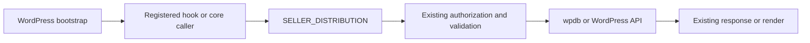

# SELLER_DISTRIBUTION — فروشنده و توزیع لید

Status: OBSERVED static source, baseline 2.0.235 / 2026-11-12. Human specialist: UNASSIGNED; repository owner: @mehrdadhafezi.

## 1. Purpose & Scope

وضعیت مرحله اول فروش، ثبت رویداد و بایگانی محدود. source_kind و source_id هویت مرجع را حفظ کنند. بایگانی به معنای حذف لید/فاکتور نیست. تغییر مالک نباید تاریخچه شاخه فروش قبلی را بازنویسی کند. این قرارداد برای توسعه ماژول موجود است؛ بازطراحی فرآیند تجاری خارج از محدوده است.

## 2. File Structure

- [includes/class-sn-seller-flow.php:1](../../includes/class-sn-seller-flow.php#L1): `SN_Seller_Flow`
- [includes/trait-sn-sales-branches.php:1](../../includes/trait-sn-sales-branches.php#L1): `SN_Sales_Branches`

متدهای راهنما (نام و محل واقعی؛ قرارداد کامل را در declaration بخوانید):

- [includes/class-sn-seller-flow.php:21](../../includes/class-sn-seller-flow.php#L21) — `instance`
- [includes/class-sn-seller-flow.php:26](../../includes/class-sn-seller-flow.php#L26) — `__construct`
- [includes/class-sn-seller-flow.php:28](../../includes/class-sn-seller-flow.php#L28) — `activate`
- [includes/class-sn-seller-flow.php:34](../../includes/class-sn-seller-flow.php#L34) — `deactivate`
- [includes/class-sn-seller-flow.php:38](../../includes/class-sn-seller-flow.php#L38) — `register_hooks`
- [includes/class-sn-seller-flow.php:47](../../includes/class-sn-seller-flow.php#L47) — `maybe_upgrade`
- [includes/class-sn-seller-flow.php:54](../../includes/class-sn-seller-flow.php#L54) — `tables`
- [includes/class-sn-seller-flow.php:62](../../includes/class-sn-seller-flow.php#L62) — `install_schema`
- [includes/class-sn-seller-flow.php:135](../../includes/class-sn-seller-flow.php#L135) — `ensure_status_catalog`
- [includes/class-sn-seller-flow.php:151](../../includes/class-sn-seller-flow.php#L151) — `ensure_schema`
- [includes/class-sn-seller-flow.php:162](../../includes/class-sn-seller-flow.php#L162) — `schedule_archive_job`
- [includes/class-sn-seller-flow.php:168](../../includes/class-sn-seller-flow.php#L168) — `statuses`

## 3. Execution Flow

مسیر مشاهده‌شده در سطح ماژول: bootstrap وردپرس، ثبت hook یا caller هسته، سپس متد ماژول. شکل زیر نمای ساختاری است؛ ترتیب همه callbackها را تضمین نمی‌کند.

## 4. Coding Standards

[استاندارد توسعه](../DEVELOPMENT_STANDARDS.md) لازم است. فقط مسیرهای این ماژول که در تسک مجاز شده‌اند تغییر کنند. متدهای عمومی و hookهای موجود rename نشوند. اشتراک در SN_Plugin به معنی مجوز تغییر تمام هسته نیست. source_kind و source_id هویت مرجع را حفظ کنند. بایگانی به معنای حذف لید/فاکتور نیست. تغییر مالک نباید تاریخچه شاخه فروش قبلی را بازنویسی کند.

## 5. Component & Interface Contracts

کلاس‌ها و متدهای بخش ۲ interface فعلی‌اند؛ امضا، مقدار پیش‌فرض و return type از سورس مرجع حفظ شوند. برای ورودی و خروجی کامل هر درخواست [API_CONTRACTS.md](../API_CONTRACTS.md) و handler متناظر را با هم بخوانید. شِمای exhaustively verified برای همه payloadها: UNVERIFIED؛ lexical index جایگزین بررسی handler نیست. خطاهای کاربر فارسی و امن باشند و رفتار فعلی status/redirect حفظ شود.

## 6. Adding or Modifying Features

1. رفتار فعلی و معیار پذیرش را از تسک و caller اثبات کنید.
2. مجوز مسیر و بازبینی مالک برای نقاط حساس را بررسی کنید.
3. تغییر محدود انجام دهید؛ migration، Role، API یا side effect جدید بدون شرح و تأیید وارد نشود.
4. سناریوهای بخش ۸ و Syntax را اجرا کنید؛ تست اجرا‌نشده را NOT_RUN بنویسید.
5. این قرارداد، API/schema مرتبط و گزارش PR را به‌روز کنید.

## 7. Data Ownership & Integrity

source_kind و source_id هویت مرجع را حفظ کنند. بایگانی به معنای حذف لید/فاکتور نیست. تغییر مالک نباید تاریخچه شاخه فروش قبلی را بازنویسی کند.

نام‌های جدول literal مشاهده‌شده و traceشده در DDL/اتصال prefix (فهرست runtime کامل نیست): `sn_distribution_items`, `sn_hr_assignments`, `sn_hr_positions`, `sn_hr_profiles`, `sn_invoice_items`, `sn_invoices`, `sn_lead_statuses`, `sn_leads`, `sn_mis_data_rows`, `sn_mis_lead_pool`, `sn_seller_flow_events`, `sn_seller_flow_states`

DDL و PK/indexها: [DATABASE_SCHEMA_AUDIT.md](../audit/DATABASE_SCHEMA_AUDIT.md). اطلاعات مشتری، مالی، token و snapshot داده حساس‌اند. رابطه‌ای که فقط در کد وجود دارد Foreign Key فرض نشود. حذف history، double-credit و استفاده از رکورد خارج از scope ممنوع است.

## 8. Testing & Preview

سناریوهای ضروری این ماژول: اولین/سومین عدم پاسخ؛ لغو؛ تخصیص مجدد؛ invoice linked؛ cron تکراری؛ لید خارج از scope.

Syntax و Secret Scan در CI فعال‌اند. [ماتریس تست](../TESTING_STANDARDS.md) وضعیت زیرساخت را مشخص می‌کند. تست MIS فقط در محیط disposable با guard مجاز است؛ سایر سناریوها که fixture ندارند NOT_IMPLEMENTED هستند. پیش‌نمایش UI و تست authorization واقعی نیازمند سایت آزمایشی ایزوله است.

## 9. API & Integration Contracts

ثبت‌های literal مرتبط (اگر action با حلقه یا نام پویا ساخته شود باید caller را نیز بررسی کنید):

- `add_action`: `init` — [includes/class-sn-seller-flow.php:41](../../includes/class-sn-seller-flow.php#L41)
- `add_action`: `admin_init` — [includes/class-sn-seller-flow.php:42](../../includes/class-sn-seller-flow.php#L42)
- `add_action`: `wp_ajax_sn_seller_flow_no_answer_attempt` — [includes/class-sn-seller-flow.php:44](../../includes/class-sn-seller-flow.php#L44)

فهرست ثبت کامل در [HOOK_API_INDEX.md](../audit/HOOK_API_INDEX.md) و امضاها در [SOURCE_SYMBOLS.json](../audit/SOURCE_SYMBOLS.json). auth، nonce، scope، ورودی/خروجی و کد خطا باید برای handler تغییرکرده مستقیماً مستند شوند؛ endpoint جدید در این سند ساخته نشده است.

## 10. Administrative & Role Behavior

مجوز جاری از handler، SN_HR_Service/SN_Scope_Service و capabilityهای ثبت‌شده خوانده می‌شود. مخفی‌کردن دکمه مجوز backend نیست. تغییر cap، role، نگاشت HR یا scope نیازمند تسک مستقل و تأیید مالک است. ماتریس تست‌شده نقش‌ها در Production: UNVERIFIED. درخواست فاقد احراز هویت، nonce لازم یا scope باید با الگوی موجود رد شود.

## 11. Compatibility & Change History

R1 در 2026-11-12 فقط کد موجود نسخه 2.0.235 را مستند کرده است؛ کد PHP/JS/CSS تغییر نکرده است. Header: WordPress >=6.0 و PHP >=8.0؛ سازگاری runtime تمام نسخه‌ها در این جلسه UNVERIFIED. تاریخچه Releaseهای قدیمی شواهد تاریخی است و به معنی PASS این نسخه نیست. Merge و Deployment این مأموریت انجام نمی‌شود.
