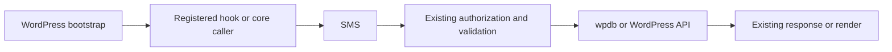

# SMS — پیامک

Status: OBSERVED static source, baseline 2.0.235 / 2026-11-12. Human specialist: UNASSIGNED; repository owner: @mehrdadhafezi.

## 1. Purpose & Scope

انتخاب provider، ارسال و قالب‌های پیامک. پروتکل provider، template، ارسال واقعی و اعتبارنامه فقط در تسک صریح این ماژول تغییر کنند. تست با HTTP stub و ارسال واقعی خاموش اجرا شود. این قرارداد برای توسعه ماژول موجود است؛ بازطراحی فرآیند تجاری خارج از محدوده است.

## 2. File Structure

- [includes/class-sn-sms.php:1](../../includes/class-sn-sms.php#L1): `SN_SMS`

متدهای راهنما (نام و محل واقعی؛ قرارداد کامل را در declaration بخوانید):

- [includes/class-sn-sms.php:15](../../includes/class-sn-sms.php#L15) — `configure_faraz_curl`
- [includes/class-sn-sms.php:23](../../includes/class-sn-sms.php#L23) — `transport_error_message`
- [includes/class-sn-sms.php:34](../../includes/class-sn-sms.php#L34) — `get_last_error`
- [includes/class-sn-sms.php:38](../../includes/class-sn-sms.php#L38) — `delivery_uncertain`
- [includes/class-sn-sms.php:43](../../includes/class-sn-sms.php#L43) — `provider_configuration`
- [includes/class-sn-sms.php:62](../../includes/class-sn-sms.php#L62) — `save_provider_settings_from_request`
- [includes/class-sn-sms.php:94](../../includes/class-sn-sms.php#L94) — `get_provider`
- [includes/class-sn-sms.php:95](../../includes/class-sn-sms.php#L95) — `get_sender`
- [includes/class-sn-sms.php:96](../../includes/class-sn-sms.php#L96) — `event_pattern`
- [includes/class-sn-sms.php:103](../../includes/class-sn-sms.php#L103) — `faraz_response_ok`
- [includes/class-sn-sms.php:148](../../includes/class-sn-sms.php#L148) — `__construct`
- [includes/class-sn-sms.php:170](../../includes/class-sn-sms.php#L170) — `allow_sms_hosts`

## 3. Execution Flow

مسیر مشاهده‌شده در سطح ماژول: bootstrap وردپرس، ثبت hook یا caller هسته، سپس متد ماژول. شکل زیر نمای ساختاری است؛ ترتیب همه callbackها را تضمین نمی‌کند.

## 4. Coding Standards

[استاندارد توسعه](../DEVELOPMENT_STANDARDS.md) لازم است. فقط مسیرهای این ماژول که در تسک مجاز شده‌اند تغییر کنند. متدهای عمومی و hookهای موجود rename نشوند. اشتراک در SN_Plugin به معنی مجوز تغییر تمام هسته نیست. پروتکل provider، template، ارسال واقعی و اعتبارنامه فقط در تسک صریح این ماژول تغییر کنند. تست با HTTP stub و ارسال واقعی خاموش اجرا شود.

## 5. Component & Interface Contracts

2.0.241 adds [SN_Invoice_SMS_Policy](../../includes/class-sn-invoice-sms-policy.php)
for global per-product invoice-link suppression. Existing products default on.
The WooCommerce product edit box saves a versioned postmeta policy with existing
product-edit capability and its own nonce. Every supported invoice-link caller
(initial issuance, resend, Dot and Operations) passes its real invoice ID to the
gate. A mixed invoice requires every product's SMS switch to be on. OTP and
payment acknowledgements remain independent; provider selection, credentials,
payload formats and protocol are unchanged.

Re-enabling never starts a background/bulk send. Administrators may separately
enable previous sends, preview a bounded page, and confirm that batch. Each item
rechecks product, policy revision, current unpaid/open state and durable unsent
evidence. Accepted, ambiguous/in-flight, paid, cancelled and unknown legacy cases
are excluded. Each HTTP request dispatches at most one item. Per-site invoice and
batch MySQL locks protect concurrent attempts. A failed final audit write retains
the durable in-flight claim, preventing a blind historical retry. New non-autoload
delivery options contain only state, actor ID, attempt ID and timestamp; no phone,
message, invoice URL/token or credential. Full SMS payload logging was removed
from the touched invoice-send path; the existing admin diagnostic option remains.

کلاس‌ها و متدهای بخش ۲ interface فعلی‌اند؛ امضا، مقدار پیش‌فرض و return type از سورس مرجع حفظ شوند. برای ورودی و خروجی کامل هر درخواست [API_CONTRACTS.md](../API_CONTRACTS.md) و handler متناظر را با هم بخوانید. شِمای exhaustively verified برای همه payloadها: UNVERIFIED؛ lexical index جایگزین بررسی handler نیست. خطاهای کاربر فارسی و امن باشند و رفتار فعلی status/redirect حفظ شود.

## 6. Adding or Modifying Features

1. رفتار فعلی و معیار پذیرش را از تسک و caller اثبات کنید.
2. مجوز مسیر و بازبینی مالک برای نقاط حساس را بررسی کنید.
3. تغییر محدود انجام دهید؛ migration، Role، API یا side effect جدید بدون شرح و تأیید وارد نشود.
4. سناریوهای بخش ۸ و Syntax را اجرا کنید؛ تست اجرا‌نشده را NOT_RUN بنویسید.
5. این قرارداد، API/schema مرتبط و گزارش PR را به‌روز کنید.

## 7. Data Ownership & Integrity

پروتکل provider، template، ارسال واقعی و اعتبارنامه فقط در تسک صریح این ماژول تغییر کنند. تست با HTTP stub و ارسال واقعی خاموش اجرا شود.

نام‌های جدول literal مشاهده‌شده در DDL/اتصال prefix (فهرست کامل runtime نیست): UNVERIFIED؛ بخشی از ذخیره‌سازی با نام پویا یا API وردپرس انجام می‌شود.

DDL و PK/indexها: [DATABASE_SCHEMA_AUDIT.md](../audit/DATABASE_SCHEMA_AUDIT.md). اطلاعات مشتری، مالی، token و snapshot داده حساس‌اند. رابطه‌ای که فقط در کد وجود دارد Foreign Key فرض نشود. حذف history، double-credit و استفاده از رکورد خارج از scope ممنوع است.

## 8. Testing & Preview

سناریوهای ضروری این ماژول: provider timeout؛ خطای upstream؛ قالب ناقص؛ جلوگیری از ارسال مجدد؛ لاگ بدون OTP/password/credential.

Syntax و Secret Scan در CI فعال‌اند. [ماتریس تست](../TESTING_STANDARDS.md) وضعیت زیرساخت را مشخص می‌کند. تست MIS فقط در محیط disposable با guard مجاز است؛ سایر سناریوها که fixture ندارند NOT_IMPLEMENTED هستند. پیش‌نمایش UI و تست authorization واقعی نیازمند سایت آزمایشی ایزوله است.

## 9. API & Integration Contracts

ثبت‌های literal مرتبط (اگر action با حلقه یا نام پویا ساخته شود باید caller را نیز بررسی کنید):

- `add_filter`: `http_request_host_is_external` — [includes/class-sn-sms.php:163](../../includes/class-sn-sms.php#L163)
- `add_filter`: `http_api_curl` — [includes/class-sn-sms.php:165](../../includes/class-sn-sms.php#L165)

فهرست ثبت کامل در [HOOK_API_INDEX.md](../audit/HOOK_API_INDEX.md) و امضاها در [SOURCE_SYMBOLS.json](../audit/SOURCE_SYMBOLS.json). auth، nonce، scope، ورودی/خروجی و کد خطا باید برای handler تغییرکرده مستقیماً مستند شوند؛ endpoint جدید در این سند ساخته نشده است.

## 10. Administrative & Role Behavior

مجوز جاری از handler، SN_HR_Service/SN_Scope_Service و capabilityهای ثبت‌شده خوانده می‌شود. مخفی‌کردن دکمه مجوز backend نیست. تغییر cap، role، نگاشت HR یا scope نیازمند تسک مستقل و تأیید مالک است. ماتریس تست‌شده نقش‌ها در Production: UNVERIFIED. درخواست فاقد احراز هویت، nonce لازم یا scope باید با الگوی موجود رد شود.

## 11. Compatibility & Change History

R1 در 2026-11-12 فقط کد موجود نسخه 2.0.235 را مستند کرده است؛ کد PHP/JS/CSS تغییر نکرده است. Header: WordPress >=6.0 و PHP >=8.0؛ سازگاری runtime تمام نسخه‌ها در این جلسه UNVERIFIED. تاریخچه Releaseهای قدیمی شواهد تاریخی است و به معنی PASS این نسخه نیست. Merge و Deployment این مأموریت انجام نمی‌شود.
