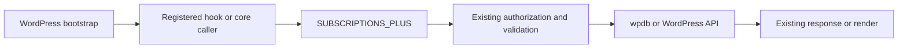

# SUBSCRIPTIONS_PLUS — اشتراک و Plus

Status: OBSERVED static source, baseline 2.0.235 / 2026-11-12. Human specialist: UNASSIGNED; repository owner: @mehrdadhafezi.

## 1. Purpose & Scope

فرم اشتراک، snapshot خرید Plus و تبدیل نقد/اعتبار. entitlement با وضعیت پرداخت، عضویت و snapshot سازگار بماند. انتخاب option_id و مبلغ فقط سمت سرور نهایی شود. این قرارداد برای توسعه ماژول موجود است؛ بازطراحی فرآیند تجاری خارج از محدوده است.

## 2. File Structure

- [includes/class-sn-subscription-form.php:1](../../includes/class-sn-subscription-form.php#L1): `SN_Subscription_Form`
- [includes/class-sn-subscription-plus.php:1](../../includes/class-sn-subscription-plus.php#L1): `SN_Subscription_Plus`
- [includes/class-sn-conversion-cash-credit.php:1](../../includes/class-sn-conversion-cash-credit.php#L1): `SN_Conversion_Cash_Credit`

متدهای راهنما (نام و محل واقعی؛ قرارداد کامل را در declaration بخوانید):

- [includes/class-sn-conversion-cash-credit.php:8](../../includes/class-sn-conversion-cash-credit.php#L8) — `instance`
- [includes/class-sn-conversion-cash-credit.php:12](../../includes/class-sn-conversion-cash-credit.php#L12) — `register_hooks`
- [includes/class-sn-conversion-cash-credit.php:16](../../includes/class-sn-conversion-cash-credit.php#L16) — `table`
- [includes/class-sn-conversion-cash-credit.php:21](../../includes/class-sn-conversion-cash-credit.php#L21) — `request`
- [includes/class-sn-conversion-cash-credit.php:29](../../includes/class-sn-conversion-cash-credit.php#L29) — `invoice`
- [includes/class-sn-conversion-cash-credit.php:34](../../includes/class-sn-conversion-cash-credit.php#L34) — `paid`
- [includes/class-sn-conversion-cash-credit.php:42](../../includes/class-sn-conversion-cash-credit.php#L42) — `completed_case`
- [includes/class-sn-conversion-cash-credit.php:68](../../includes/class-sn-conversion-cash-credit.php#L68) — `entitlement_active`
- [includes/class-sn-conversion-cash-credit.php:74](../../includes/class-sn-conversion-cash-credit.php#L74) — `verified_parent`
- [includes/class-sn-conversion-cash-credit.php:90](../../includes/class-sn-conversion-cash-credit.php#L90) — `resume_for_case`
- [includes/class-sn-conversion-cash-credit.php:98](../../includes/class-sn-conversion-cash-credit.php#L98) — `profile_credit`
- [includes/class-sn-conversion-cash-credit.php:115](../../includes/class-sn-conversion-cash-credit.php#L115) — `payment_allowed`

## 3. Execution Flow

مسیر مشاهده‌شده در سطح ماژول: bootstrap وردپرس، ثبت hook یا caller هسته، سپس متد ماژول. شکل زیر نمای ساختاری است؛ ترتیب همه callbackها را تضمین نمی‌کند.

## 4. Coding Standards

[استاندارد توسعه](../DEVELOPMENT_STANDARDS.md) لازم است. فقط مسیرهای این ماژول که در تسک مجاز شده‌اند تغییر کنند. متدهای عمومی و hookهای موجود rename نشوند. اشتراک در SN_Plugin به معنی مجوز تغییر تمام هسته نیست. entitlement با وضعیت پرداخت، عضویت و snapshot سازگار بماند. انتخاب option_id و مبلغ فقط سمت سرور نهایی شود.

## 5. Component & Interface Contracts

کلاس‌ها و متدهای بخش ۲ interface فعلی‌اند؛ امضا، مقدار پیش‌فرض و return type از سورس مرجع حفظ شوند. برای ورودی و خروجی کامل هر درخواست [API_CONTRACTS.md](../API_CONTRACTS.md) و handler متناظر را با هم بخوانید. شِمای exhaustively verified برای همه payloadها: UNVERIFIED؛ lexical index جایگزین بررسی handler نیست. خطاهای کاربر فارسی و امن باشند و رفتار فعلی status/redirect حفظ شود.

## 6. Adding or Modifying Features

1. رفتار فعلی و معیار پذیرش را از تسک و caller اثبات کنید.
2. مجوز مسیر و بازبینی مالک برای نقاط حساس را بررسی کنید.
3. تغییر محدود انجام دهید؛ migration، Role، API یا side effect جدید بدون شرح و تأیید وارد نشود.
4. سناریوهای بخش ۸ و Syntax را اجرا کنید؛ تست اجرا‌نشده را NOT_RUN بنویسید.
5. این قرارداد، API/schema مرتبط و گزارش PR را به‌روز کنید.

## 7. Data Ownership & Integrity

entitlement با وضعیت پرداخت، عضویت و snapshot سازگار بماند. انتخاب option_id و مبلغ فقط سمت سرور نهایی شود.

نام‌های جدول literal مشاهده‌شده و traceشده در DDL/اتصال prefix (فهرست runtime کامل نیست): `sn_dot_cases`, `sn_dot_invoice_links`, `sn_dot_payments`, `sn_invoice_items`, `sn_invoice_payment_stages`, `sn_invoices`, `sn_project_membership_items`, `sn_project_memberships`, `sn_subscription_plus_sales`

DDL و PK/indexها: [DATABASE_SCHEMA_AUDIT.md](../audit/DATABASE_SCHEMA_AUDIT.md). اطلاعات مشتری، مالی، token و snapshot داده حساس‌اند. رابطه‌ای که فقط در کد وجود دارد Foreign Key فرض نشود. حذف history، double-credit و استفاده از رکورد خارج از scope ممنوع است.

## 8. Testing & Preview

سناریوهای ضروری این ماژول: گزینه منقضی/جعلی؛ خرید ناقص؛ entitlement پس از لغو؛ snapshot قدیمی؛ تبدیل نقد/اعتبار و idempotence.

Syntax و Secret Scan در CI فعال‌اند. [ماتریس تست](../TESTING_STANDARDS.md) وضعیت زیرساخت را مشخص می‌کند. تست MIS فقط در محیط disposable با guard مجاز است؛ سایر سناریوها که fixture ندارند NOT_IMPLEMENTED هستند. پیش‌نمایش UI و تست authorization واقعی نیازمند سایت آزمایشی ایزوله است.

## 9. API & Integration Contracts

ثبت‌های literal مرتبط (اگر action با حلقه یا نام پویا ساخته شود باید caller را نیز بررسی کنید):

- `add_action`: `add_meta_boxes_product` — [includes/class-sn-subscription-form.php:7](../../includes/class-sn-subscription-form.php#L7)
- `add_action`: `save_post_product` — [includes/class-sn-subscription-form.php:8](../../includes/class-sn-subscription-form.php#L8)
- `add_shortcode`: `sn_subscription_form` — [includes/class-sn-subscription-form.php:9](../../includes/class-sn-subscription-form.php#L9)
- `add_action`: `admin_post_nopriv_sn_subscription_form_pay` — [includes/class-sn-subscription-form.php:10](../../includes/class-sn-subscription-form.php#L10)
- `add_action`: `admin_post_sn_subscription_form_pay` — [includes/class-sn-subscription-form.php:11](../../includes/class-sn-subscription-form.php#L11)
- `add_action`: `init` — [includes/class-sn-subscription-plus.php:55](../../includes/class-sn-subscription-plus.php#L55)
- `add_action`: `admin_menu` — [includes/class-sn-subscription-plus.php:57](../../includes/class-sn-subscription-plus.php#L57)
- `add_action`: `admin_post_sn_save_shared_cash_credit` — [includes/class-sn-subscription-plus.php:58](../../includes/class-sn-subscription-plus.php#L58)
- `add_action`: `add_meta_boxes_product` — [includes/class-sn-subscription-plus.php:59](../../includes/class-sn-subscription-plus.php#L59)
- `add_action`: `save_post_product` — [includes/class-sn-subscription-plus.php:60](../../includes/class-sn-subscription-plus.php#L60)
- `add_action`: `wp_enqueue_scripts` — [includes/class-sn-subscription-plus.php:61](../../includes/class-sn-subscription-plus.php#L61)
- `add_action`: `sn_invoice_paid` — [includes/class-sn-subscription-plus.php:62](../../includes/class-sn-subscription-plus.php#L62)
- `add_action`: `sn_invoice_financial_rejected` — [includes/class-sn-subscription-plus.php:63](../../includes/class-sn-subscription-plus.php#L63)
- `add_action`: `sn_invoice_financial_reopened` — [includes/class-sn-subscription-plus.php:64](../../includes/class-sn-subscription-plus.php#L64)
- `add_action`: `sn_plus_reconcile` — [includes/class-sn-subscription-plus.php:65](../../includes/class-sn-subscription-plus.php#L65)

فهرست ثبت کامل در [HOOK_API_INDEX.md](../audit/HOOK_API_INDEX.md) و امضاها در [SOURCE_SYMBOLS.json](../audit/SOURCE_SYMBOLS.json). auth، nonce، scope، ورودی/خروجی و کد خطا باید برای handler تغییرکرده مستقیماً مستند شوند؛ endpoint جدید در این سند ساخته نشده است.

## 10. Administrative & Role Behavior

مجوز جاری از handler، SN_HR_Service/SN_Scope_Service و capabilityهای ثبت‌شده خوانده می‌شود. مخفی‌کردن دکمه مجوز backend نیست. تغییر cap، role، نگاشت HR یا scope نیازمند تسک مستقل و تأیید مالک است. ماتریس تست‌شده نقش‌ها در Production: UNVERIFIED. درخواست فاقد احراز هویت، nonce لازم یا scope باید با الگوی موجود رد شود.

## 11. Compatibility & Change History

R1 در 2026-11-12 فقط کد موجود نسخه 2.0.235 را مستند کرده است؛ کد PHP/JS/CSS تغییر نکرده است. Header: WordPress >=6.0 و PHP >=8.0؛ سازگاری runtime تمام نسخه‌ها در این جلسه UNVERIFIED. تاریخچه Releaseهای قدیمی شواهد تاریخی است و به معنی PASS این نسخه نیست. Merge و Deployment این مأموریت انجام نمی‌شود.
