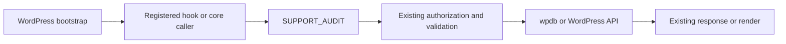

# SUPPORT_AUDIT — پشتیبانی و ردپای تغییر

Status: OBSERVED static source, baseline 2.0.235 / 2026-11-12. Human specialist: UNASSIGNED; repository owner: @mehrdadhafezi.

## 1. Purpose & Scope

کنسول پشتیبانی و مشاهده/پیگیری کنترل‌شده. رفع اشکال به معنای مجوز تغییر مالی یا Role نیست. لاگ باید actor و نتیجه داشته باشد و secret، توکن و فایل خصوصی را افشا نکند. این قرارداد برای توسعه ماژول موجود است؛ بازطراحی فرآیند تجاری خارج از محدوده است.

## 2. File Structure

- [includes/class-sn-support-console.php:1](../../includes/class-sn-support-console.php#L1): `SN_Support_Console`

متدهای راهنما (نام و محل واقعی؛ قرارداد کامل را در declaration بخوانید):

- [includes/class-sn-support-console.php:22](../../includes/class-sn-support-console.php#L22) — `register`
- [includes/class-sn-support-console.php:29](../../includes/class-sn-support-console.php#L29) — `config`
- [includes/class-sn-support-console.php:30](../../includes/class-sn-support-console.php#L30) — `text`
- [includes/class-sn-support-console.php:33](../../includes/class-sn-support-console.php#L33) — `secure_transport`
- [includes/class-sn-support-console.php:39](../../includes/class-sn-support-console.php#L39) — `administrator`
- [includes/class-sn-support-console.php:42](../../includes/class-sn-support-console.php#L42) — `session_token`
- [includes/class-sn-support-console.php:52](../../includes/class-sn-support-console.php#L52) — `grant_key`
- [includes/class-sn-support-console.php:55](../../includes/class-sn-support-console.php#L55) — `unlocked`
- [includes/class-sn-support-console.php:62](../../includes/class-sn-support-console.php#L62) — `url`
- [includes/class-sn-support-console.php:65](../../includes/class-sn-support-console.php#L65) — `lookup`
- [includes/class-sn-support-console.php:77](../../includes/class-sn-support-console.php#L77) — `numeric_id`
- [includes/class-sn-support-console.php:81](../../includes/class-sn-support-console.php#L81) — `headers`

## 3. Execution Flow

مسیر مشاهده‌شده در سطح ماژول: bootstrap وردپرس، ثبت hook یا caller هسته، سپس متد ماژول. شکل زیر نمای ساختاری است؛ ترتیب همه callbackها را تضمین نمی‌کند.

## 4. Coding Standards

[استاندارد توسعه](../DEVELOPMENT_STANDARDS.md) لازم است. فقط مسیرهای این ماژول که در تسک مجاز شده‌اند تغییر کنند. متدهای عمومی و hookهای موجود rename نشوند. اشتراک در SN_Plugin به معنی مجوز تغییر تمام هسته نیست. رفع اشکال به معنای مجوز تغییر مالی یا Role نیست. لاگ باید actor و نتیجه داشته باشد و secret، توکن و فایل خصوصی را افشا نکند.

## 5. Component & Interface Contracts

کلاس‌ها و متدهای بخش ۲ interface فعلی‌اند؛ امضا، مقدار پیش‌فرض و return type از سورس مرجع حفظ شوند. برای ورودی و خروجی کامل هر درخواست [API_CONTRACTS.md](../API_CONTRACTS.md) و handler متناظر را با هم بخوانید. شِمای exhaustively verified برای همه payloadها: UNVERIFIED؛ lexical index جایگزین بررسی handler نیست. خطاهای کاربر فارسی و امن باشند و رفتار فعلی status/redirect حفظ شود.

## 6. Adding or Modifying Features

1. رفتار فعلی و معیار پذیرش را از تسک و caller اثبات کنید.
2. مجوز مسیر و بازبینی مالک برای نقاط حساس را بررسی کنید.
3. تغییر محدود انجام دهید؛ migration، Role، API یا side effect جدید بدون شرح و تأیید وارد نشود.
4. سناریوهای بخش ۸ و Syntax را اجرا کنید؛ تست اجرا‌نشده را NOT_RUN بنویسید.
5. این قرارداد، API/schema مرتبط و گزارش PR را به‌روز کنید.

## 7. Data Ownership & Integrity

رفع اشکال به معنای مجوز تغییر مالی یا Role نیست. لاگ باید actor و نتیجه داشته باشد و secret، توکن و فایل خصوصی را افشا نکند.

نام‌های جدول literal مشاهده‌شده و traceشده در DDL/اتصال prefix (فهرست runtime کامل نیست): `sn_activity_logs`, `sn_dot_cases`, `sn_dot_invoice_links`, `sn_dot_payments`, `sn_invoice_items`, `sn_invoice_payment_stages`, `sn_invoices`, `sn_payments`, `sn_project_memberships`

DDL و PK/indexها: [DATABASE_SCHEMA_AUDIT.md](../audit/DATABASE_SCHEMA_AUDIT.md). اطلاعات مشتری، مالی، token و snapshot داده حساس‌اند. رابطه‌ای که فقط در کد وجود دارد Foreign Key فرض نشود. حذف history، double-credit و استفاده از رکورد خارج از scope ممنوع است.

## 8. Testing & Preview

سناریوهای ضروری این ماژول: کاربر عادی؛ دسترسی مجاز؛ رکورد ناموجود؛ خطای امن؛ ماسک داده؛ scope جستجو.

Syntax و Secret Scan در CI فعال‌اند. [ماتریس تست](../TESTING_STANDARDS.md) وضعیت زیرساخت را مشخص می‌کند. تست MIS فقط در محیط disposable با guard مجاز است؛ سایر سناریوها که fixture ندارند NOT_IMPLEMENTED هستند. پیش‌نمایش UI و تست authorization واقعی نیازمند سایت آزمایشی ایزوله است.

## 9. API & Integration Contracts

ثبت‌های literal مرتبط (اگر action با حلقه یا نام پویا ساخته شود باید caller را نیز بررسی کنید):

- `add_action`: `admin_menu` — [includes/class-sn-support-console.php:23](../../includes/class-sn-support-console.php#L23)
- `add_action`: `admin_init` — [includes/class-sn-support-console.php:24](../../includes/class-sn-support-console.php#L24)
- `add_action`: `wp_ajax_` — [includes/class-sn-support-console.php:25](../../includes/class-sn-support-console.php#L25)
- `add_action`: `admin_post_sn_support_case` — [includes/class-sn-support-console.php:26](../../includes/class-sn-support-console.php#L26)
- `add_action`: `load-` — [includes/class-sn-support-console.php:92](../../includes/class-sn-support-console.php#L92)

فهرست ثبت کامل در [HOOK_API_INDEX.md](../audit/HOOK_API_INDEX.md) و امضاها در [SOURCE_SYMBOLS.json](../audit/SOURCE_SYMBOLS.json). auth، nonce، scope، ورودی/خروجی و کد خطا باید برای handler تغییرکرده مستقیماً مستند شوند؛ endpoint جدید در این سند ساخته نشده است.

## 10. Administrative & Role Behavior

مجوز جاری از handler، SN_HR_Service/SN_Scope_Service و capabilityهای ثبت‌شده خوانده می‌شود. مخفی‌کردن دکمه مجوز backend نیست. تغییر cap، role، نگاشت HR یا scope نیازمند تسک مستقل و تأیید مالک است. ماتریس تست‌شده نقش‌ها در Production: UNVERIFIED. درخواست فاقد احراز هویت، nonce لازم یا scope باید با الگوی موجود رد شود.

## 11. Compatibility & Change History

R1 در 2026-11-12 فقط کد موجود نسخه 2.0.235 را مستند کرده است؛ کد PHP/JS/CSS تغییر نکرده است. Header: WordPress >=6.0 و PHP >=8.0؛ سازگاری runtime تمام نسخه‌ها در این جلسه UNVERIFIED. تاریخچه Releaseهای قدیمی شواهد تاریخی است و به معنی PASS این نسخه نیست. Merge و Deployment این مأموریت انجام نمی‌شود.
